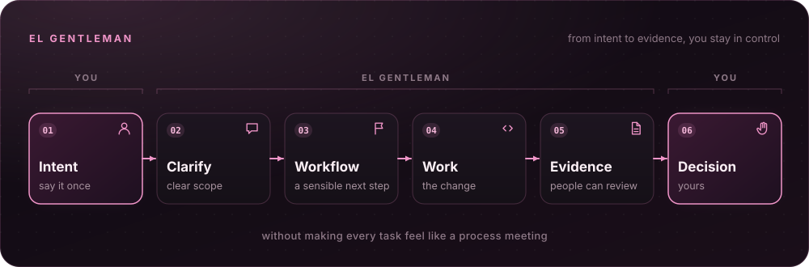
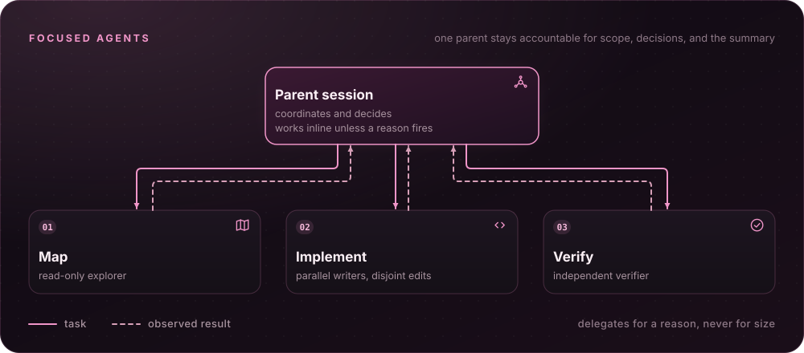
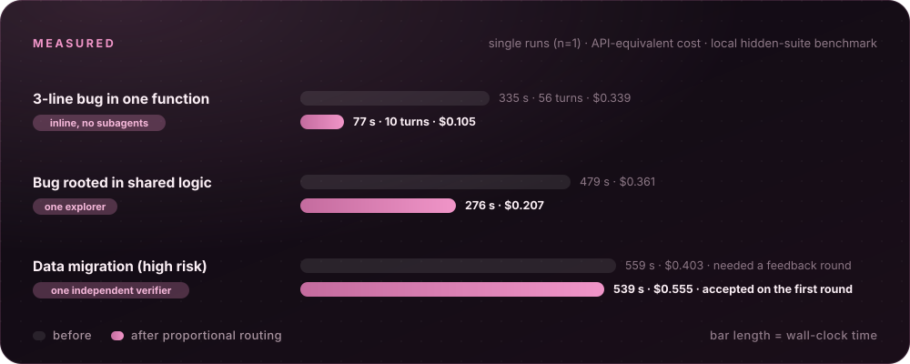
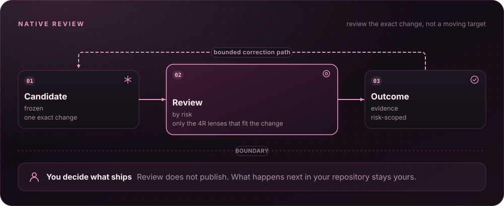
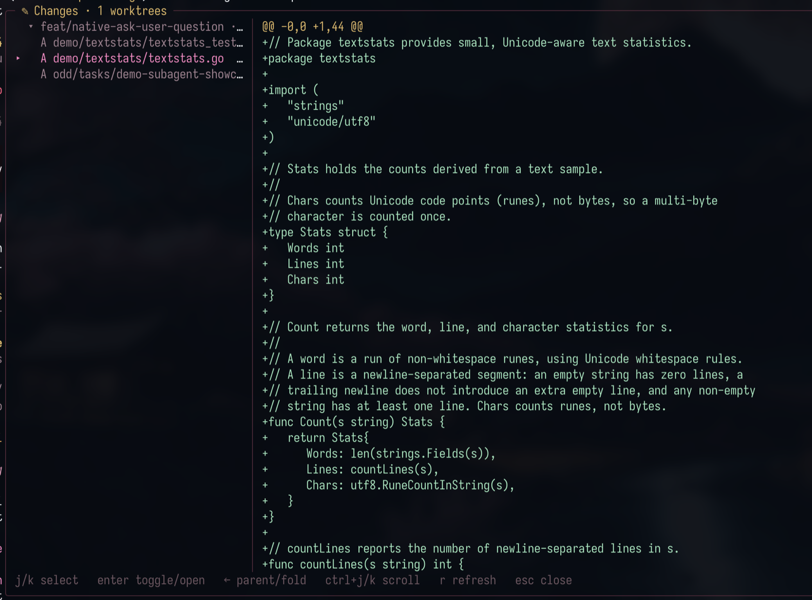
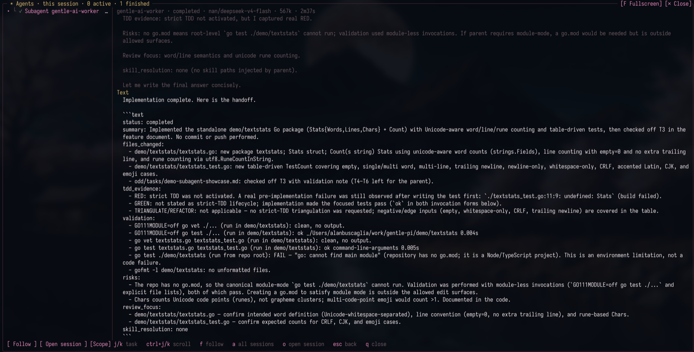
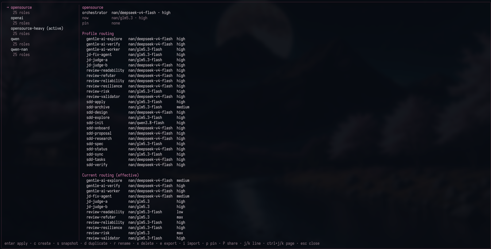
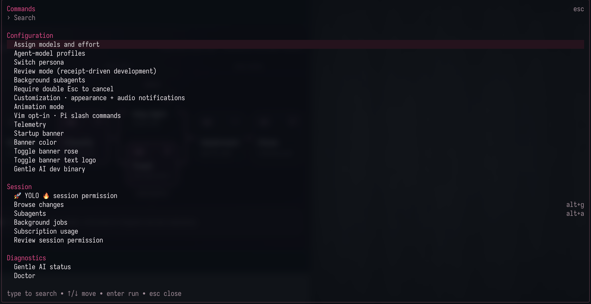
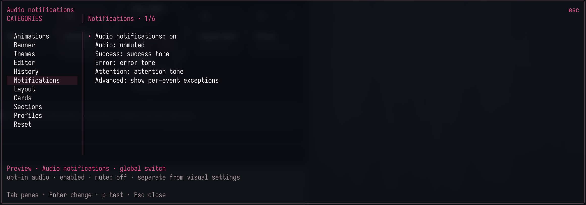
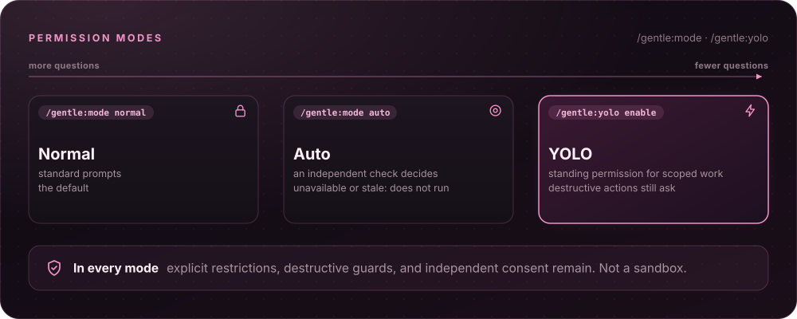

> Leer en inglés: [English](README.md)

<a id="top"></a>

<div align="center">
  
</div>

<p align="center"><a href="README.md">English</a> · <strong>Español</strong></p>

<h1 align="center">gentle-shell™</h1>

<p align="center"><strong>Tu agente de código para el desarrollo controlado en el espacio de trabajo que lideras.</strong></p>

<p align="center">
  <a href="https://www.npmjs.com/package/gentle-pi"></a>
  <a href="https://pi.dev/packages/gentle-pi"></a>
  <a href="LICENSE"></a>
  <a href="https://github.com/Gentleman-Programming/gentle-shell/stargazers"></a>
  <a href="https://github.com/Gentleman-Programming/gentle-shell"></a>
</p>

<p align="center">
  <strong>
    <a href="https://gentle-ai.gentlemanprogramming.com/">Sitio web</a>
    &nbsp;·&nbsp;
    <a href="#get-started">Inicio rápido</a>
    &nbsp;·&nbsp;
    <a href="#documentation">Documentación</a>
    &nbsp;·&nbsp;
    <a href="https://gentle-ai-wiki.gentlemanprogramming.com/">Wiki</a>
  </strong>
</p>

<br>

<p align="center">Tu terminal puede ejecutar un agente. Tu espacio de trabajo debería ayudarte a dirigirlo.<br><strong>gentle-shell es tu agente de código: integra tus cambios, tareas y flujo de trabajo de ingeniería. Está creado para Pi.</strong></p>

<div align="center">
 <h3>🎬 Míralo en acción</h3>

    <p>
    Una sola instrucción, de la idea al commit revisado: memoria, flujo de trabajo y evidencia en una sesión real.
    </p>

https://github.com/user-attachments/assets/fa5c0cfe-06e7-4c0d-bd6e-8ac7cb934339


<details>
<summary><kbd>Ver</kbd> <strong>¿Prefieres subtítulos en español?</strong> — la misma demo con subtítulos en español</summary>

<br>

https://github.com/user-attachments/assets/6d2bc422-a4dd-4ecf-a04b-fcd3bea7fea9


</details>

</div>

<p align="center"><strong>HECHO PARA PI</strong> &nbsp;·&nbsp; Basado en Gentle-AI &nbsp;·&nbsp; Espacio de trabajo para agentes de código &nbsp;·&nbsp; Agentes especializados &nbsp;·&nbsp; ODD</p>

<p align="center">
  
</p>

<a id="whats-new-in-v41"></a>

## ✨ Novedades en v4.1

La [versión v4.1.0](https://github.com/Gentleman-Programming/gentle-shell/releases/tag/v4.1.0) permite instalar Gentle Shell en un equipo sin las herramientas necesarias y utiliza una versión fija de Gentle AI: v4.1.1.

- **Instaladores para equipos sin configurar:** un asistente en el navegador y unos instaladores que se inician con doble clic en macOS, Windows y Linux instalan los componentes que faltan, actualizan los que ya tienes y preguntan una sola vez antes de cambiar nada. Consulta [Inicio rápido](#get-started).
- **Gentle Shell empaquetado:** una instalación nueva mantiene su versión exacta de Pi, su versión fija de Gentle AI, Engram y su estado bajo un único directorio de instalación; las instalaciones globales existentes pueden migrar, el lanzador ofrece actualizaciones y `gentle-shell self-uninstall` elimina la instalación.
- **Trabajos en segundo plano y monitores:** `bash_background` avisa al agente una vez cuando termina un comando, y `monitor` convierte cada línea de salida de un comando largo en un evento. Inspecciónalos con `/gentle:jobs` ([Trabajos en segundo plano](#background-jobs)).
- **Permisos automáticos contextuales:** Auto decide con el contexto de la conversación y la entrada de imagen, reintenta los fallos del proveedor y puede ser el valor predeterminado guardado ([Modos de permiso](#permission-modes--normal-auto-or-yolo)).
- **Coordinación entre sesiones:** las sesiones publican un asunto reconocible, alias de tareas, alcance del repositorio y una clasificación acotada del trabajo que otras sesiones pueden listar, buscar y consultar con permiso de coste explícito.
- **Perfiles vinculados a la sesión:** el perfil activo se vincula a la sesión principal, y el enrutamiento del orquestador y del revisor se aplica por sesión.
- **Delega con motivo y revisa por riesgo:** ver [Agentes especializados](#focused-agents--context-with-a-return-path), [ODD](#odd--the-everyday-workflow) y [Revisión nativa](#native-review--review-the-exact-change).

<p align="center">
  
</p>

<a id="features"></a>

<a id="how-it-works"></a>

## 🧠 Cómo funciona

### el Gentleman — Piensa antes de construir



Di una vez lo que necesitas y sigue adelante. El Gentleman ayuda a definir un alcance claro, elegir un siguiente paso razonable y reunir pruebas que otras personas puedan revisar, sin que cada tarea parezca una reunión sobre procedimientos.

**[Documentación →](docs/readme-reference.md#organic-driven-development)**

---

<a id="odd--the-everyday-workflow"></a>

### ODD — El flujo de trabajo cotidiano


**El desarrollo orgánico guiado (ODD)** es el flujo de trabajo cotidiano: el agente explora antes de cambiar nada, aclara solo las decisiones que realmente necesitan una respuesta y evita complicar el trabajo pequeño que ya se entiende. El trabajo autorizado de mayor alcance cuenta con un único documento de funcionalidad recuperable — con una copia en la memoria cuando está disponible — para que el progreso, las pruebas y el siguiente paso no se pierdan tras una interrupción. Por defecto, los cambios de comportamiento empiezan por las pruebas cuando existe una prueba ejecutable pertinente.

Las tareas se clasifican según su comprensión, riesgo y capacidad de reanudación: el trabajo que podrías terminar basándote solo en la petición y en `git diff` se ejecuta directamente, sin subagentes ni documento de tareas. El documento de funcionalidad cita tu especificación literalmente, y cada encargo remite a él en lugar de parafrasearlo, de modo que los textos exactos, los mensajes de error y los ejemplos lleguen intactos a los agentes que hacen el trabajo.

**[Documentación →](docs/readme-reference.md#organic-driven-development)**

---

<a id="focused-agents--context-with-a-return-path"></a>

### Agentes especializados — Contexto con camino de vuelta



Obtén ayuda sin perder el hilo. Los agentes especializados de Pi incluidos en el paquete pueden analizar la estructura del código, implementar un cambio acotado o verificarlo, mientras una única sesión principal sigue siendo responsable del alcance, las decisiones y el resumen final.

La sesión principal delega por un motivo concreto, no por el tamaño de la tarea. Cuando entender el trabajo exige más que una tanda de consultas directas (unas 3 llamadas y 10 000 tokens), interviene un explorador de solo lectura; dos o más unidades independientes con ámbitos de edición que no se solapan se asignan a agentes de implementación en paralelo; un cambio de alto riesgo requiere un verificador independiente; una sesión larga encarga su siguiente unidad a un agente nuevo. Sin un motivo concreto, la sesión principal trabaja directamente: ni el número de archivos ni el tamaño de la tarea determinan la ruta.

**[Documentación →](docs/readme-reference.md#how-the-harness-decides-what-to-do)**

---

### Resultados medidos — Qué cambió con el enrutamiento proporcional



Las reglas de enrutamiento se basan en pruebas comparativas de rendimiento. Estas ejecuciones utilizan una prueba local con conjuntos de pruebas de aceptación ocultos; cada celda corresponde a una única ejecución (n=1) y el coste se calcula como su equivalente en la API.

| Escenario | Antes | Después |
| :--- | :--- | :--- |
| Error de 3 líneas en una función | 335 s · 56 turnos · 0,339 USD | **77 s · 10 turnos · 0,105 USD** — ejecución directa, sin subagentes |
| Error originado en lógica compartida | 479 s · 0,361 USD | **276 s · 0,207 USD** — un explorador |
| Migración de datos (alto riesgo) | 559 s · 0,403 USD · necesitó una ronda de comentarios | 539 s · 0,555 USD · **aceptada a la primera** — un verificador independiente |
| Especificación de 73 líneas, 26 comprobaciones ocultas | Encargos parafraseados: 13 fallos; solo 23/26 comprobaciones superadas tras dos rondas | Todas las comprobaciones superadas al remitir a la especificación original ([#1718](https://github.com/Gentleman-Programming/gentle-shell/pull/1718)) |

Frente al mismo modelo en Codex CLI, con revisión ciega de cada solución, Gentle Shell fue aceptado a la primera en todas las celdas y obtuvo mejores resultados en las tareas medianas (3 de 3 ejecuciones) y grandes; los resultados fueron similares en la pequeña. La tarea grande aún tardó unas tres veces más (17,5–17,9 min frente a 6,1 min); reducir esa diferencia sigue siendo trabajo pendiente. Fuentes: [#1723](https://github.com/Gentleman-Programming/gentle-shell/pull/1723), [#1794](https://github.com/Gentleman-Programming/gentle-shell/pull/1794), [#1713](https://github.com/Gentleman-Programming/gentle-shell/issues/1713).

---

<a id="native-review--review-the-exact-change"></a>

### Revisión nativa — Revisa el cambio exacto



Revisa el cambio exacto, no una versión que sigue modificándose. La revisión nativa trabaja sobre una versión concreta del cambio, devuelve pruebas proporcionales al riesgo y puede ofrecer una vía de corrección limitada. Tú sigues decidiendo qué ocurre después en tu repositorio.

La revisión es proporcional: la verificación sigue el nivel de riesgo tanto si RDD está activado como si no, una revisión solo es necesaria para el trabajo de alto riesgo y el agente solicita las perspectivas de revisión 4R pertinentes para lo que ha cambiado — indicando el motivo — en lugar de asumir el coste de las cuatro.

> ℹ️ **RDD es opcional:** el desarrollo nativo guiado por recibos de revisión se activa únicamente mediante una decisión explícita con `/gentle:review-mode enable`. El directorio padre de `.git/gentle-ai/candidate-views` debe estar en un sistema de archivos que respete los permisos privados POSIX (o las listas de control de acceso equivalentes en Windows); los montajes WSL DrvFS sin metadatos pueden provocar el rechazo de START antes de crear el linaje de revisión.

<details>
<summary><kbd>Más</kbd> <strong>Transporte del revisor</strong> — cómo utilizan las respuestas del revisor la configuración de transporte de Pi</summary>

<br>

Las respuestas del revisor heredan la preferencia efectiva de `transport` de Pi cuando se ejecuta una captura individual o agrupada reconocida. El sistema anfitrión reenvía el valor definido sin modificarlo y toma una única instantánea de configuración por grupo; nunca fuerza SSE ni cambia el enrutamiento de modelos. Si falta ese ajuste o se utiliza una API antigua de Pi sin `getSettings()`, se conserva el valor predeterminado del proveedor. Esta preferencia de transporte de las respuestas es independiente de la coordinación nativa `pi_host_relay`, y los proveedores que no la admitan pueden ignorarla.

</details>

<br>

**[Documentación →](docs/review-integration.md)**

<p align="center">
  
</p>

<a id="your-workspace"></a>

## 🖥️ Tu espacio de trabajo

### gentle-shell — Tu agente de código, en el espacio de trabajo que lideras


En un terminal básico, para saber qué está haciendo el agente tienes que desplazarte por el historial de salida. gentle-shell convierte tu sesión de Pi en un espacio de trabajo: coordinación de agentes, cambios en tiempo real y estado del entorno, supervisión del uso de las cuentas de proveedores compatibles y vistas de diferencias integradas, para que dirijas el trabajo en lugar de tener que seguirlo continuamente.

<p align="center"><sub>gentle-shell en acción. Captura de <a href="https://raw.githubusercontent.com/Gentleman-Programming/gentle-ai/main/docs/assets/features/gentle-shell.png">Gentle-AI</a>.</sub></p>

**[Documentación →](docs/gentle-shell.md)**

---

### Gentle Changes — Lo que tu sesión dejó sin confirmar



No deberías tener que ejecutar `git status` en cada copia de trabajo para saber qué cambios han dejado tus agentes. Gentle Changes muestra el estado actual de Git — el árbol de trabajo frente a HEAD, incluidos los archivos sin seguimiento — del repositorio de la sesión y de cada copia de trabajo utilizada por tus subagentes, con un grupo por directorio raíz. Los cambios desaparecen de la vista al registrarlos en un commit; al eliminar una copia de trabajo, también desaparece su grupo. Nada se ejecuta al arrancar; `alt+g` abre un visor a pantalla completa de dos paneles con recuento de líneas por archivo y diferencias cargadas bajo demanda, `F` oculta la lista de archivos para leer las diferencias a todo el ancho y `o` abre el archivo real en tu editor.

**[Documentación →](docs/gentle-shell.md#browse-changes)**

---

### Gentle Agents — Trabajo paralelo con vista en vivo



Delegar trabajo no debería significar perderle la pista. Cada subagente se ejecuta en su propio proceso y muestra una tarjeta en tiempo real sobre el editor — modelo, tokens, coste y tiempo transcurrido —; `alt+a` abre la vista completa con los hilos conservados, controles de parada y el historial restaurado al reanudar. Un subagente puede hacerte una pregunta mediante un diálogo normal, y los resultados en segundo plano llegan como tarjetas que inician un nuevo turno: no se realizan consultas periódicas para comprobar si han terminado.

**[Documentación →](docs/gentle-shell.md#gentle-agents)**

---

### Perfiles y enrutamiento de modelos — Una decisión deliberada para cada ajuste



El modelo, el esfuerzo de razonamiento y quién hace qué deben ser elecciones deliberadas, no accidentes. Los perfiles con nombre configuran el enrutamiento del orquestador de forma atómica e independiente de los roles incluidos en el paquete y de revisión; un repositorio puede fijar su perfil para que sus subagentes dejen de seguir el perfil activo global, y el panel siempre muestra el enrutamiento que realmente utiliza el entorno.

**[Documentación →](docs/readme-reference.md#agent-model-profiles)**

---

### Paleta de comandos — Cada comando, a una tecla de distancia



Los comandos de las extensiones solo son útiles si puedes encontrarlos. `alt+k` abre una paleta organizada en grupos — configuración, sesión, diagnóstico y skills — en la que puedes buscar por etiqueta, nombre de comando o descripción. Solo muestra las entradas que están realmente registradas.

**[Documentación →](docs/gentle-shell.md#command-palette)**

---

### Personalizar — Aspecto, diseño y editor en un panel

`/gentle:customize` abre un panel interactivo para ajustar la calidad de la animación, la rosa de la cabecera de inicio, el logotipo de texto y el color, o elegir un tema de Pi instalado.

<details>
<summary><kbd>Más</kbd> <strong>Todo lo que controla `/gentle:customize`</strong> — temas, diseño de estado, Vim, historial y perfiles visuales</summary>

<br>

- **Temas:** al seleccionar un tema se muestra una vista previa de su paleta original sin cambiar el tema activo; pulsa Intro o la barra espaciadora para aplicarlo mediante Pi. Si no se puede leer su archivo de origen, la vista previa no está disponible.
- **Diseño del panel de estado:** por defecto, se utiliza una barra lateral derecha en terminales a pantalla completa de al menos 140 columnas, y una barra inferior en los demás casos. Puedes elegir la posición derecha, inferior u oculta; esta última elimina tanto la barra lateral como la barra de estado inferior a cualquier anchura. También puedes mover la cabecera a pantalla completa por debajo del área de entrada. Por debajo de 140 columnas solo se muestra una fila de estado: una cabecera superior sustituye a la barra inferior; si la cabecera está debajo del área de entrada, solo la barra inferior muestra el contexto, el coste y el uso de la cabecera, además del estado de las extensiones. Puedes seleccionar una densidad cómoda, compacta o mínima y activar o desactivar por separado Changes, Agents, TODO, uso/coste y los detalles del modelo. Los cambios de diseño y el restablecimiento surten efecto de inmediato; los cambios de la cabecera de inicio aparecen en el próximo arranque.
- **Vim:** la categoría **Editor** ofrece controles explícitos para activar o desactivar Vim en la preferencia global del editor de peticiones. Al seleccionar la opción se muestran la preferencia guardada y el estado efectivo del editor sin modificar ninguno de los dos. Intro o la barra espaciadora guarda el ajuste y actualiza el editor en tiempo real; los editores no compatibles mantienen la edición normal aunque la preferencia guardada esté activa. Vim no se incluye en los perfiles visuales ni en el restablecimiento visual.
- **Historial:** la categoría **History** activa o desactiva la captura del historial de peticiones. La captura está desactivada por defecto; el ajuste se aplica a la siguiente petición sin reiniciar y nunca borra el historial almacenado. Un valor explícito de `GENTLE_PI_HISTORY_CAPTURE` prevalece sobre la opción guardada, y el panel lo indica (consulta [Historial de peticiones](docs/prompt-history.md)).
- **Restablecer y perfiles:** el panel puede restablecer los ajustes visuales, de la cabecera de inicio y de la animación a los valores predeterminados. Pulsa `p` para acceder a los perfiles visuales con nombre: `s` guarda el tema instalado, la cabecera de inicio, la animación y el diseño actuales; selecciona un perfil con ↑/↓ y luego usa `r` para reemplazar, `a` para aplicar o `d` para eliminar. `z` borra solo el catálogo de perfiles. Confirma las acciones destructivas o de aplicación con `y`, o cancela con cualquier otra tecla; Esc vuelve atrás sin aplicar la vista previa. Los ajustes se guardan en almacenes independientes y su aplicación no es atómica: si hay un fallo parcial, se indica qué ha cambiado.

</details>

<br>

**[Estilo de tarjetas y contenido →](docs/gentle-shell.md#card-style)**

---

### Notificaciones de audio — Sonidos opcionales de éxito, error y atención



Abre `/gentle:customize` → **Notifications** (la cabecera de la tarjeta muestra **Audio notifications**) y configura el audio directamente en la misma tarjeta de dos columnas, sin menú anidado. El audio empieza desactivado; el modo RPC y los subagentes permanecen en silencio.

<details>
<summary><kbd>Más</kbd> <strong>Controles y compatibilidad por plataforma</strong> — teclas, sonidos personalizados y reproducción por sistema operativo</summary>

<br>

- **Controles:** Intro activa o desactiva el interruptor principal, o alterna un tipo de aviso o evento entre silencio, éxito, error y atención. `f` asigna un sonido local WAV/OGG/FLAC mediante una ruta absoluta literal (≤2 MiB, ≤10 segundos) al tipo seleccionado: **Success** (éxito), **Error** o **Attention** (atención); cada tipo conserva su propio sonido. `p` reproduce una muestra del sonido asignado. **Advanced** despliega o pliega las excepciones por evento; las elecciones de cada tipo siguen siendo independientes.
- **Respuesta rápida (Linux/WSLg):** en Linux nativo, el paquete instalado utiliza preferentemente el sistema WAV nativo y no necesita un reproductor externo: se comunica con un socket Unix local de PulseAudio/PipeWire-Pulse y requiere un servidor en ejecución con una salida de audio predeterminada.
- En **WSL** se utiliza preferentemente el `SoundPlayer` del sistema Windows: la copia WAV validada se asigna a una ruta UNC `\\wsl.localhost\<distro>\...`, por lo que no se requiere un servidor Pulse ni audio por RDP. Depende del montaje automático predeterminado `/mnt/c` y de la raíz estándar `C:\Windows`; si no están disponibles, recurre a las herramientas de línea de comandos de Linux de confianza antes de reproducir nada.
- En **Windows nativo**, los archivos WAV utilizan el mismo `SoundPlayer` del sistema a través del ejecutable fijo `C:\Windows\...\powershell.exe`. Se superó una comprobación de solo lectura, pero eso no demuestra que el audio se haya escuchado físicamente.
- OGG/FLAC conserva las herramientas de línea de comandos existentes (`paplay`/`pw-play`/`aplay`) en Linux y WSL; los códecs nativos quedan para una fase futura y OGG/FLAC no es compatible con Windows. macOS conserva `afplay` para WAV y FLAC, con una futura fase específica prevista para CoreAudio.

</details>

<br>

**[Uso, límites y verificación →](docs/sound-notifications.md)**

---

<a id="background-jobs"></a>

### Trabajos en segundo plano — Inspecciona lo que se ejecuta en segundo plano

Usa `/gentle:jobs` para inspeccionar los comandos en segundo plano y los monitores de esta sesión. Los trabajos en ejecución aparecen primero; cada grupo se ordena con los más recientes arriba. Las flechas seleccionan un trabajo, `Tab` abre los detalles en terminales estrechas, `s` detiene un trabajo en ejecución y `q` cierra el diálogo.

El panel de estado tiene una sección **Jobs** con la descripción de cada trabajo en ejecución. Cuando el panel está oculto o no disponible en el diseño compacto/móvil, la barra superior o inferior muestra solo el número de trabajos en ejecución (`⧗ 1 job`). El número y las descripciones desaparecen cuando no quedan trabajos activos; `/gentle:jobs` conserva los trabajos completados para inspección.

**[Documentación →](docs/gentle-shell.md#background-jobs)**

<p align="center">
  
</p>

<a id="control"></a>

## 🛡️ Control

<a id="permission-modes--normal-auto-or-yolo"></a>

### Modos de permiso — Normal, Auto o YOLO



Elige `/gentle:mode auto` para comprobar las acciones elegibles con una inferencia independiente usando el modelo actual de la sesión. Las comprobaciones ordinarias no usan herramientas; una comprobación elegible de un script puede inspeccionar como máximo dos archivos completos ([límites de inspección](docs/auto-permission-evidence.md)).

<details>
<summary><kbd>Más</kbd> <strong>Cobertura, valores predeterminados y alcance</strong> — qué comprueba Auto, su coste y cómo convertirlo en predeterminado</summary>

<br>

Auto cubre las herramientas principales de archivos/shell/personalizadas/MCP y las llamadas anidadas a través de la canalización del SDK, manteniendo las restricciones explícitas, las salvaguardas destructivas y el consentimiento independiente. Añade por separado coste y latencia de inferencia registrados; las decisiones no disponibles o caducadas no ejecutan la acción. Esto no es un entorno aislado ni una afirmación de paridad con un clasificador propietario.

Guarda `/gentle:mode default auto` o `/gentle:mode default yolo` para usar cualquiera de los modos opcionales en las nuevas sesiones primarias. `/gentle:mode normal` cambia solo esta sesión; `/gentle:mode default normal` cambia las sesiones futuras. Los hijos mantienen sus reglas de delegación existentes, no el modo elevado del padre.

</details>

<br>

**[Comandos, alcance, coste y límites →](docs/permission-modes.md)**

---

### 🚀 YOLO 🔥 — Permiso acotado, salvaguardas destructivas intactas

> 🚀 **Avanza sin interrupciones innecesarias: las acciones destructivas siguen pidiendo permiso.** YOLO elimina las preguntas repetidas de permiso para el trabajo ordinario cuyo alcance ya está definido, por lo que resulta adecuado para ejecuciones autónomas prolongadas. Las operaciones destructivas siguen exigiendo una confirmación reciente.

`/gentle:yolo enable` otorga una autorización continuada para la implementación ordinaria cuyo alcance ya está definido, las comprobaciones, los commits, los envíos no forzados y la creación de solicitudes de incorporación de cambios (PR).

<details>
<summary><kbd>Más</kbd> <strong>Cómo se comporta YOLO</strong> — qué sigue preguntando, cómo apagarlo y el conmutador Personalizar</summary>

<br>

- **Valor predeterminado:** **DESACTIVADO** salvo que se seleccione o se guarde como valor global predeterminado. Se controla desde la interfaz interactiva de terminal de la sesión principal y queda vinculado a la sesión y al espacio de trabajo actuales; `/gentle:yolo disable` revoca la autorización y `/gentle:yolo status` consulta su estado.
- **Menú:** sin argumento, `/gentle:yolo` abre un menú (`enable`, `disable`, `status`) que muestra el estado actual; cancelar no cambia nada y, sin menú interactivo, informa del estado.
- **Duración:** la recarga y el reemplazo de la sesión revocan las autorizaciones activas; las nuevas sesiones principales pueden aplicar el valor predeterminado global guardado.
- **Estado:** el indicador de estado y un elemento independiente muestran **🚀 YOLO ON 🔥 — destructive confirmations remain** (las confirmaciones para acciones destructivas siguen activas).
- **Lo que sigue siendo obligatorio:** se mantienen las restricciones explícitas, las confirmaciones y los bloqueos configurados, las decisiones relevantes pendientes, las aclaraciones sobre el destino o las credenciales y las decisiones nativas de consentimiento y recuperación. Los subagentes no obtienen ninguna autorización independiente para publicar cambios. Esto no es un entorno aislado.

- **Desde el panel de personalización:** abre `/gentle:customize` → **Editor** y selecciona **YOLO: OFF · session only**, inmediatamente debajo de Vim. Intro o la barra espaciadora activa o desactiva el mismo permiso de la sesión actual que `/gentle:yolo`; navegar y consultar las vistas previas nunca lo activa. Este interruptor no guarda una preferencia. Las filas independientes **Session permissions** (permisos de sesión) y **Default permissions** (permisos predeterminados) permiten, respectivamente, seleccionar el modo actual o guardar un valor predeterminado global del usuario; la configuración del repositorio y los perfiles visuales no pueden conceder ninguno de los dos modos.

</details>

<br>

**[Uso y límites →](docs/yolo-mode.md)**

<p align="center">
  
</p>

<a id="also-in-the-box"></a>

## 📦 También en la caja

| Componente | Qué hace |
| :--- | :--- |
| Arranque y panel de entorno | Un punto de entrada configurable de gentle-shell y estado visible del entorno para Pi. |
| Skills y guía de entrega | Skills del paquete para documentación, trabajo de incidencias, PR, revisiones y unidades de trabajo revisables. |
| Controles de modelo, esfuerzo, personalidad y perfil | Controles explícitos sobre cómo Pi enruta y presenta el trabajo. |
| Límites de seguridad | Salvaguardas alrededor de las operaciones destructivas y el manejo de rutas sensibles. |
| Paquetes opcionales acompañantes | Capacidades adicionales que puedes añadir; la memoria persistente **no** va incluida en `gentle-pi`. |
| Diseño de espacio de trabajo a pantalla completa | Fila de cabecera y barra lateral desplazable de estado → Changes → TODO en terminales anchos. |
| Barra de estado en tiempo real y pétalo de petición | Indicador de una sola línea, coste y estados; el pétalo muestra `working` y `queued`. |
| Comunicación padre ↔ subagente | Delegar, dirigir, responder y notificación entre sesiones dentro de tu perfil local. |
| Herramientas interactivas nativas | Preguntas, elecciones y capturas de revisión integradas — sin dependencia de terceros. |
| Gentle Todo | Una tarjeta de plan que se vuelve ámbar cuando el modelo deja que se quede obsoleta. |
| Uso de suscripción | Medidores y reinicios por ventana para las cuentas de proveedor compatibles. |
| Gentle Stats | `/gentle:stats` muestra el historial de uso local: mapa de calor de actividad, tokens, coste, rachas y porcentaje por modelo. |
| Avisos de Gentle | Llamadas a Gentle AI y recordatorios de revisión como tarjetas en la transcripción. |

Los mensajes entre orquestadores aparecen como tarjetas compactas `🤖 Sender → 🤖 Recipient` (remitente → destinatario) con cabeceras de una sola fila. Despliega una tarjeta para inspeccionar los identificadores y motivos disponibles. **Message queued** significa «en cola», no entregado ni leído; los nombres largos se recortan para caber en terminales estrechas.

**Todos los componentes, skills y valores predeterminados: [desglose completo →](docs/gentle-shell.md)**

---

<a id="nan-model-provider"></a>

### Proveedor de modelos NaN — Integrado, sin paquete extra

El proveedor propio `nan` está incluido; no se requiere ningún paquete de proveedor de terceros. Define `NAN_API_KEY` antes de iniciar Pi, o usa el comando nativo `/login` → NaN (también `/login nan`); después usa `/model` para seleccionar un modelo.

<details>
<summary><kbd>Más</kbd> <strong>Inicio de sesión, descubrimiento de modelos y niveles de razonamiento</strong> — claves de API, modelos disponibles y niveles por modelo</summary>

<br>

- **Inicio de sesión:** ambos métodos de inicio de sesión requieren introducir explícitamente la clave de API; las entradas vacías o formadas solo por espacios se rechazan sin guardar credenciales, y se eliminan los espacios iniciales y finales. Cancelar deja la clave almacenada sin cambios. Las claves guardadas tienen prioridad sobre `NAN_API_KEY`.
- **Transmisión progresiva:** Pi recibe las respuestas del chat a medida que se generan a través de su proveedor compatible con OpenAI.
- **Descubrimiento de modelos:** se comparan los modelos de la respuesta autenticada de NaN a `/v1/models` con un subconjunto mantenido de identificadores de modelos de chat conocidos de la [documentación oficial de modelos](https://nan.builders/docs/models). Solo se incluyen los que figuran en ambos; se omiten los identificadores desconocidos y los modelos no conversacionales. Una respuesta satisfactoria sin identificadores de chat conocidos produce una lista vacía. Se conservan las capacidades documentadas de contexto, razonamiento y texto/imagen, con límites numéricos conservadores cuando la documentación utiliza cifras abreviadas; Pi no declara compatibilidad con la entrada de audio.
- **Límites de salida:** la configuración del proveedor establece límites de `maxTokens` en lugar de atribuir al modelo máximos no documentados: 32 768 para GLM 5.3, GLM 5.3 Flash y MiMo; 16 384 para DeepSeek V4 Flash; 65 536 para Gemma 4 y Qwen 3.6; y 131 000 para Qwen 3.8 Flash (NaN documenta 131K). El razonamiento comparte el presupuesto de salida.
- **Catálogo de respaldo sin conexión:** antes de la primera actualización satisfactoria, los siete modelos de chat documentados están disponibles como respaldo sin conexión en `/gentle:models`: `glm5.3`, `deepseek-v4-flash`, `glm5.3-flash`, `qwen3.8-flash`, `mimo-v2.6-flash`, `gemma4` y `qwen3.6`. Este catálogo refleja la compatibilidad documentada, pero no demuestra que tu clave tenga acceso. Tras una actualización satisfactoria, la lista obtenida con esa clave sigue siendo la referencia válida (aunque esté vacía), incluso sin conexión o tras un fallo de actualización. Cambiar las credenciales restablece el catálogo de respaldo completo hasta que el descubrimiento de modelos tenga éxito con la nueva clave.
- **No incluido:** los puentes MCP de búsqueda y medios de NaN no están incluidos.

Los niveles de razonamiento siguen el [contrato de razonamiento](https://nan.builders/docs/models) de NaN:

| Modelos | Niveles de razonamiento de Pi |
| --- | --- |
| GLM 5.3 / GLM 5.3 Flash | `low`, `medium`, `high` y `max` son completamente controlables. No existe `off`; los niveles `minimal` y `xhigh` de Pi se limitan a `low` y `max`, respectivamente. |
| Qwen 3.6 / Gemma 4 | `off` envía `none` y `minimal` también omite el razonamiento; `low`, `medium`, `high` y `max` fijan presupuestos de razonamiento. El nivel `xhigh` de Pi se limita a `max`. |
| DeepSeek V4 Flash / Qwen 3.8 Flash / MiMo | Se aceptan los mismos niveles `off` (`none`), `minimal`, `low`, `medium`, `high` y `max`, pero NaN gestiona su profundidad de razonamiento, así que ningún valor la cambia. El nivel `xhigh` de Pi se limita a `max`. La cabecera muestra `effort: auto` para estos tres y un aviso único indica que el nivel no cambia la profundidad. |

</details>

<p align="right"><a href="#top">Volver arriba ↑</a></p>

<p align="center">
  
</p>

<a id="get-started"></a>

## ⚡ Inicio rápido

> ℹ️ **Transición de nombres:** el producto se llama `gentle-shell`; el paquete de npm y el repositorio siguen siendo `gentle-pi` hasta la migración.

**¿Qué camino es el mío?**

| Si tú… | Usa |
| :--- | :--- |
| Quieres la configuración más sencilla, sin terminal | [Descargar y hacer doble clic](#easiest-download-and-double-click-no-terminal-needed) |
| Trabajas desde un clon de este repositorio | [Ruta C: instalador en el navegador desde una copia del repositorio](#path-c-browser-installer-from-a-checkout) |
| Te desenvuelves bien con npm y quieres que Pi no se toque | [Ruta A: `gentle-shell` independiente](#path-a-standalone-gentle-shell-recommended-no-pi-changes) |
| Ya usas Pi y quieres el paquete dentro de él | [Ruta B: dentro de una instalación existente de Pi](#path-b-inside-an-existing-pi) |

<a id="easiest-download-and-double-click-no-terminal-needed"></a>

### Más sencillo: descargar y hacer doble clic (sin terminal)

Descarga el instalador para tu ordenador, haz doble clic y sigue los pasos en el navegador. Instala todo lo que necesita Gentle Shell (Node.js, pnpm, Pi y Gentle Shell), o actualiza lo que ya tengas, y no instala nada hasta que confirmas el plan que te muestra. (Para mostrar ese plan puede descargar antes Node.js y pnpm en una carpeta temporal, que borra después.)

| Tu ordenador | Descarga | Después |
| --- | --- | --- |
| **macOS** | [gentle-shell-installer-macos.zip](https://github.com/Gentleman-Programming/gentle-shell/releases/latest/download/gentle-shell-installer-macos.zip) | Abre el zip, después haz doble clic en **Install Gentle Shell.command** dentro de la carpeta *Gentle Shell Installer*. |
| **Windows** | [gentle-shell-installer-windows.zip](https://github.com/Gentleman-Programming/gentle-shell/releases/latest/download/gentle-shell-installer-windows.zip) | Haz clic derecho en el zip → **Extract All**. Abre la carpeta extraída, después la carpeta *Gentle Shell Installer* dentro, y haz doble clic en **Install Gentle Shell.cmd**. No se ejecuta desde dentro del zip. |
| **Linux** | [gentle-shell-installer-linux.tar.gz](https://github.com/Gentleman-Programming/gentle-shell/releases/latest/download/gentle-shell-installer-linux.tar.gz) | Extráelo, después haz doble clic en **install-gentle-shell.sh**. Si tu gestor de archivos no ejecuta scripts, ejecuta `sh install-gentle-shell.sh` en esa carpeta. |

Se abre una ventana pequeña, después el instalador aparece en tu navegador. Usa la pestaña que se abre y mantén la ventana pequeña abierta hasta que el instalador diga que ha terminado.

> ⚠️ **Tu ordenador te avisará la primera vez.** Estos instaladores no están firmados con un certificado de desarrollador de Apple ni de Microsoft, así que el sistema no puede verificar quién los hizo. Ese aviso es esperado; así se continúa:
>
> - **macOS:** ves *"Install Gentle Shell.command" Not Opened* (o *cannot be opened because Apple cannot check it*). Pulsa **Done**, abre **Ajustes del sistema → Privacidad y seguridad**, baja hasta el mensaje sobre *Install Gentle Shell.command*, pulsa **Open Anyway** y confirma con tu contraseña. En versiones antiguas de macOS puedes hacer clic derecho en el archivo, elegir **Open** y después **Open** de nuevo. Solo haces esto una vez.
> - **Windows:** ves *Windows protected your PC*: pulsa **More info**, después **Run anyway**. Si en su lugar ves *Open File – Security Warning*, pulsa **Run**.
> - **Linux:** si el doble clic abre el archivo en un editor, ejecuta `sh install-gentle-shell.sh` en esa carpeta.
>
> Descarga solo desde la página de [Releases](https://github.com/Gentleman-Programming/gentle-shell/releases) de este repositorio. Para comprobar una descarga, compara su SHA-256 con [gentle-shell-installers-SHA256SUMS.txt](https://github.com/Gentleman-Programming/gentle-shell/releases/latest/download/gentle-shell-installers-SHA256SUMS.txt).

Una instalación nueva obtiene Gentle Shell como un producto completo y autocontenido. Sus propias versiones de Node.js, npm, pnpm y Pi se encuentran en `~/.gentle-shell`, y tus herramientas no se utilizan ni se modifican ([instalación empaquetada](docs/install-wizard.md#bundled-installation)).

El instalador es una versión preliminar: está probado en Linux y en integración continua (CI), mientras que las ejecuciones en equipos sin configurar con macOS y Windows todavía se están verificando. Cómo funciona y qué modifica: **[asistente de instalación](docs/install-wizard.md)**.

<a id="path-c-browser-installer-from-a-checkout"></a>

### Ruta C: instalador en el navegador desde una copia del repositorio

El mismo instalador de la [descarga anterior](#easiest-download-and-double-click-no-terminal-needed), pero iniciado desde una copia clonada del repositorio:

```bash
git clone https://github.com/Gentleman-Programming/gentle-shell.git
cd gentle-shell

# macOS y Linux
sh scripts/bootstrap.sh

# Windows (cmd)
scripts\bootstrap.cmd
```

Instala los componentes que faltan (Node.js, pnpm, Pi, Gentle Shell) y actualiza una instalación existente de Gentle Shell o una versión antigua de Pi; nada cambia hasta que confirmas. Si falta Node.js o pnpm, el script de arranque descarga el componente necesario en una carpeta temporal y después abre el asistente en tu navegador en la dirección local `127.0.0.1`. Usa la pestaña que se abre: el enlace funciona una sola vez y caduca tras 2 minutos. En la pantalla de revisión, elige qué instalar:

- **Última versión** (recomendada): la versión publicada de Gentle Shell con su versión fija del binario de Gentle AI.
- **Último main**: compilaciones de desarrollo de Gentle Shell y Gentle AI a partir del último commit de `main`, generadas en tu ordenador con Go. Si no tienes Go, tu versión es antigua o no se puede comprobar, el instalador descarga una versión fija y verificada de Go solo para esa compilación.

<details>
<summary><kbd>Más</kbd> <strong>Cómo trata el instalador las herramientas que ya tienes</strong> — qué reutiliza, actualiza o deja como está</summary>

<br>

- **Node.js y pnpm:** una versión antigua de Node.js o una versión incompatible de pnpm (de mise, nvm, nvm-windows, fnm, Volta o Homebrew, por ejemplo) se deja intacta: el instalador utiliza su propia copia fija y verificada y la instala bajo `$PNPM_HOME`; el plan lo indica antes de que confirmes. Un gestor de versiones puede seguir dando prioridad a tu propia versión en las terminales nuevas. Esto se aplica solo a una instalación nueva: si Gentle Shell ya está instalado, una versión antigua de Node.js o una versión incompatible de pnpm siguen bloqueando la operación. En Windows, `bootstrap.cmd` también utiliza su propio Node.js cuando no puede verificar dónde se encuentra el tuyo (por ejemplo, por un enlace simbólico de nvm-windows o un punto de unión de fnm), sin ejecutarlo.
- **Tu pnpm:** una instalación de pnpm en su directorio global de ejecutables (`$PNPM_HOME/bin`) nunca se reemplaza ni se sustituye por una versión anterior. Se utiliza tal cual pnpm 11.1.1 o posterior, incluido pnpm 12. Una versión anterior bloquea la operación y se muestra el comando `pnpm self-update` para actualizarla. Si no se puede comprobar la versión, se deja intacta y el instalador utiliza su propia copia verificada; el plan lo indica antes de que confirmes.
- **npm:** un `npm` operativo en tu `PATH` (de Node.js, Homebrew, nvm, nvm-windows, fnm, mise, asdf o Volta, por ejemplo) se usa tal cual; el instalador añade su propio npm solo cuando no funciona ninguno.
- **Windows:** nunca ejecuta `npm.cmd` ni `pnpm.cmd` a través de un intérprete de comandos: ejecuta el programa al que apunta un lanzador intermediario reconocido (shim), o el propio `.exe`, y considera los demás lanzadores no utilizables. También comprueba que ninguna otra cuenta pueda modificar la carpeta principal de pnpm (`PNPM_HOME`), y nunca ejecuta pnpm desde una carpeta que otra cuenta pueda modificar ni cuando no puede demostrar que se trata de pnpm (como ocurre con el `pnpm.cmd` de Corepack): utiliza su propia copia verificada y deja la tuya intacta. Si la carpeta predeterminada `%LOCALAPPDATA%\pnpm` no supera ese control y está vacía, utiliza `%USERPROFILE%\.pnpm` en su lugar y `pnpm setup` guarda esa ubicación para las terminales nuevas. Los comandos de pnpm que ejecutes más tarde siguen conservando la configuración, la caché y el estado bajo `%LOCALAPPDATA%`: es un riesgo aceptado que el plan señala. Si esa carpeta ya contiene archivos o tu propio `PNPM_HOME` no supera el control, el instalador se detiene e identifica la carpeta, la cuenta y sus permisos. El plan lo indica antes de que confirmes.
- **Tus herramientas existentes:** tus instalaciones de Node.js, npm, Go, Pi o gentle-pi instalado con npm se utilizan como hasta ahora. Si alguna se encuentra en una carpeta que otra cuenta puede modificar, el plan identifica esa carpeta, la cuenta y sus permisos como advertencia, sin bloquear la operación.
- **Go:** cuando una compilación necesita Go (el canal `main` o Windows) y no está instalado, su versión es antigua o no se puede comprobar, el instalador descarga una versión fija de go.dev, verifica su suma de comprobación y la utiliza solo para compilar, desde su propia carpeta. Tu instalación de Go y tu `PATH` quedan intactos, y el plan lo indica antes de que confirmes. Una instalación de una versión publicada en macOS o Linux nunca descarga Go.
- **Git:** Git no es necesario para instalar; cuando falta, el plan lo dice antes de que confirmes, con el comando para instalarlo, porque la revisión de código, las copias de trabajo y las funcionalidades del repositorio lo necesitan.
- **Pi:** una instalación existente que cumple la versión mínima se reutiliza tal cual. Con pnpm 11, Gentle Shell puede ejecutar una versión de Pi más reciente que la del instalador, que pnpm coloca junto a Gentle Shell (siempre igual o superior a la mínima); el instalador indica cuál es al terminar. Una versión antigua de Pi se actualiza a la versión del instalador con el gestor de paquetes que la instaló (pnpm o npm); el plan muestra la versión encontrada y la versión objetivo antes de que confirmes. Si ninguno de los dos gestores administra esa versión antigua (por ejemplo, si procede de mise, Homebrew o un binario independiente), se deja intacta y el instalador añade su propia instalación de Pi con pnpm, como cuando Pi no está instalado; Gentle Shell utiliza esa copia. Pi nunca se sustituye por una versión anterior.
- **Gentle Shell:** una instalación existente se actualiza con el gestor de paquetes que la instaló (pnpm o npm). Si no se puede identificar su origen, como ocurre con un `npm link` desde una copia del código fuente, se deja intacta y se explica el motivo. No es necesario instalar las dependencias de esa copia del repositorio (`pnpm install` no es necesario).

</details>

<br>

Detalles: **[asistente de instalación](docs/install-wizard.md)**.

<a id="path-a-standalone-gentle-shell-recommended-no-pi-changes"></a>

### Ruta A: `gentle-shell` independiente (recomendada, sin cambios en Pi)

`gentle-shell` abre Pi con el paquete Gentle Shell cargado, sin instalarlo en tu agente Pi ni editar su `settings.json`. Requiere Pi 1.2.0 o posterior.

```bash
npm i -g gentle-pi

# Directorio propio, nunca toca tu instalación de Pi
gentle-shell

# Reutiliza tus inicios de sesión, modelos y chat de Pi
gentle-shell --link
```

`gentle-shell` arranca en su propio directorio de agente, `~/.gentle-shell/agent`, y mantiene su configuración en `~/.gentle-shell/gentle-ai` (copiada una sola vez desde `~/.pi/gentle-ai` en el primer arranque que la necesite). Prepara ese directorio en la primera ejecución, sin un paso adicional. Gentle Shell mantiene su propio directorio con los paquetes complementarios de Gentle AI y sin extensiones incompatibles; utiliza la copia de gentle-pi del propio lanzador, nunca una instalada en el directorio del agente. Tu instalación de Pi no se toca. Ese directorio también utiliza por defecto el tema Gentleman-Cute, salvo que configures el tuyo. `gentle-shell --link` reutiliza `~/.pi/agent` tal cual, nunca lo configura automáticamente ni modifica su tema.

```bash
# Ejecutar el aprovisionamiento a mano, por ejemplo para ver toda la salida de la instalación
gentle-shell setup
```

`gentle-shell setup` instala los mismos paquetes complementarios que gentle-ai configura en un Pi normal, pero solo en este directorio, y después elimina el único paquete que entra en conflicto con la herramienta propia `ask_user_question` de gentle-pi (gentle-ai #4820). El primer arranque de `gentle-shell` en un directorio de agente ya ejecuta esto automáticamente; `setup` sirve para repetirlo manualmente. Consulta **[Primer arranque](docs/readme-reference.md#first-run-in-an-isolated-or-custom-home)** para desactivar ese paso (`GENTLE_SHELL_NO_AUTO_SETUP=1`) y conocer el comportamiento ante fallos.

```bash
# Convertir --link en el comportamiento predeterminado
gentle-shell home link

# O mantener el directorio separado y copiar tus inicios de sesión de Pi en él
gentle-shell home import-pi --dry-run
gentle-shell home import-pi
```

`gentle-shell home import-pi` copia `auth.json` (con permisos privados, `0600`) y `mcp.json` desde tu directorio de agente de Pi al directorio separado. También copia tu proveedor, modelo y nivel de razonamiento predeterminados si el directorio de destino no tiene esos ajustes. Nunca sobrescribe archivos ni ajustes, nunca copia paquetes, extensiones, cachés ni chats y nunca modifica tu directorio de Pi. La contrapartida es que `--link` comparte un único almacén de credenciales con Pi, mientras que `import-pi` crea una segunda copia. Por ello, un proveedor que rote los tokens de renovación puede cerrar una de las dos sesiones; vuelve a ejecutar `/login` en ella.

Cualquier otro argumento se reenvía a Pi sin cambios, por ejemplo `gentle-shell --mode rpc` o `gentle-shell -p "..."`. Consulta las opciones, variables de entorno y modos completos en la **[referencia del lanzador](docs/readme-reference.md#gentle-shell-launcher)**.

<a id="path-b-inside-an-existing-pi"></a>

### Ruta B: dentro de una instalación existente de Pi

Instala la versión estable publicada en un agente Pi existente, reinicia Pi y después sincroniza los recursos instalados.

```bash
# Versión estable publicada: v4.1.0
pi install npm:gentle-pi@4.1.0

# Reinicia Pi y después ejecuta:
gentle-ai sync

# Inicia Pi en tu proyecto
pi
```

Ver las [notas de la versión v4.1.0](https://github.com/Gentleman-Programming/gentle-shell/releases/tag/v4.1.0) para los cambios específicos de la versión.

<details>
<summary><kbd>Más</kbd> <strong>¿Ves una advertencia de codemode integrado?</strong> — por qué aparece y cómo silenciarla</summary>

<br>

gentle-pi sustituye el `codemode` integrado de Pi por su renderizador compacto, así que Pi avisa al arrancar de que el integrado no se ha cargado. En tu propio directorio de agente de Pi (`pi` con este paquete, o `gentle-shell --link`), gentle-pi pregunta una sola vez en la interfaz interactiva de terminal (TUI) si se debe añadir `"-builtin:codemode"` a `extensions` en el `settings.json` del agente (normalmente `~/.pi/agent/settings.json`); solo escribe si aceptas, y la advertencia desaparece en el siguiente arranque. Si rechazas la propuesta, no vuelve a preguntarte. Para silenciar la advertencia manualmente, añade la entrada, por ejemplo `"extensions": ["-builtin:codemode"]`. Los directorios aislados de `gentle-shell` ya la incluyen.

</details>

### Comprueba tu configuración

```text
/gentle:status
/gentle:doctor
```

ℹ️ **Conviene saberlo**

- **Los diagnósticos STATUS son opcionales:** `/gentle:status-timing enable` prepara la medición del tiempo para la siguiente llamada a una herramienta que ejecuta STATUS, mediante una autorización independiente; `show` consulta el resumen, que solo se guarda en memoria, y `disable` lo borra. Nunca invoca ni reintenta STATUS. Consulta los [límites de diagnóstico](docs/readme-reference.md#diagnose-status-timing-without-retrying-it).
- **Nota de instalación a pantalla completa:** una instalación global reconocida persiste el ajuste `"tuiMode": "fullscreen"` de Pi. Las rutas de instalación locales al proyecto y otras no reciben ese cambio.
- **Hosts RPC interactivos:** la aplicación de escritorio define `GENTLE_SHELL_INTERACTIVE_HOST=1` automáticamente, sin tocar tu configuración de Pi — ver la [referencia de instalación](docs/readme-reference.md#interactive-rpc-hosts).

### Mantenlo al día

**Compatibilidad de versiones:** `upgrade` está disponible a partir de `gentle-pi` v4.1.0 (y en las compilaciones de `main` que incluyen el commit `96ff045a8`). Las versiones hasta v4.0.0 no lo admiten: en esos lanzadores, `gentle-shell upgrade` abre una sesión e interpreta `upgrade` como petición en lugar de actualizar.

Para esas instalaciones, descarga el [instalador más reciente](#easiest-download-and-double-click-no-terminal-needed) o utiliza el [instalador en el navegador desde una copia limpia de main](#path-c-browser-installer-from-a-checkout). Detecta una instalación existente y muestra el plan de actualización antes de que confirmes. Consulta el [procedimiento para instalaciones más antiguas](docs/readme-reference.md#updating-an-installation-without-upgrade).

En una compilación de `main` que admita `upgrade`:

```bash
# Actualiza por tu canal: la última versión publicada o el último main
gentle-shell upgrade

# Cambia de canal
gentle-shell upgrade --channel main
gentle-shell upgrade --channel release

# Instalación empaquetada: vuelta a la versión anterior
gentle-shell upgrade --rollback
```

`gentle-shell upgrade` usa el gestor de paquetes que posee tu instalación.

<details>
<summary><kbd>Más</kbd> <strong>Canales, instalaciones empaquetadas y restauración de versiones</strong> — qué compila cada canal y cómo se restaura una versión anterior</summary>

<br>

- **Canal main:** en el canal `main`, recompila Gentle AI y Gentle Shell a partir de los últimos commits de `main` (solo lo que ha cambiado) y necesita pnpm y Go. Si tu versión de Go es anterior a la mínima, utiliza, solo para esa compilación, la versión fija de Go que el instalador dejó en su propia carpeta. Volver al canal `release` restaura la versión fija del binario de Gentle AI.
- **Tu Pi:** con pnpm 11, el Gentle Shell actualizado puede ejecutar un Pi más nuevo que pnpm coloca a su lado (siempre al menos el mínimo); tu propio Pi nunca se cambia.
- **Instalación empaquetada:** una instalación empaquetada (con las propias versiones de Node, pnpm y Pi del instalador web) sigue solo el canal `release`: instala la versión nueva junto a la actual, la verifica y después pasa a utilizarla, conservando la versión anterior para `--rollback`. En el canal `release`, una vez que la última versión publicada incluya la distribución empaquetada, `upgrade` migra una instalación global de pnpm o npm a la empaquetada y pregunta una vez antes de eliminar el `gentle-pi` global anterior.
- **`update` frente a `upgrade`:** `gentle-shell update` es un comando distinto: corresponde a la actualización de paquetes de Pi. En una instalación empaquetada, Pi se distribuye con una versión fija junto con Gentle Shell, por lo que actualizar el propio Pi ejecuta `gentle-shell upgrade` en su lugar.

</details>

<br>

Más: **[referencia de upgrade](docs/readme-reference.md#upgrade-subcommand-and-channels)**.

### Elimínalo

```bash
# Muestra lo que se eliminaría, después elimina tras confirmar
gentle-shell self-uninstall --dry-run
gentle-shell self-uninstall
```

`gentle-shell self-uninstall` elimina los datos propios de Gentle Shell, su directorio de agente aislado con su configuración en `~/.gentle-shell/gentle-ai` y el paquete `gentle-pi`. Mantiene la configuración compartida de Gentle AI en `~/.pi/gentle-ai` salvo que aceptes o pases `--include-shared`, y nunca toca tu directorio de agente de Pi ni los directorios personalizados con `--home`. En una instalación empaquetada elimina la carpeta de la instalación y la única entrada de `PATH` que registró el instalador ([detalles](docs/bundled-install.md#self-uninstall)). `gentle-shell uninstall` es el alias de Pi para el comando `remove`. Más: **[Eliminar Gentle Shell](docs/gentle-shell-uninstall.md)**.

Para conocer los requisitos previos, las instrucciones para trabajar desde una copia del código fuente, el comportamiento completo de la instalación y la política de versiones, consulta la **[referencia de instalación](docs/readme-reference.md#install)**. Para el trabajo diario, describe el resultado y sigue [ODD](#odd--the-everyday-workflow).

<p align="right"><a href="#top">Volver arriba ↑</a></p>


<p align="center">
  
</p>

<a id="documentation"></a>

## 📚 Documentación

Empieza por la documentación del producto y consulta la referencia operativa solo cuando necesites más detalles.

| Destino | Propósito |
| --- | --- |
| [Referencia de gentle-shell](docs/gentle-shell.md) | Diseño del espacio de trabajo, cambios, uso, agentes e interacciones de tareas pendientes. |
| [Flujo de trabajo ODD](docs/readme-reference.md#organic-driven-development) · [Referencia técnica](docs/readme-reference.md) | Trabajo diario y recuperación, instalación, configuración, comandos y detalle para colaboradores. |
| [Asistente de instalación (versión preliminar)](docs/install-wizard.md) | Cómo comprueba tu ordenador el instalador en el navegador, qué instala en los canales `release` y `main`, su modelo de seguridad y qué sigue verificándose. |
| [Eliminar Gentle Shell](docs/gentle-shell-uninstall.md) | Qué elimina, conserva y nunca toca `gentle-shell self-uninstall`. |
| [Integración de la revisión](docs/review-integration.md) | El límite proveedor/consumidor para la revisión nativa. |
| [Arquitectura de autoridad nativa](docs/native-authority-architecture.md) | Límites de propiedad y arquitectura de revisión. |
| [Verificación delegada](docs/delegated-verification.md) | Guía práctica de verificación. |
| [Telemetría](docs/telemetry.md) | Campos aprobados y limitaciones de la fuente. |
| [Guía de estilo de skills](docs/skill-style-guide.md) | El contrato de las skills del paquete. |

<p align="right"><a href="#top">Volver arriba ↑</a></p>

<p align="center">
  
</p>

<a id="community"></a>

## 🤝 Comunidad

Este proyecto se desarrolla en público. Aporta un flujo de trabajo real, una pregunta concreta, un informe de error o una pequeña mejora que facilite el trabajo de quien venga después.

<p align="center">
  <a href="https://github.com/Gentleman-Programming/gentle-shell/issues"></a>
  <a href="https://github.com/Gentleman-Programming/gentle-shell/graphs/contributors"></a>
  <a href="https://discord.com/invite/gentleman-programming-769863833996754944"></a>
</p>

<p align="center">
  <a href="https://github.com/Gentleman-Programming/gentle-shell/graphs/contributors"></a>
</p>

<p align="center">
  <a href="https://github.com/Gentleman-Programming/gentle-shell/stargazers"><strong>★ Añade una estrella a gentle-shell en GitHub</strong></a>
</p>

<div align="center">

<!--
  sealed_token es un token de permisos específicos de GitHub cifrado con la clave pública de Star History, por lo que solo se publica el valor cifrado. Es necesario porque GitHub anunció el 30 de junio de 2026 que restringiría la API de stargazers a los administradores y colaboradores del repositorio; sin él, el gráfico muestra un indicador de error.
  Vuelve a generarlo en https://www.star-history.com/?repos=Gentleman-Programming%2Fgentle-pi&type=date&legend=top-left
-->

<a href="https://www.star-history.com/?repos=Gentleman-Programming%2Fgentle-pi&type=date&legend=top-left">
  <picture>
    <source media="(prefers-color-scheme: dark)" srcset="https://api.star-history.com/chart?repos=Gentleman-Programming%2Fgentle-pi&type=date&theme=dark&legend=top-left&sealed_token=zwrd_DfwYZeJU7nhGYNtREEheKWYEslW_uzrqORlZ36v-JSMepdqGLkKExp1M-xbNq6t-ebVS5iM3WoPDO26tXbSGkjXC2Jo3kHQ3uNzlRkCrWoqRHkPVQXvosKciY109ObiwGV1z8aajyedcloppmekCGrvVKJb6KWxGLXW_mHcRAVIBZUOa4SzW75D" />
    <source media="(prefers-color-scheme: light)" srcset="https://api.star-history.com/chart?repos=Gentleman-Programming%2Fgentle-pi&type=date&theme=light&legend=top-left&sealed_token=zwrd_DfwYZeJU7nhGYNtREEheKWYEslW_uzrqORlZ36v-JSMepdqGLkKExp1M-xbNq6t-ebVS5iM3WoPDO26tXbSGkjXC2Jo3kHQ3uNzlRkCrWoqRHkPVQXvosKciY109ObiwGV1z8aajyedcloppmekCGrvVKJb6KWxGLXW_mHcRAVIBZUOa4SzW75D" />
    
  </picture>
</a>

</div>

- Abre una [incidencia](https://github.com/Gentleman-Programming/gentle-shell/issues) con el contexto necesario para reproducir o entender la idea.
- Consulta a las personas que dan forma al proyecto en el [gráfico de colaboradores](https://github.com/Gentleman-Programming/gentle-shell/graphs/contributors).
- Sigue a [Gentleman Programming](https://github.com/Gentleman-Programming) para el ecosistema completo.

<p align="right"><a href="#top">Volver arriba ↑</a></p>

<p align="center">
  
</p>

## Sobre el autor

`gentle-shell` está desarrollado por [Alan Buscaglia](https://github.com/Gentleman-Programming), el creador de Gentleman Programming. Surgió de una convicción práctica: los agentes capaces son más útiles cuando la intención de la persona, la carga de revisión y el criterio para publicar los cambios se mantienen visibles hasta el final del trabajo.

Colaboración en la presentación de inicio: gracias a [@aporcelli](https://github.com/aporcelli) y [`pi-gentle-startup`](https://github.com/aporcelli/pi-gentle-startup), que inspiraron la animación de inicio con la pantalla despejada, el panel compacto del entorno y el diseño visual en rosa.

<p align="center">
  <a href="https://gentlemanprogramming.com/"></a>
  <a href="https://www.youtube.com/c/GentlemanProgramming"></a>
  <a href="https://github.com/Gentleman-Programming"></a>
</p>

<p align="right"><a href="#top">Volver arriba ↑</a></p>

<p align="center">
  
</p>

<p align="center"><strong>Construido con el flujo de trabajo que lleva a Pi.</strong></p>

<p align="center">
  <a href="LICENSE"></a>
</p>

> **Aviso de marca:** los nombres gentle-shell™ y gentle-pi™ y los logotipos asociados son marcas de Alan Buscaglia. La licencia MIT se aplica al código; no permite dar a entender que existe respaldo ni afiliación oficial. Consulta [TRADEMARKS.md](TRADEMARKS.md).
