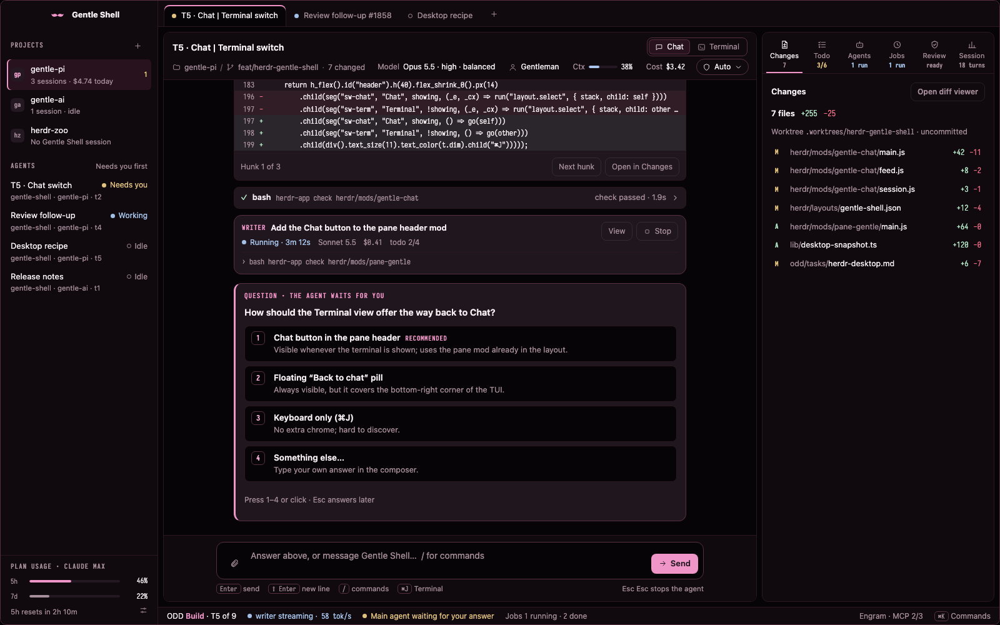

# Gentle Shell Desktop

Gentle Shell Desktop shows your Gentle Shell sessions in a native window: the conversation as a
chat, everything the TUI's sidebar shows beside it, and the real TUI one switch away. It shows
every live Gentle Shell session on your computer, wherever it runs: in the window's own
terminals, and in any other terminal (the Herdr TUI, Ghostty, …). It is
[Herdr app](https://herdr.dev), unchanged, with Gentle Shell's own `gentle-*` mods and its
`gentle-shell` layout. Gentle Shell ships Herdr the way it ships Pi: one pinned version, an exact
download it checks, and its own files kept separate.



<sub>The approved design (`design/herdr-desktop/01-inspector.html`), rendered headless. The live
window is checked against it side by side (`herdr/FIDELITY-T6.md`).</sub>

## Quick path

0. Until Gentle Shell Desktop is in a release, switch to the main channel: `gentle-shell upgrade --channel main`.
1. In a project folder, run `gentle-shell desktop`.
2. Read the plan it prints and answer `y`. It installs Herdr app if needed, the mods, the layout
   and the shortcuts, then opens Herdr with a Gentle Shell session in this folder.
3. Talk to the session in the chat. Press `⌘J` for the real TUI, `⌘K` for every command.
4. Sessions that were already running before you installed show up after you restart them: they load the desktop feed when they start.

```
gentle-shell desktop [--yes] [--no-open]
gentle-shell desktop --status
gentle-shell desktop --uninstall
```

| Option | Does |
|---|---|
| (none) | Installs what is missing (asks first), then opens Herdr on the `gentle-shell` layout. |
| `--yes`, `-y` | Does not ask. Needed when no terminal can answer. |
| `--no-open` | Installs only; does not start or switch Herdr. |
| `--status` | Prints versions, the Herdr home, what is installed, the shortcuts and the window state. |
| `--uninstall` | Removes our mods, layout and shortcuts and puts back what was there before. Herdr stays. |
| `--refresh` | Used by `gentle-shell upgrade`; reinstalls our files only if they were installed. |

## Requirements

| Need | Detail |
|---|---|
| A computer Herdr app runs on | macOS on Apple silicon and Linux (x86_64, arm64): Gentle Shell installs Herdr app for you. Windows: install Herdr app with its official installer first ([below](#how-herdr-app-is-installed)). |
| Herdr app 0.1.16 or newer | Older or missing: Gentle Shell installs exactly 0.1.16. Newer: used as it is. |
| herdr-core | Herdr app offers to set it up the first time it opens. |
| Gentle Shell sessions in a known home | The mods read the sessions of `~/.gentle-shell/agent` (bundled Gentle Shell) and `~/.pi/agent` (Gentle AI as a Pi extension). For another home (`--home <path>`, `GENTLE_PI_AGENT_HOME`, `PI_CODING_AGENT_DIR`), list its agent dir in `~/.config/herdr-app/gentle-shell-roots.json` as `{ "roots": ["~/my/agent"] }`. Herdr app lets mods read only inside your home folder. See [where readers look](desktop-feed.md#where-readers-look). |
| Remote machines (optional) | Herdr's own machines (`hc machine ls`, **Add machine** in the sidebar). A session on another machine shows what herdr-core reports (state, title, its Terminal); its chat and inspector stay on that machine ([Remote machines](#remote-machines)). |

The live checks so far ran on macOS with Herdr app 0.1.15 and 0.1.16, and on Windows 11 for the guard tests. The pin is 0.1.16: every mod passes `herdr-app check` on it, and its changelog has no breaking change for mods, layouts or keys. On Windows and Linux, the `⌘` shortcuts are macOS keys; use the Chat | Terminal switch and the palette button instead.

## What you see

Six regions, left to right and top to bottom. Every one reads the shown session's
[desktop snapshot](desktop-feed.md), which each interactive Gentle Shell session keeps up to date.

### Two kinds of session

Every session carries a small labelled badge, with its own icon, wherever it appears (Agents,
tabs, chat header, Terminal header); Projects counts each kind.

| Badge | Kind | What you get |
|---|---|---|
| **Herdr** | Runs in a terminal of this window (herdr-core). | The **Chat \| Terminal** switch and `⌘J`; what you type goes to its terminal. |
| **TUI** | A Gentle Shell TUI in another terminal: the Herdr TUI, Ghostty, any terminal, or a herdr-core terminal this window does not show. | Chat, inspector, status bar and modes as for any session. No Terminal here: the header says "This session runs in another terminal" ("Other terminal" when narrow). Messages, answers, Stop and modes go through the session's inbox. |
| **Remote** (the machine's name, e.g. `vps`) | Runs in a terminal of this window on another machine (a Herdr space on that machine). | Its state, title and **Terminal** come from herdr-core. Its desktop snapshot and conversation are on that machine and the desktop reads this computer's only, so the chat and inspector say "Runs on vps" instead of showing data; Projects shows no spend for it. |

A session stays listed while its process runs. Sessions started before this version of Gentle
Shell show and answer like the others, but take messages from the desktop only after a restart.

| Region | Shows |
|---|---|
| **Sidebar** | **Needs you**, pinned at the top only while a session waits for you (a question, a permission prompt, a consent, a blocker), wherever it runs: one row per session with what it waits for, its kind badge and the question or reason; click to show it. When a session in another terminal starts waiting, Herdr's "needs you" sound plays (if Settings › Sounds is on) and a toast names it unless you are looking at it; click the toast to show it (Herdr already does both for the agents of its own terminals, so nothing is told twice). Then **Projects** (Herdr spaces, and the project of each session no space holds: "1 Herdr · 2 TUI · $4.74", how many need you), two sections of sessions, each with its count and the ones that need you first: **Herdr · In this window** (every agent in the window) and **TUI · Other terminals**, each row with its state: Needs you, "Working · 2 agents" while its turn runs, "Waiting on 2 agents" once the turn ended while its subagents or background jobs still run (never Idle then), Idle; and **Plan usage** (what the TUI usage panel, alt+u, shows: the plan name when the provider reports one, every window of the session's provider, such as 5h and 7d, the other providers the panel lists with their windows or its note, when the first window resets, and a refresh button, the panel's `r`; the block grows with its rows). An empty section says so in one line. |
| **Tabs** | One tab per session in the shown project, named after the session, with a state dot (needs you, working, waiting on its subagents or jobs, done, idle; the dot's tooltip says "Working · 2 agents" or "Waiting on 2 agents") and its kind badge: the space's tabs, then the project's sessions in other terminals. |
| **Chat header** | Session name, its kind badge, its state while it is not idle ("Working · 2 agents", "Waiting on 2 agents", "Needs you") and the **Chat \| Terminal** switch (for a TUI session, where it runs instead); then project / branch · changed files, and the facts: Model · effort · profile, Persona, Ctx, Cost ("sub" on a subscription, as the TUI footer says), and the permission mode. |
| **Chat** | The conversation: your messages, answers in markdown, thinking, tool calls (read-only runs grouped as "Explored"), diffs, subagent cards, and the open question. The composer sits at the bottom. |
| **Inspector** | Six tabs: **Changes**, **Todo**, **Agents**, **Jobs**, **Review**, **Session** (turns, tool calls, duration, cost, subagent spend, cost by model, integrations). |
| **Status bar** | The ODD phase and todo position, streaming / working / idle (with tok/s when published; "working · 2 agents", and "waiting on 2 agents" once the turn ended while subagents or background jobs still run), what the session waits for, jobs running · done, **Agents N running** (the inspector's Agents count: background subagents are agents, not jobs), and **⌘K Commands**. |

**Terminal** shows the real Gentle Shell TUI of the same session, in the same place, under a header
with the session's name, its Herdr badge, its folder and the same **Chat \| Terminal** switch
(Terminal active; on a narrow card the switch keeps only its icons). Click **Chat** or press `⌘J` to
go back. Nothing is copied: the chat and the TUI are two views of one session.

Some facts are not published yet and show as empty: integrations
("Engram and MCP status are not published by this session yet"), and plan usage for providers
that report none (the usage panel's own note, such as "usage arrives with the first response").

### Remote machines

Herdr can run spaces on other computers over ssh (`hc machine ls`). Add one with **Add machine**
at the bottom of the sidebar. Once one exists, **Projects** groups by machine, as Herdr's own
sidebar does: **This computer** first, then each machine by name with its state (**ready**,
**loading…**, **unavailable**) and **+** for a new project there. A project on a machine starts its
tabs, and new Gentle Shell sessions (**+** after the tabs), on that machine. Sessions there carry the
**Remote** badge named after the machine (Agents, tabs, chat and Terminal headers). The desktop feed
(snapshots, conversation, inspector data) is written on the machine that runs the session, so a
remote session shows only what herdr-core reports and says "Runs on <machine>": nothing from this
computer is matched to it.

### Light and dark

The window follows the appearance Herdr shows: the system's light or dark mode, or settings.json
`"appearance": "light"` / `"dark"`. The layout picks `gentle-shell-light` or `gentle-shell-dark`
(installed into `<herdr home>/themes/`); the dark one is the artboard, the light one keeps the
Gentleman rose with WCAG AA text ([herdr/FIDELITY-light.md](../herdr/FIDELITY-light.md)). A theme
chosen in Herdr's Settings still wins, as for any layout.

## Controls

### Sidebar and tabs

| Control | Does |
|---|---|
| Project row | Click selects the project and every region follows it, even when a session in another terminal was shown; drag reorders; right-click opens Herdr's space menu. |
| **+** next to Projects | Opens a new project (Herdr's `space.new`). |
| Agent row | **Herdr** section: focuses that agent's pane. **TUI** section: shows that session in every region. |
| Project row of a project no space holds | Shows its session that needs you, else its newest one. |
| Refresh in Plan usage | Fetches the subscription windows again (the usage panel's `r`). |
| **Add machine** (sidebar footer) | Herdr's own Add machine dialog (`mod.open machine-add`, as in Herdr's sidebar): lists your ssh-config hosts and says what each needs. |
| Machine header in Projects | Shown once a machine other than this computer exists. **+** opens a new project on that machine; an unavailable machine opens Settings › Machines (its login guidance). |
| Gear in Plan usage | Opens Herdr's settings. |
| Tab | Click selects and every region follows it; a tab with no Gentle Shell session shows no session (the chat says "No Gentle Shell session"), never the session shown before. Drag reorders; double-click renames; right-click opens the tab menu; the wheel moves between tabs. A TUI session's tab: click shows it. |
| **+** after the tabs | Starts a new Gentle Shell session in the project's folder. |
| Window buttons (Windows, Linux) | Minimise, maximise (restore when maximised) and close, at the end of the tab bar, as in Herdr's own layout. On macOS the traffic lights stay at the top left. |

### Chat header

| Control | Does |
|---|---|
| **Chat \| Terminal** | Switches the centre between the chat and the real TUI. |
| **Model** | Opens the profiles menu: every saved profile (the session's one checked, the default marked), the per-agent models and thinking of the hovered profile, **Apply** (`/gentle:profiles`' "Use in this session", through the session's own apply; its confirmation dialog shows when the owner asks for one; refused while the agent, a job or a subagent runs) and **Manage in Terminal** (`/gentle:profiles`, Herdr sessions). Works for Herdr and TUI sessions. The ⌘K palette lists the same profiles and "Refresh plan usage". |
| **Persona** | Opens `/gentle:persona` in the Terminal. |
| Permission pill | Opens the mode menu: **Normal**, **Auto**, **YOLO**, **Super-YOLO**. Super-YOLO asks in a dialog first. See [Permissions and safety](#permissions-and-safety). |

When the header is narrow it drops Persona, then Ctx, Model and Cost; the permission pill always
stays.

### Chat

| Control | Does |
|---|---|
| **Show earlier** | Shows 40 more older messages. A long session opens at its end (its last ~300 KB and 300 lines, at most 3 MB); once those are all shown, **Show earlier messages** reads as much again before them. |
| Any one-line item | Click to open it, click again to close it (see [The minimal chat](#the-minimal-chat)). |
| **⌘O expand all** / **collapse all** | Opens every item in the chat, or brings back the minimal view. |
| Diff card: **Next hunk** | Shows the edit's next hunk. |
| Diff card: **Open in Changes** | Marks the file in the inspector's Changes tab. |
| Subagent card (open) | Its title closes it again. |
| Subagent card: **View** | Opens `/gentle:agents` in the Terminal. |
| Subagent card: **Stop** | Stops that subagent. |
| Question option | Click it, or press `1`…`N`, to answer. **Something else…** puts the keyboard in the composer; what you send is the answer. |
| **Answer in Terminal** | Shown when the question must be answered in the TUI (see [below](#what-stays-in-the-terminal)). |

### The minimal chat

The chat starts in the same minimal view as the Gentle Shell TUI: everything that is not the
conversation's own text is one line, and any line opens.

| Item | One line | Open |
|---|---|---|
| Tool call | Status, tool, what it does in words, never its raw arguments (todo "write · 3 tasks, 1 in progress", ask_user_choice its question, subagent_run "agent · label", web_search its query, fetch_content its URL, mem_* the title or query, codemode its first line of code, gentle_review* its operation, bash_background its label; any other tool its first text value), the result's gist (a failure's last line in red), duration | Arguments and output |
| Reads and searches in a row | "Explored · 2 reads, 1 search" | The tool lines |
| Thinking | "Thought for 14s" when the session hides thinking (`hideThinkingBlock`, ctrl+t in its TUI); open when it does not | The thinking |
| Edit | File, +added −removed | The diff card |
| Subagent | Role, task, state, model, spend | The subagent card (View, Stop, last step, its answer) |
| Longer notices, compaction, branch summaries, skills | Type and first line ("Compacted from 182,345 tokens") | The whole text |

Your messages, the agent's replies, the open question and "Working" are always whole.

**Expand all / Collapse all** works like the TUI's ctrl+o, for every item including thinking:
`⌘O`, the composer's "⌘O expand all" hint, or the palette's **Expand all** / **Collapse all**.
An item you open or close by hand stays that way, also when new lines arrive or you come back
from another session, until the next Expand all / Collapse all.

### Composer

| Control | Does |
|---|---|
| `Enter` / **Send** | Sends the message. While a question is open, a plain message is refused: "Answer the open question first." |
| `Shift+Enter` | New line. |
| `/` | Opens the command menu (below). |
| Paperclip | Pastes the clipboard (an image, or files on macOS) into the session's draft, as `Ctrl+V` does in the TUI. It goes with your next message. |
| **Stop** | Replaces Send while the agent works and the draft is empty. Stops the turn, as `Esc Esc` does in the TUI. Typing brings Send back: the message is queued, as in the TUI. |

Send, answers, **Apply** and the chat's other actions go to the session the window shows at that
moment, also while the chat still reads the session shown before.

### Inspector

| Tab | Controls |
|---|---|
| **Changes** | **Open diff viewer** and each file row open `/gentle:changes` in the Terminal. |
| **Todo** | Read only: tasks, states, the current one and what it waits for. |
| **Agents** | **View** opens `/gentle:agents` in the Terminal; **Stop** stops that subagent. |
| **Jobs** | **Cancel** stops a running job; **Output** (on a failed job) opens `/gentle:jobs` in the Terminal. |
| **Review** | **Start review** and **Skip for this change** show the Terminal, where you answer the review consent. The **RDD** row turns receipt-driven review on or off **for every repository**, after a dialog that says so. |
| **Session** | Read only: stats, cost by model, integrations. |

A refusal or notice under the panel belongs to the session it came from: it is cleared when
the window shows another session.

### Status bar

Click **Commands** to open the palette. Everything else on the bar is read only.

## The ⌘K palette and the `/` menu

**⌘K palette** (or the status bar's **Commands**). Type to filter, `↑`/`↓` to move, `Enter` to
run, `Esc` to close. Its groups:

| Group | Rows |
|---|---|
| **Needs you** | Every session or agent waiting for you; `Enter` focuses it. |
| **Session** | **Stop the agent** (while it works), then Pi's session commands: `/new`, `/resume`, `/fork`, `/compact`, `/name`, `/export`, … |
| **View** | Chat, Terminal, Expand all / Collapse all (the chat's minimal view) and the six inspector tabs, with their keys. |
| **Permission** | The four modes; the current one is checked. |
| **Commands** | The session's own commands: extension commands, prompt templates and skills. |

**`/` menu.** Type `/` at the start of the composer. Names that start with what you typed come
first, then names and descriptions that contain it.

| Key | Does |
|---|---|
| `↑` / `↓` | Move. |
| `Enter`, click | Run the command. |
| `Tab` | Complete it (`/name `) without running. |
| `Esc` | Close the menu; the draft stays. |

Both run a command the same way you would: it is typed into the session's TUI. A command that
answers with a TUI screen (a picker, a panel, a report; marked with the terminal icon) shows the
Terminal; prompt templates, skills and commands like `/new` stay in the chat. A command that needs
an argument (`/name <name>`) goes into the composer for you to finish. `/quit` is never listed:
type it.

## Keyboard shortcuts

Window-wide, while the `gentle-shell` layout shows (added to Herdr's `keys.json`):

| Key | Does |
|---|---|
| `⌘K` | Opens the Gentle commands palette. |
| `⌘J` | Switches Chat ↔ Terminal. For a TUI session it says "This session runs in another terminal." |
| `⌘.` | Stops the shown session's turn. |
| `⌘O` | Expand all / Collapse all in the chat (the TUI's ctrl+o). |
| `⌥⌘1` … `⌥⌘6` | Inspector tab: Changes, Todo, Agents, Jobs, Review, Session. |

`herdr-app do gentle-status.session-next` (or `session-prev`) shows the next (previous) live session,
wherever it runs; bind it in `keys.json` if you want a key for it. `herdr-app do
gentle-chat.expand-all` (or `collapse-all`) sets the chat's view.

Inside the chat, even without those shortcuts:

| Key | Does |
|---|---|
| `⌘K` | Palette. |
| `⌘J` | Terminal. |
| `⌘O` | Expand all / Collapse all. |
| `Esc Esc` | Stops the agent's turn. The first `Esc` says "Press Esc again to stop the agent." for one second. `Esc` first closes the `/` menu. |
| `1` … `N` | Answers the open question (when the composer does not have the keyboard). |

In dialogs, `Enter` confirms and `Esc` cancels.

## What stays in the Terminal

Some things are answered or done only in the real TUI. The desktop shows them and points you
there (**Answer in Terminal**, or it switches to the Terminal itself).

For a **TUI** session (it runs in another terminal) the desktop has no Terminal to switch to.
From the chat you can send messages (queued as a steer while the agent works, as Enter does in the
TUI), prompt templates and skills, answer a single-choice question, stop the agent, and change the
permission mode. Everything else in the table below, plus pi's own commands (`/new`, `/model`, …),
extension commands (`/gentle:mode`, `/gentle:agents`, …), `!` shell lines and attachments, is done in
that session's own terminal: "Open that session's terminal to run /commands."

| Stays in the Terminal | Why |
|---|---|
| **Consent**: review consent, and any provider consent or maintenance authorization the agent relays as a question | Consent must come from you at the session itself. A click elsewhere, or a file another process could write, is not proof of that. |
| Questions with several parts or several picks, and extension prompts (select, confirm, input, editor) | The desktop can only answer a single-choice list safely, by pressing the same keys you would. |
| Interactive pickers and panels (`/gentle:profiles`, `/gentle:customize`, `/model`, `/gentle:agents`, …) | They are TUI screens; the desktop sends the command and shows the Terminal instead of redrawing them. |
| Vim prompt editing | It is a mode of the TUI's editor. The chat composer is a plain native text field. |
| Voice dictation (`/gentle:voice`) | It pastes into the TUI's draft. |
| `/quit` | Typed, never one click away. |

## Permissions and safety

**Same authority as the TUI, never more.** The desktop does only what you could do in the
session's terminal, through the session's own owners:

| Desktop action | Who decides |
|---|---|
| Change the permission mode | The same owner as `/gentle:mode`. |
| Stop a subagent, cancel a job | The subagents and jobs owners. |
| Stop the agent's turn | The session's own abort (the TUI's `Esc Esc`); refused while the agent is idle. |
| Answer a question | The session checks it is still the open one and names the keys its list takes; the desktop presses them and nothing else. If the question changed meanwhile, nothing is pressed. |
| Send a message or a slash command | Herdr session: typed into the TUI, as you would. TUI session: handed to pi as if typed in its editor (`send_prompt`); only plain text, prompt templates and skills. Refused while a question is open. A desktop message never counts as your typed consent. |
| RDD switch | Runs `gentle-ai review mode enable\|disable --scope global --cwd <project> --json`, after a dialog that says it is global. |

**Escalation rules.**

- **Super-YOLO** and the **RDD switch** ask in a dialog first. **Confirm** runs it once; **Cancel**
  or `Esc` forgets it; an unanswered dialog expires after two minutes.
- Raising the mode (Normal → Auto → YOLO → Super-YOLO) is refused while the agent, a background
  job or a subagent of the session is running, or within 2 s after: "Raising the permission mode
  is refused while the agent, a background job or a subagent is running, or within 2 s after; try
  again when the session is idle." This keeps the agent from raising its own mode through the
  desktop. The action file's time decides, and a file stamped up to 2 s before the activity also
  counts as written during it, because file clocks lag (Linux's coarse clock, 2 s FAT stamps).
- Lowering the mode, stopping and cancelling are always accepted.
- **Consent is never answered from the desktop.**

The session's desktop folder is private (`0700`/`0600`) and the agent's own file and shell tools
are denied it. For the file formats and every refusal code, see
[desktop-feed.md](desktop-feed.md#actions-gentle-shelldesktop-actionv1).

## Upgrade and rollback

- **`gentle-shell upgrade`** refreshes the desktop afterwards (`gentle-shell desktop --refresh`),
  only if `gentle-shell desktop` installed it before. It reinstalls our mods, layout and themes safely and
  updates the Gentle shortcuts already added: a shortcut the new version no longer ships is
  removed; one it changes is updated, unless you rebound it. It never installs Herdr app or opens
  the window.
- **`gentle-shell upgrade --rollback`** only switches the version. Run `gentle-shell desktop`
  afterwards to install that version's mods.
- **Herdr app** updates itself in the background. Newer versions are accepted; see
  [Herdr version pin](#herdr-version-pin) if a mod stops loading.

## Uninstall

```
gentle-shell desktop --uninstall
```

It removes only what `~/.gentle-shell/desktop/state.json` records as ours, and:

1. moves our mods, layout and themes to `~/.gentle-shell/desktop/backup`;
2. puts back, byte for byte, whatever was at those paths before (`~/.gentle-shell/desktop/originals`);
3. removes from `keys.json` exactly the Gentle shortcuts that still hold the action we wrote
   (the file from before Gentle Shell, byte for byte, when you have not edited it since;
   otherwise every other byte stays);
4. switches Herdr back to the layout it showed before (or `main`) when ours is showing.

Without `state.json` it removes nothing. Herdr app itself stays installed; remove it with Herdr's
own instructions. `gentle-shell self-uninstall` covers Gentle Shell itself
([Removing Gentle Shell](gentle-shell-uninstall.md)).

## Troubleshooting

| Symptom | What to do |
|---|---|
| `gentle-shell desktop: Herdr app reports: [...]` | Herdr's own `herdr-app status` listed errors after the switch. Run `herdr-app check <herdr home>/mods/<mod>` on the mod it names. If the mods are ours and fail, see [Herdr version pin](#herdr-version-pin). |
| "Herdr app did not open its window." | Open Herdr app once by hand (it may ask to set up herdr-core), then run `gentle-shell desktop` again. |
| A mod failed `herdr-app check` during install | Nothing in the Herdr home changed. The printed output says why; this usually means a Herdr version the mods were not built for. |
| The window looks stale, or `herdr-app shot` returns an old frame | Herdr does not draw a covered or hidden window. Bring it to the front. |
| A working session's dot does not pulse | On purpose: any animation redraws the whole Herdr window on every frame, which kept Herdr app near 40 % CPU while a session worked. The dot's colour and its word (Working, streaming) say it; the chat and the inspector update as the session writes. Measurements: `herdr/PERF.md`. |
| "No Gentle Shell session focused" / "No Gentle Shell session here" | Focus a tab that runs `gentle-shell`, or start one with **+** in the tab bar. Sessions started with `--link` or `--home` are not seen ([Requirements](#requirements)). |
| "Cannot read this conversation" | The chat could not read the session file the session names (moved, deleted or unreadable). It reads it again when the session updates; its Terminal still shows the conversation. |
| A session in another terminal is missing | It is listed while its process runs and once it published a snapshot (an interactive Gentle Shell TUI does). Check **TUI · Other terminals**. |
| "This session started before desktop messages: type in its own terminal, or restart it." / "This session takes no prompts from the desktop. Update Gentle Shell and restart it." | The TUI session runs a Gentle Shell from before desktop messages. Restart it, or type in its own terminal. |
| "Open that session's terminal to run /commands." | The shown session runs in another terminal; pi's and extensions' commands run only there. |
| "This session takes no desktop actions. Update Gentle Shell and restart it." | The session started before an update that added desktop actions. Restart it. |
| "The session did not answer. Is it still running?" | The session did not answer within 6 s. Check its Terminal. |
| "The agent is not working" | Stop was pressed while the agent was idle; nothing to stop. |
| Raising the mode was refused | Wait until the agent, its jobs and subagents are idle, then try again ([Escalation rules](#permissions-and-safety)). |
| A shortcut does not work | A key you already bound in `layout:gentle-shell` stays yours; install reported it once. `--status` shows how many Gentle shortcuts are in `keys.json`. In the chat, `⌘K`, `⌘J` and `Esc Esc` still work. The status bar shows the palette key Herdr actually has. |
| "keys.json … it was not changed" or a `keys.error` | Gentle Shell never writes an invalid `keys.json` and puts the previous file back if Herdr rejects it. Fix the file it names and run the command again. |
| The shortcuts did not appear on the first run | Herdr writes `keys.json` on its first start; they are added when the window opens, or with `--no-open` the next time `gentle-shell desktop` opens Herdr. |

### Herdr version pin

The mods are built and checked against Herdr app **0.1.16** (`HERDR_APP_VERSION` in
`lib/gentle-shell-desktop.ts`). Herdr app is 0.1.x and changes its mod API between versions, so a
newer Herdr can reject a mod. Then:

1. run `gentle-shell desktop --status` and note the Herdr app version;
2. run `herdr-app check` on the failing `gentle-*` mod;
3. update Gentle Shell (`gentle-shell upgrade`) in case a newer release supports that Herdr, or
   report the check output.

Gentle Shell never downgrades a newer Herdr app.

---

## Reference: what `gentle-shell desktop` does

1. **Herdr app.** It looks for `herdr-app` on your `PATH`, then in `~/.local/bin`, and reads
   `herdr-app --version`. Version 0.1.16 or newer is used as it is; we built and checked the mods
   against 0.1.16 (`HERDR_APP_VERSION` in `lib/gentle-shell-desktop.ts`). If Herdr app is missing
   or older, Gentle Shell installs exactly 0.1.16 (see below).
2. **Mods and layout.** It copies every `herdr/mods/gentle-*` folder of the running Gentle Shell
   package into `<herdr home>/mods/` and `herdr/layouts/gentle-shell.json` into
   `<herdr home>/layouts/`, and the layout's two themes, `herdr/themes/gentle-shell-light.json` and
   `gentle-shell-dark.json`, into `<herdr home>/themes/`. The Herdr home is `$HERDR_APP_HOME`, else `$XDG_CONFIG_HOME/herdr-app`,
   else `~/.config/herdr-app` (Herdr's own rule). Herdr's generated `gpui-kit.d.ts`/`jsconfig.json`
   and our design notes are not copied.
   - The files are staged in `~/.gentle-shell/desktop/stage`, and every staged mod must pass
     `herdr-app check <staged mod>` first. If one fails, Gentle Shell prints the check output and
     stops: nothing in the Herdr home changes, so a running window never loads an unchecked mod.
   - Then each folder is swapped in. `~/.gentle-shell/desktop/state.json` records which paths are
     ours. Our own previous copy moves to `~/.gentle-shell/desktop/backup` (replaced each time).
   - Anything at one of those paths that Gentle Shell did not install (for example your own
     `mods/gentle-tabs` or `layouts/gentle-shell.json`) moves to `~/.gentle-shell/desktop/originals`.
     Later installs and upgrades never overwrite or delete it; `--uninstall` puts it back.
   - If a swap fails, every previous copy goes back and folders this install created are removed.
   - Only the mods this package ships, `layouts/gentle-shell.json` and `themes/gentle-shell-*.json`
     are written. Your other mods, layouts, themes and settings are never touched.
3. **Keys.** It adds the Gentle shortcuts of `herdr/keys.json` (the `layout:gentle-shell` section;
   see [Keyboard shortcuts](#keyboard-shortcuts)) to `<herdr home>/keys.json`, so they work
   anywhere in the window while the `gentle-shell` layout shows, not only with the chat focused.
   - Herdr reads one `keys.json` on every OS; only its built-in defaults differ (`keys.macos.json`
     on macOS). That file is the whole keymap: Herdr writes its defaults there on its first start
     and does not layer them under it. So Gentle Shell never creates `keys.json`: if Herdr has not
     written it yet, the shortcuts are added right after the window opens, or with `--no-open` the
     next time `gentle-shell desktop` opens Herdr.
   - Only entries in `layout:gentle-shell` are added or updated, as text: every other byte of the
     file stays as you wrote it. `state.json` records each entry we added (its tag; JSON has no
     comments). A key you already bind in that section, spelled any way (`alt-cmd-1` is `cmd-alt-1`),
     stays yours and is reported once; a Gentle shortcut you later delete or rebind is yours and is
     never added again.
   - An invalid `keys.json` (bad JSON, not an object of sections, a binding that is not a command
     string or object) is never written; Gentle Shell says why and installs the rest.
   - The write is atomic. The previous file is kept in `~/.gentle-shell/desktop/keys-backup.json`
     and the file from before Gentle Shell's first change in `~/.gentle-shell/desktop/originals/keys.json`.
     When Herdr is running on that Herdr home, it applies `keys.json` at once: if it then writes
     `keys.error`, the previous file goes back. If it already reports `keys.error`, nothing is written.
   - Herdr updates an untouched default `keys.json` to new default shortcuts on upgrade; once the
     file has our shortcuts it counts as edited, so new Herdr defaults must be added by hand until
     `--uninstall` puts the original back.
4. **Window.** Gentle Shell starts Herdr app if its window is not open and runs
   `herdr-app do layout.switch {"name":"gentle-shell"}`. If no Gentle Shell terminal runs in the
   current folder yet, it also runs `space.new` with `{"folder": <cwd>, "argv": ["gentle-shell"]}`.
   `--no-open` installs only.

Before changing anything it prints exactly what it will install and where, then asks
`Install Gentle Shell Desktop as shown above? [y/N]`. `--yes` skips the question. Without a terminal
and without `--yes`, it refuses and writes nothing. When everything is already installed and current,
it opens Herdr without asking.

`--status` prints the Gentle Shell version, the Herdr app version and path, the Herdr home, whether
the `gentle-shell` layout, its themes and each shipped mod are installed, how many Gentle shortcuts are in
`keys.json`, and whether the window is running and which layout it shows.

This works the same for every Gentle Shell install, bundled in `~/.gentle-shell` or the npm package.
The mods always come from the `herdr/` folder of the Gentle Shell that is running.

## How Herdr app is installed

Herdr's documented installer is `curl -fsSL https://releases.herdr.dev/app/install.sh | sh`
(<https://herdr.dev/download/>). That installer always takes the latest release from
`app/latest.json` and runs whatever script the server returns. Gentle Shell follows the same steps,
but for one pinned version, and it does not pipe a script into a shell:

- It downloads `https://releases.herdr.dev/app/0.1.16/herdr-app-<target>.tar.gz` (the versioned file
  the official installer downloads; `HERDR_RELEASES_URL` selects a mirror, as for Herdr itself).
- It refuses the file unless its SHA-256 equals the value pinned in Gentle Shell. The pins come from
  Herdr's immutable release manifest `https://releases.herdr.dev/app/0.1.16/manifest.json`.
- macOS (Apple silicon): the bundle must have a valid Developer ID signature
  (`codesign -dvv`, then `codesign --verify --deep --strict`), as the official installer requires for
  release builds. It becomes `~/Applications/Herdr.app`, with `~/.local/bin/herdr-app` linked to it.
- Linux (x86_64, arm64): it becomes `~/.local/share/herdr-app` (or `$XDG_DATA_HOME/herdr-app`), with
  `~/.local/bin/herdr-app` linked to it and a launcher entry, as the official installer does.
- Windows: Gentle Shell does not install Herdr app itself. It prints Herdr's official PowerShell
  installer command, `powershell -c "irm https://releases.herdr.dev/app/install.ps1 | iex"`; run it,
  then run `gentle-shell desktop` again.
- herdr-core, the terminal runtime, is not installed by Gentle Shell. Herdr app offers to set it up
  when it opens, and keeps it current after that.

Herdr app updates itself in the background after that; newer versions are accepted.

## Related

- [Desktop feed format](desktop-feed.md): the snapshot the mods read and the actions they send.
- [`herdr/RECIPE.md`](../herdr/RECIPE.md): the layout's gallery brief.
