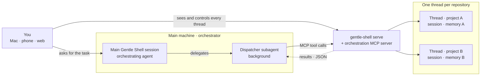

# Plan: multi-repo orchestration (Phase 5)

> **Status: plan, not implemented.** This document is the brief for whoever implements Phase 5 of [RFC #3527](https://github.com/Gentleman-Programming/gentle-shell/issues/3527) once phases 1–4 (`gentle-shell serve`, see [serve.md](serve.md) and [remote.md](remote.md)) are merged. It is written so a coding agent can take it as is: goal, contract, order of work, tests and acceptance criteria.

## Goal

One orchestrating agent opens and drives full Gentle Shell sessions ("threads") in other repositories, each with its own history and its own memory, while the user watches and steers every thread from a laptop, a phone or the web.

## What already exists (build on it, don't duplicate)

- Sessions owned by `serve`, surviving clients and server restarts (session keepers), with `seq`/`epoch` resume, dialog replay and host tools ([serve.md](serve.md) "Process model", "Event stream").
- Devices with scopes checked per request, pairing, revocation, `lastActiveDevice` ([serve.md](serve.md) "Authentication").
- Desktop RPC over `serve` with or without a session (`/api/sessions/:id/desktop`, `/api/desktop`).
- Engram as each machine's memory service.

## Contract to implement

### 1. Threads = sessions with metadata

- Every session record gains: `title` (≤ 120 chars, default: folder name), `project` (absolute cwd), `createdAt`, `lastActiveAt`, `archived` (bool), `createdBy` (device id), `parent` (thread id or `null`), `origin` (`"device"` | `"orchestrator"`). Persist it with the session keeper's record so it survives restarts.
- `POST /api/sessions` accepts `{ cwd, title?, parent? }`.
- `PATCH /api/sessions/:id { title }` — `sessions:operate`.
- `POST /api/sessions/:id/archive` — `sessions:operate`. Stops the process, keeps the Pi session file, keeps the record with `archived: true`.
- `POST /api/sessions/:id/unarchive` — `sessions:operate`. Starts a session resuming the same Pi session id (`--session-id`), same thread id.
- `GET /api/sessions?query=&project=&state=running|exited|archived&limit=&cursor=` — `sessions:read`. Search over title and project; keyset pagination (`nextCursor`). Archived threads are excluded unless `state=archived`.
- Every session's environment gets `GENTLE_SHELL_SESSION_ID=<thread id>`.

### 2. Scope `orchestrate` and a depth limit of one

- New scope `orchestrate`, not part of the default pairing scopes.
- Creating a thread with `parent`, or any request made with an orchestration token, needs `orchestrate`; such threads get `origin: "orchestrator"`.
- A create whose `parent` is a thread with `origin: "orchestrator"` is refused with `403 depth_limit`. Delegated threads never delegate.

### 3. Send and wait

`POST /api/sessions/:id/send { text, wait?: "settled" | "question" | "none", timeoutMs? }` — `sessions:operate`.
Sends a Pi `prompt` (follow-up when the agent is busy) and, unless `wait` is `"none"`, waits until `agent_settled` or a pending `extension_ui_request`. Answers `{ state: "settled" | "question" | "timeout", reply?, dialog? }`: `reply` is the last assistant message's text, `dialog` the pending request (id, kind, title, options).

### 4. Structured replies

`POST /api/sessions/:id/ask_json { prompt, schema, timeoutMs? }` — `sessions:operate` + `orchestrate`.
Sends the prompt with an instruction to answer only a JSON object matching `schema`; waits for `agent_settled`; extracts the last assistant message's JSON (fenced or bare); validates against a JSON Schema subset (`type`, `properties`, `required`, `items`, `enum`, primitive types, nested objects/arrays); on failure retries once with the validation errors. Answers `{ ok: true, value }` or `{ ok: false, error, raw }`.

### 5. Memory per project

Each thread's memory project is the git repository root of its `cwd` (or `cwd` outside a repository). Find how Gentle Shell picks the Engram project today and make it explicit for threads (environment or extension setting); nothing crosses projects unless the agent asks.

### 6. MCP server for orchestration

`gentle-shell serve mcp [--server <url>] [--token-file <path>]`: an MCP server over stdio (initialize, `tools/list`, `tools/call`; JSON-RPC 2.0 framing per the MCP stdio transport; no new dependency) that calls `serve`'s API.

- Server and token: by default the server in this agent home (`server.json`) and a dedicated device token with `sessions:read sessions:operate orchestrate`, minted on first use with the admin token and stored `0600` in `<home>/serve/mcp-token`.
- Parent: threads it creates get `parent = $GENTLE_SHELL_SESSION_ID` when set, so the depth limit applies.
- Tools (input schemas in `tools/list`):

| Tool | Does |
| --- | --- |
| `thread_create { cwd, title? }` | `POST /api/sessions` |
| `thread_send { id, text, wait? }` | `POST /:id/send` |
| `thread_wait { id, until: "settled" \| "question", timeoutMs? }` | waits on the event stream |
| `thread_read { id, after? }` | recent user/assistant messages, compact |
| `thread_answer { id, dialogId, value }` | answers a pending dialog |
| `thread_ask_json { id, prompt, schema }` | `POST /:id/ask_json` |
| `thread_list { query?, project?, state? }` | `GET /api/sessions` |
| `thread_stop { id }` | stops the thread |
| `thread_archive { id }` | archives it |

### 7. Dispatcher subagent

A Gentle Shell agent definition named `dispatcher` that owns the MCP tools: given a plan, it creates or reuses threads per repository, runs them in parallel, answers or escalates their questions, collects structured results and reports back, so the main session stays free. Document how to register the MCP server for an orchestrating session (`mcp.json` entry or `gentle-shell mcp add`).

### 8. Clients

- Clients connected to several servers at once (Gentle Shell GPUI already keeps several paired servers) show a threads view: every server's threads grouped by machine and project, with open, stop and archive.
- Answering a thread's question from any device (dialogs are already replayed to every subscriber).

### 9. Linked environments (last)

A server pairs another server as a device with narrow scopes (for example a sandbox that may only create threads under one folder, no terminals); the orchestrator reaches it with the same MCP tools (`--server`).

## Rules

- A thread is a full session: its own repository, history, tools, permissions and memory. Work never silently crosses threads or servers.
- The orchestrator's authority over a thread is what its device scopes allow. Consent prompts inside a thread stay the thread's: the orchestrator answers only what the user allowed; everything else goes to the user's devices.
- Delegated threads cannot delegate (depth 1), enforced by scope, not by convention.
- Threads outlive the orchestrator's turn: results stay listed until archived.

## Order of work (one PR each)

1. Thread metadata, archive/unarchive, search, `GENTLE_SHELL_SESSION_ID`.
2. `orchestrate` scope and depth limit.
3. `send` and `ask_json`.
4. Memory per project.
5. `gentle-shell serve mcp`.
6. `dispatcher` definition and `docs/orchestration.md` (user guide).
7. Clients: threads view across servers (Gentle Shell GPUI).
8. Linked environments.

## Tests and acceptance

- `tests/serve-*.test.ts` with the fake Pi child (extend `tests/fixtures/serve-fake-pi.mjs` to emit assistant messages, `agent_settled` and dialogs): metadata persists across a serve restart; archive frees the process and unarchive resumes the same Pi session; search and pagination; depth limit returns `403 depth_limit`; `send` returns the reply or the dialog; `ask_json` validates, retries once and fails cleanly; MCP handshake and every tool against a real `serve` in a temp home; token minting and file mode.
- No model turns in tests; temp homes only.
- Acceptance: from an orchestrating session with the MCP server registered, a prompt like "in repos A and B, list the failing tests as JSON" creates two threads, runs them in parallel, returns validated JSON per repo, and both threads appear in a client's threads view; a thread's attempt to create another thread is refused.
