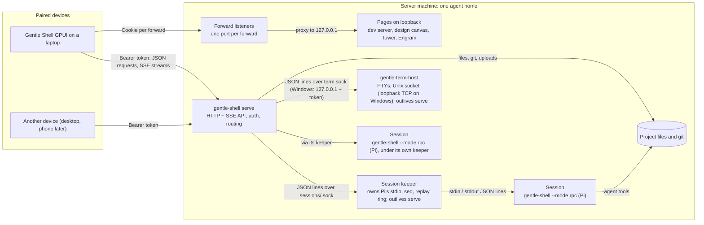
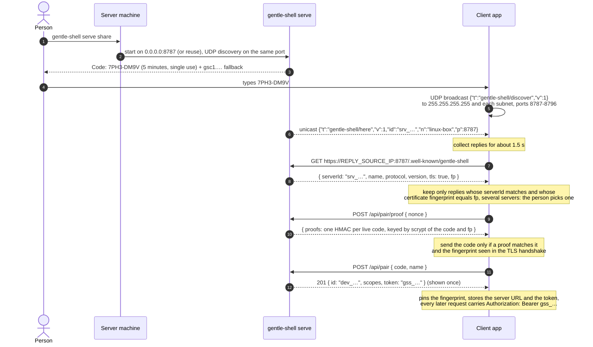
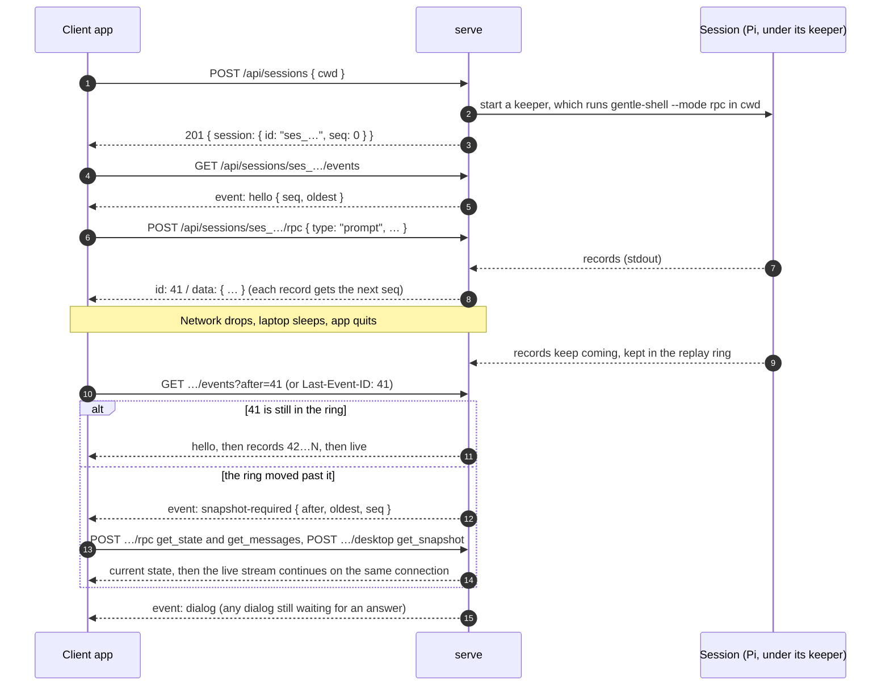
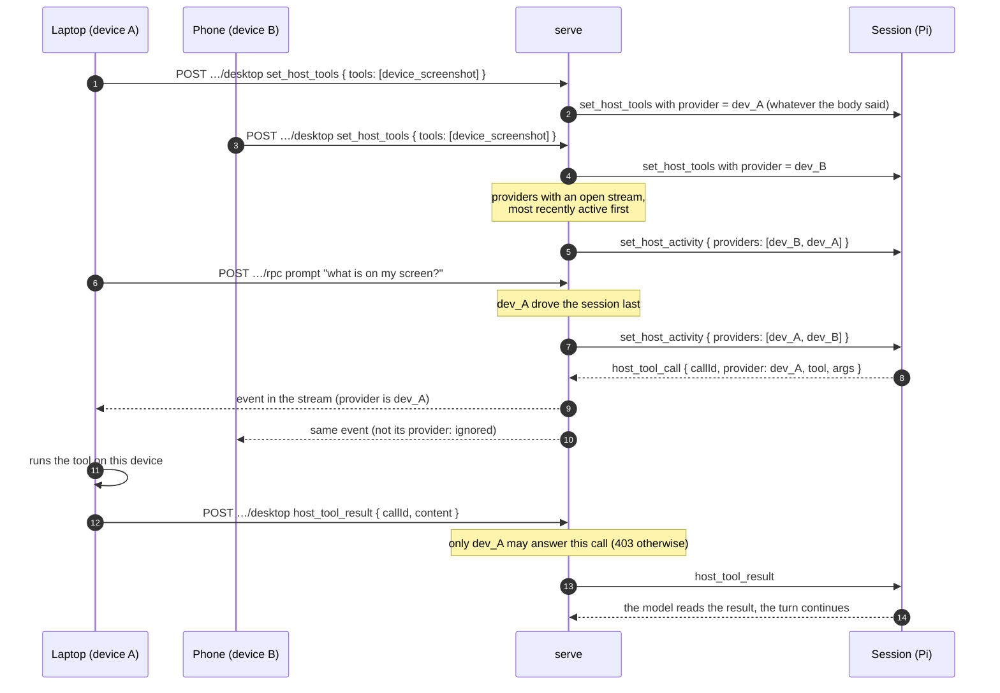
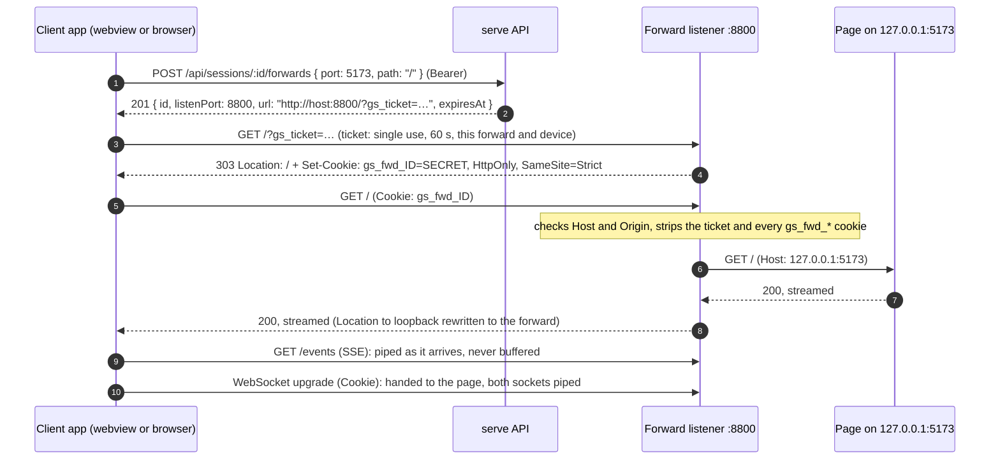
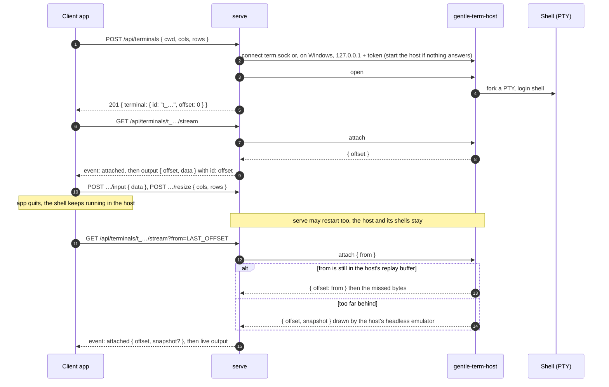
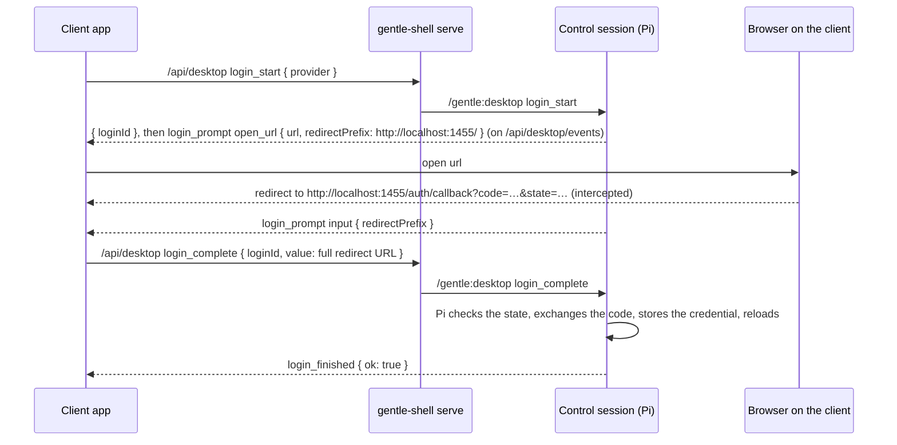

# Remote use

Gentle Shell can run its agents on one machine — a Linux PC on your home network, a workstation under the desk — and let you drive them from another: a laptop with Gentle Shell GPUI today, a phone later. The machine that runs the agents runs `gentle-shell serve`; every other device is a paired client of it.

This page is the overview: what runs where and why, how a device connects, what happens when things disconnect or restart, how tools that need the client's own device work, how pages and terminals on the server reach you, and the security model. The exact endpoints, fields, limits and error codes are in the references:

- [`gentle-shell serve`](serve.md) — commands, files, every HTTP endpoint, pairing and tokens, limits, troubleshooting.
- [Desktop RPC](desktop-rpc.md) — the in-session channel, including the [host tool methods and events](desktop-rpc.md#set_host_tools).

## Contents

- [What runs where](#what-runs-where)
- [Connecting with the short code](#connecting-with-the-short-code)
- [Session lifecycle](#session-lifecycle)
- [Host tools across several devices](#host-tools-across-several-devices)
- [Pages on the server: port forwarding](#pages-on-the-server-port-forwarding)
- [Terminals](#terminals)
- [Sign-in, packages and upgrades from the client](#sign-in-packages-and-upgrades-from-the-client)
- [Clients without sessions](#clients-without-sessions)
- [Security model](#security-model)
- [Reference](#reference)
- [Known limits and next steps](#known-limits-and-next-steps)

## What runs where

The rule is simple: **the work happens on the server; the client shows it and drives it.** The agent, its tools, the project files, git, shells and dev servers all live on the server machine, because that is where the project and the compute are. The client keeps only what is personal to the device in front of you — its screen, its windows, its own tools — and a cache of what it last saw.



| Piece | Runs on | Does | Why there |
| --- | --- | --- | --- |
| `gentle-shell serve` | Server | One long-lived process per agent home. Pairs devices, checks every request's token and scope, starts and stops sessions, serves each session's replay ring to devices, routes host tool calls, serves files, git and uploads, opens forwards, talks to the terminal host. | One owner per home: sessions must survive the client that started them, and every device must see the same state. |
| Session keeper | Server | One small detached Node process per session: starts Pi and owns its stdin and stdout, numbers its records, keeps the replay ring, pending dialogs and open host tool calls; `serve` attaches to it over an owner-only socket. | Sessions must survive a `serve` restart or upgrade with their ids and `seq`, as terminals do. |
| Session | Server | One `gentle-shell --mode rpc` process per session: the same launcher, Pi and extensions as a local launch, with Desktop RPC on. | The agent needs the project, the tools and the provider sign-ins that live on the server. Each session isolated in its own process: a crash or a hang takes down one session, not the server. |
| `gentle-term-host` | Server | A small native process that owns the PTYs (ConPTY on Windows); `serve` is its client over an owner-only Unix socket, or on Windows over loopback TCP with a token from an owner-only file. | Shells must survive a `serve` restart or upgrade, and a reattaching client needs the screen as it is, which a headless terminal emulator in the host can draw. |
| Forward listeners | Server (inside `serve`) | One listener per forward, proxying to a page on the server's loopback. | Pages bound to `127.0.0.1` (dev servers, the design canvas, Tower) are unreachable from another machine by design; a forward opens one of them to one device without opening the port to anyone. |
| Client app | Each device | Shows sessions, files, diffs, branches, terminals and forwarded pages; sends prompts, edits and keystrokes; runs its own [host tools](#host-tools-across-several-devices) (a screenshot of this Mac). Remembers the server, its device token, and the last `seq` / terminal offset it saw. | It is the person's device: the screen, the keyboard, and tools that only make sense on that device. |

What the client does **not** do against a server: run the agent, read or write project files locally, run git locally, or start a shell locally for a server folder. Everything that touches the project goes through the server's API, so two devices never disagree about the state of the project.

## Connecting with the short code

On the server, `gentle-shell serve share` starts (or reuses) a network server and prints an 8-character pairing code, with a long `gsc1.…` connection code under it as the fallback. The person types the short code in the app; the app finds the server by itself and pairs. Details: [Share on your network](serve.md#share-on-your-network), [LAN discovery](serve.md#lan-discovery), [Connection code](serve.md#connection-code).



- **Identity before secrets.** The pairing code is sent only to an address whose `/.well-known/gentle-shell` names the `serverId` the discovery reply (or the connection code) announced, over TLS to the certificate that answer names. With the short code the app also asks for a **pairing proof** first: for each live code the server answers `HMAC(scrypt(code, fingerprint), fingerprint ‖ nonce)` for the app's random nonce, and the app sends its code only when one proof matches it and the fingerprint it saw in the handshake. A device that answers discovery with a forged reply has neither the code nor the server's key, so it can neither prove the code nor stand in the middle. The `serverId` is minted once per agent home (`<home>/serve/server-id`) and stays the same across restarts and upgrades, so the app recognises the server it paired with.
- **When discovery does not reach** (another subnet, a tailnet, a Wi-Fi with client isolation, UDP blocked), the long `gsc1.…` code carries the `serverId`, the port, up to 8 addresses to try, the pairing code, the certificate fingerprint (`fp`, pinned directly) and, when the server uses one, its relay (`r`). The app probes every address in parallel and pairs at the first whose identity and certificate match; with a relay it also tries the server through it ([Outside the network](#outside-the-network-the-relay)).
- **Manual pairing.** `gentle-shell serve pair` mints a code for a server on loopback, reached through an SSH tunnel ([Reach it from the Mac](serve.md#4-reach-it-from-the-mac)).

## Session lifecycle

A session belongs to the server, not to the client that started it. Clients come and go; the session keeps running until someone deletes it, Pi exits, or the server stops with `--sessions`. It also outlives the server itself: its keeper holds it while the server restarts.

Every record a session prints gets the session's next sequence number (`seq`). The keeper keeps the newest records in a replay ring (2000 records or 8 MiB), which the server serves. A client follows a session with one SSE stream and remembers the last `seq` it saw; when it comes back it asks for everything after it. Details: [Event stream](serve.md#event-stream-get-apisessionsidevents), [Replay and resume](serve.md#replay-and-resume), [Sessions across server restarts](serve.md#sessions-across-server-restarts).



| Situation | What happens |
| --- | --- |
| **Start** | `POST /api/sessions { cwd }` starts a keeper and Pi in that folder. `{ cwd, sessionId }` opens the Pi session with that exact id (an existing conversation in that folder, or a new one under that id). The starting device becomes the session's `lastActiveDevice`. |
| **Client disconnects** | Nothing stops. Pi keeps running and its records keep entering the ring. A turn waiting on a dialog keeps waiting (until the dialog's own timeout). |
| **Resume by `seq`** | The client reconnects with `after=<last seq>`. Inside the ring it gets exactly what it missed, then live records. Dialogs still pending are re-sent as `dialog` events; a host tool call still waiting for this device is re-sent as `host_tool_call`. |
| **Snapshot required** | The cursor is older than the ring (the client was away for a long run) or newer than the stream (a cursor from another session). The client rebuilds its view from Pi `get_state` / `get_messages` and Desktop RPC `get_snapshot`, then follows the live stream on the same connection. |
| **Slow client** | A subscriber with more than 4 MiB unsent is dropped with a `resync` event and reconnects with its last `id`. The session is never slowed down by a client. |
| **Client restarts** | The app keeps the server URL, the token, the session ids it had open and their last `seq`. On relaunch it lists `GET /api/sessions` and reattaches each one as above; terminals reattach by id and offset (see [Terminals](#terminals)). |
| **Several clients** | Every subscriber sees the same records. The first answer to a dialog wins; the others get `serve_dialog_resolved` and close it. Each request is authorized on its own, by scope. |
| **Session ends** | `DELETE /api/sessions/:id`, or Pi exits on its own: the stream carries `serve_session_exited` and ends. Up to 16 exited sessions stay listed until deleted. The session's forwards close with it. |
| **Server restarts** | `serve stop`, a service manager's restart or an upgrade stops only `serve`: sessions keep running under their keepers. The next server reattaches every one before it answers requests: same ids, `seq` continuing, dialogs and host tool calls still pending; a device owing a host tool call has 30 s to reconnect. A client reconnects with `after=<last seq>` and gets what it missed while the server was down. `serve stop --sessions` stops the sessions too; a reboot ends them (a client starts one again with `{ cwd, sessionId }` and Pi reopens the conversation from disk). A session no server came back to stops after 24 hours. Paired devices stay paired (`devices.json`), the server id stays the same, and terminals live on in the terminal host. |

## Host tools across several devices

Some tools only make sense on the device in front of you: a screenshot of this Mac, a photo from the phone, a simulator running on the laptop. A client registers such tools with the session as **host tools**; the agent calls them like any other tool, but they run on the client, with the client's authority, and only the result goes back into the conversation. Nothing is installed on the server for them. Details: [Host tools](serve.md#host-tools) in serve, and [`set_host_tools`](desktop-rpc.md#set_host_tools), [`host_tool_result`](desktop-rpc.md#host_tool_result), [`host_tool_progress`](desktop-rpc.md#host_tool_progress), [`host_tool_call`](desktop-rpc.md#host_tool_call), [`host_tool_cancel`](desktop-rpc.md#host_tool_cancel), [`set_host_activity`](desktop-rpc.md#set_host_activity) in Desktop RPC.



- **Registration.** `set_host_tools` and `set_host_context` go through `POST /api/sessions/:id/desktop` only, with `sessions:operate`. The server always replaces `provider` with the calling device's id, so no device can register tools (or hidden context) as another one. Through `/rpc` these requests are refused (`400 use_desktop_endpoint`).
- **Last-active routing.** Several devices may offer the same tool name. The server tells the session, with `set_host_activity`, which providers have an open stream, most recently active first ("active" = sent a prompt, a steer, a dialog answer, a Desktop write, or started the session). The session sends each call to the first of them that offers the tool. Clients cannot send `set_host_activity` themselves.
- **Offline fallback.** If the chosen device has no open stream when the call appears, the server answers it at once with an error result the model reads — `<tool> runs in <device name>, which isn't connected right now.` — instead of letting the turn hang. If a device's last stream closes while it owes results, the server waits 10 s for it to come back, then answers its calls the same way. Revoking a device answers its calls at once.
- **Cancel.** When the person aborts the turn, the call ends at once as cancelled; when no result arrives within 10 minutes, it ends with an error result. Either way the session emits `host_tool_cancel { callId }` and the client stops running it; a late `host_tool_result` is answered `already_answered`.
- **Long calls.** A client still working on a call (a review the person is reading, a browser wait, a device flow) sends `host_tool_progress { callId }` every 60 s; each one restarts the 10 minutes, with no cap on the total. A client that dies stops sending, and the call fails 10 minutes later. Heartbeats are not activity: they never change which device gets the next call.
- **Only the provider answers.** The server remembers which device each call went to until it settles (at most 11 minutes after the call or its last heartbeat); a `host_tool_result` or `host_tool_progress` from any other device is refused with `403 forbidden`.

## Pages on the server: port forwarding

A page the agent started on the server (`127.0.0.1:5173`), the design canvas, Gentle Tower or Engram listen on the server's loopback, which no other machine can reach. A **forward** opens one of them to one paired device. Details: [Port forwarding](serve.md#port-forwarding), [Forward security](serve.md#forward-security), [Server-level forwards and services](serve.md#server-level-forwards-and-services), [Gentle Tower](serve.md#gentle-tower).



- **One port per forward,** not a path prefix on the API port: pages use absolute paths (`/assets/app.js`, `/@vite/client`) and their own WebSocket URLs, which keep working unchanged on their own origin. `serve share` uses ports 8800-8899 (`--forward-ports`) so one firewall rule covers them.
- **A ticket, then a cookie.** Tokens never go in URLs. The link carries a 60-second single-use ticket, exchanged on first use for an `HttpOnly; SameSite=Strict` cookie named after the forward, so forwards on different ports of the same host never share a cookie.
- **Only loopback targets.** A forward targets `127.0.0.1:<port>` (or `[::1]`) on the server machine, never another host and never the API's or another forward's port.
- **Scoped and short-lived.** A forward belongs to one device and (for session forwards) to one session. It closes on `DELETE`, when the session stops, when the device is revoked, when the server stops, or after 12 idle hours.

## Terminals

Terminals on the server are real shells in a project folder that keep running when the client disconnects, when another device takes over, and when `serve` itself restarts. Details: [Persistent terminals](serve.md#persistent-terminals), [The host](serve.md#the-host), [Terminal endpoints](serve.md#terminal-endpoints).



- **The host owns the PTYs.** `serve` is only a client: it opens one control connection and one connection per stream. A `serve` restart closes connections, never terminals. The host exits by itself after 10 minutes with no terminals and no connections; a reboot or a host crash loses its terminals.
- **Attach, snapshot, resume.** Each terminal keeps at least the last 1 MiB of output. A client that comes back with an offset still in that buffer gets exactly the missed bytes. Otherwise it gets a snapshot: an ANSI sequence that, written into a fresh emulator of the terminal's size, reproduces the screen — contents, cursor, colours, alternate screen and modes — plus up to 2000 lines of scrollback. Full-screen programs such as `top` or an editor come back exactly as they are.
- **Ownership.** A terminal belongs to the device that opened it; other devices get `404` for it. An `admin` token sees all of them. Revoking a device closes its terminals.
- **Several viewers.** Every stream is its own attachment; two windows or two devices (with `admin`) can follow the same terminal.
- **Where the host comes from.** `$GENTLE_TERM_HOST`, else `<home>/serve/bin/gentle-term-host`, else `gentle-term-host` on `PATH`. Without one the server has no `terminals` capability and the terminal endpoints answer `501 term_host_missing`; an `admin` client can install a build with `PUT /api/term-host` (sha256-checked). The host is a small Rust program (PTYs and a headless emulator); it is not shipped with the npm package, but every Gentle Shell GPUI release carries it per platform (`gentle-term-host-<os>-<arch>[.exe]`, in the release's `SHA256SUMS`), and `GET /api/term-host` names the one that fits the server (`asset`).

## Sign-in, packages and upgrades from the client

What a person would otherwise do in a terminal on the server, the client does over the same connection:

| Task | How | Scope |
| --- | --- | --- |
| See which providers are signed in, and how each can be | [`get_auth_status`](desktop-rpc.md#get_auth_status) (`loginKinds`: `oauth`, `device`, `api_key`) | `sessions:read` |
| See which models the server can use, and their thinking levels | [`list_available_models`](desktop-rpc.md#list_available_models) | `sessions:read` |
| Sign in to a provider | [`login_start`](desktop-rpc.md#login_start), then [`login_prompt`](desktop-rpc.md#login_prompt) events answered with [`login_complete`](desktop-rpc.md#login_complete), until [`login_finished`](desktop-rpc.md#login_finished) | `sessions:operate` |
| Save or remove an API key | [`set_api_key`](desktop-rpc.md#set_api_key), [`remove_credentials`](desktop-rpc.md#remove_credentials) | `sessions:operate` |
| List, install or remove packages | [`list_packages`](desktop-rpc.md#list_packages); [`install_package`](desktop-rpc.md#install_package) / [`remove_package`](desktop-rpc.md#remove_package) with [`package_progress`](desktop-rpc.md#package_progress) and [`package_finished`](desktop-rpc.md#package_finished) | read / `sessions:operate` |
| Upgrade Gentle Shell | [`POST /api/upgrade`](serve.md#upgrade-from-a-client), its stream, then the server restarts on the new version | `admin` |
| Run Gentle Shell's setup (companion packages) | [`POST /api/setup`](serve.md#setup-from-a-client) and its stream; no restart | `admin` |
| Change model defaults (default model, effort, scoped models) | [`get_config`/`set_config`](desktop-rpc.md#set_config) store `pi_settings` (its four model keys, as a patch) | read / `sessions:operate` |
| Edit custom models (`models.json`) or MCP servers (`mcp.json`) | [`get_config`/`set_config`](desktop-rpc.md#set_config) stores `custom_models` and `mcp`; secrets read as `"•••"` | read / `sessions:operate` |

The Desktop RPC rows go to a session's `/desktop` (`POST /api/sessions/:id/desktop`) or, without a session of the client's own, to the server's [`/api/desktop`](#clients-without-sessions): Pi runs its own `/login` flow, key setup, `/logout`, or the `gentle-shell install`/`remove` CLI, on the server, with the server's agent home. Credentials land in Pi's credential store on the server and serve every session there; the session that signed in has the new models at once, other sessions after `reload_credentials`.



A browser sign-in redirects to a loopback callback on the machine that started it; the browser is on the client, so the client catches that redirect (or the user pastes the address bar) and hands the full URL to the server, which completes the exchange exactly as its own callback would. A device-code sign-in needs nothing of the sort: the client shows the code and the page. The upgrade restarts only `serve`: sessions, their keepers and the terminal host keep running, and clients reconnect as after any [server restart](#session-lifecycle).

## Clients without sessions

Configuration, sign-in and packages belong to the server, not to a conversation, so a client that has no agent session open — a phone checking which providers are signed in, a web page, a script with curl, the app's Configuration screen — reaches them without starting one. `GET /api/server` lists the capability `desktop`; details: [Desktop RPC without a session](serve.md#desktop-rpc-without-a-session-post-apidesktop).

```mermaid
sequenceDiagram
    participant App as Client (no session)
    participant S as gentle-shell serve
    participant C as Control session (Pi, in the server user's home)
    App->>S: GET /api/desktop/events
    S->>C: first use: start it (hidden, never prompted)
    S-->>App: event: hello, then its Desktop events only
    App->>S: POST /api/desktop { method: "install_package", params: { source } }
    S->>C: /gentle:desktop install_package
    C-->>App: { jobId } (the HTTP answer)
    C-->>App: package_progress …, package_finished (on the stream)
    Note over S,C: 10 minutes without a request or an open stream: stopped; the next use starts it again
```

| | `POST /api/desktop` + `GET /api/desktop/events` | A session's `/desktop` + `/events` |
| --- | --- | --- |
| Needs | Nothing: the server starts its control session on first use | A session the client started or attached to |
| Answers | Configuration (`get_config`/`set_config`), models (`list_available_models`), sign-in, API keys, packages, update status, `capabilities` | The same, plus what is about that conversation (permission mode, jobs, subagents, changes) |
| Events | Desktop events only (`login_prompt`, `package_progress`, `config_changed`, …) with the stream's `seq`, `after`, tickets | Every record of the session |
| Host tools | Refused (`400 use_session_desktop`): they belong to the agent session whose model calls them | Registered and answered per device |
| Model turns | Never | Prompts, steering, … |
| Scopes | Per method, as `/desktop`: `capabilities`, `get_*`, `list_*` read; the rest operate | The same |

The control session is a session like the others under the hood: the same launcher, Pi and extensions, its own keeper. Unlike them it ends with its server: it holds no user state, and a `serve` restart (after a `git pull`, a reinstall or an upgrade) must answer with the new code, so the next server starts a fresh one on first use and stops any an earlier server left running. It is never listed (an `admin` sees it with `GET /api/sessions?includeControl=1`), not reachable by id, and not counted against the 16 running sessions.

## Security model

### Threat model

| Actor | Can | Cannot |
| --- | --- | --- |
| Someone on the same network, not paired | See that a server exists (discovery reply and `/.well-known/gentle-shell`: server id, hostname, port, version, certificate fingerprint). Try pairing codes, rate-limited. Only with `--no-tls`: read and alter traffic they can intercept (see [TLS on the network](#tls-on-the-network)). | Call any endpoint other than the identity, the pairing proof and pairing. Guess a pairing code: 40 random bits, 5 minutes, single use, 10 failures per minute pause pairing for everyone. Read or alter the traffic of a paired device (TLS to a pinned certificate). |
| A web page in a browser on any device | Nothing against the API. | Send requests with an `Origin` other than the server's own (refused before auth); ride a token (tokens are never cookies); use DNS rebinding (the `Host` header must name this server). Use a forward's cookie from another origin (`Origin` checked per forward; `SameSite=Strict`). |
| A paired device | What its scopes allow ([table below](#scopes)), as the server user. | Act as another device: register tools or context under another id, answer another device's host tool calls, see or drive another device's terminals or forwards (without `admin`). |
| A revoked device | Nothing: its token, tickets, streams, forwards, terminals and pending host tool calls end at once. | — |
| The model / agent | What its tools and the permission mode allow, as with a local session. Call host tools a client registered (the client decides how to run them and whether to ask). | Reach the client's device except through a registered host tool. |
| A local user other than the server user | Nothing: `<home>/serve/` is `0700`, its files `0600`, the terminal socket `0600` (on Windows the host's port is reachable, but its token is in a file only the server user can read). | Read `server.json` (the local admin token) or connect to the terminal host. |

### Scopes

Every request is authorized on its own, by the device token's scopes; `/rpc` and `/desktop` are authorized per command or method. `serve share` and `serve pair` grant `sessions:read`, `sessions:operate` and `terminal` by default; `serve pair --scope …` narrows them.

| Scope | Allows exactly | Notably does not allow |
| --- | --- | --- |
| `sessions:read` | List sessions and read their state; follow event streams; mint stream tickets; read-only Pi RPC (`get_state`, `get_messages`, `get_available_models`, `get_available_thinking_levels`, `get_session_stats`, `get_fork_messages`, `get_entries`, `get_tree`, `get_last_assistant_text`, `get_commands`); read-only Desktop RPC (`capabilities`, `get_*`, `list_*`); `GET /api/server`, `/api/services`, `/api/tower`, list its own forwards; **read every file the server user can read** (`/api/fs/list`, `stat`, `read`, `search`, `watch`); read-only git commands (`status`, `diff`, `log`, …). | Prompt, steer, answer dialogs, start or stop sessions, write files, change git state, open forwards or terminals. Sees session names, not absolute `cwd`. |
| `sessions:operate` | Everything a person typing in the session's terminal could do: start and delete sessions in any folder; every other Pi RPC command (prompts, steering, abort, bash, model changes, dialog answers); every other Desktop RPC method, **including `set_permission_mode`** and host tool registration; write, rename and remove files; any git command (except the refused program-running options); uploads; forwards; start and stop Tower. | Open shells (`terminal`), pair or revoke devices, stop the server, install the terminal host (`admin`). Remove or rename the file system root, the home folder or a folder above it. |
| `terminal` | Open, list, drive, resize and close its own terminals: an interactive shell as the server user. `GET /api/term-host`. | Other devices' terminals; installing the host. |
| `admin` | Pairing codes, list and revoke devices, stop the server, install the terminal host binary; see and close every device's forwards and terminals. Held by the local admin token (in owner-only `server.json`, used by the `serve` CLI); not granted by default to devices. | — |

### Pairing, tokens and tickets

| Credential | Form | Lifetime | Stored as |
| --- | --- | --- | --- |
| Pairing code | `ABCD-EFGH`, 40 random bits, Crockford base32 | 5 minutes, single use (the first attempt that names it consumes it); at most 16 live; 10 failures per minute pause pairing | In memory |
| Connection code | `gsc1.` + base64url JSON (server id, name, port, addresses, pairing code) | A secret while its pairing code is valid; afterwards only names the server | Not stored |
| Device token | `gss_` + 32 random bytes | Until revoked (`serve devices --revoke`, `DELETE /api/devices/:id`); at most 64 devices | sha256 only, in `devices.json` (`0600`); compared in constant time |
| Local admin token | Random, per server run | The server run | `server.json` (`0600`), owner only |
| Stream ticket | Random | 60 s, single use, one session's events stream, the minting device's scopes | In memory |
| Forward ticket | Random, in the link | 60 s, single use, one forward and device | In memory |
| Forward cookie | `gs_fwd_<forwardId>`, random secret, `HttpOnly; SameSite=Strict` | The forward's life (closed, revoked, 12 idle hours, server stop); 32 browser sessions per forward | In memory |

### Host and Origin rules

- **`Host`** must name this server and its port (`421 bad_host`): loopback names for a loopback bind; the bound address otherwise; for `0.0.0.0`/`::`, any IP literal or the machine's own hostname (also `<hostname>.local`). Any other DNS name only when the operator adds it exactly with `--allow-host <name>` (for example a tailnet MagicDNS name). This blocks DNS rebinding.
- **`Origin`**, when present, must be `http://<Host>` or `https://<Host>` (`403 forbidden_origin`), checked before authentication, pairing included. Native clients and curl send none.
- **Forwards** apply the same `Host` rule to their own port and accept only their own origin, so one forwarded page cannot drive another forward's page with its cookie.
- **Headers** on every API answer: `Cache-Control: no-store`, `Content-Security-Policy: default-src 'none'; frame-ancestors 'none'`, `X-Content-Type-Options: nosniff`, `Referrer-Policy: no-referrer`. No CORS headers.

### TLS on the network

Without `--listen` the server binds `127.0.0.1` only and speaks plain HTTP to this machine. A network server (`serve share`, or any non-loopback `--listen`) speaks **HTTPS** with a self-signed ECDSA P-256 certificate it makes on first run (`<home>/serve/tls/`, key `0600`); clients pin its SHA-256 fingerprint at pairing and refuse any other certificate afterwards. Plain HTTP from another machine gets `400 tls_required`; connections from the server machine itself may still use plain HTTP. Changing the certificate (deleting `tls/`) makes every paired device pair again.

`--no-tls` serves plain HTTP on the network, printed as a warning: the pairing code, the device token, prompts, file contents and terminal keystrokes then cross the network unencrypted. Use it only where the network encrypts by itself (a tailnet); otherwise keep TLS or the SSH tunnel.

### Outside the network: the relay

`gentle-shell relay --listen <host>:<port>` is a small self-hostable rendezvous (a VPS, any machine both sides reach). A server started with `--relay gsr://<host>:<port>` keeps one outbound control connection to it, authenticated with a shared secret (`<home>/serve/relay-secret`, `0600`, or `GENTLE_SHELL_RELAY_SECRET`). A client asks the relay for a server by its certificate fingerprint; the relay asks that server to open one more outbound connection and splices the two TCP streams. TLS runs end to end between the client and `serve`, pinned to the fingerprint, so the relay only sees ciphertext and logs byte counts. `--relay` cannot be combined with `--no-tls`. Details: [Relay](serve.md#4-reach-it-from-the-mac).

### What the server never does

- **Run client code.** A host tool runs on the device that registered it; the server and the agent only see its arguments and its result. No script, binary or command from a client is executed on the server, except the terminal host binary an `admin` explicitly installs (hash-checked) and the commands a scope already allows (prompts, git, a shell).
- **Expose paths beyond scope.** A forward reaches only the server's loopback, never another host. Session lists show only the folder name to a `sessions:read` token. A device sees only its own forwards and terminals. Uploads go to an owner-only folder per device. The terminal host never listens on the network (on Windows only on `127.0.0.1`, behind a token).
- **Exceed the terminal's authority.** `sessions:operate` is exactly what typing in the session's terminal can do — including changing the permission mode, see the [Desktop RPC trust boundary](desktop-rpc.md#trust-boundary). Remote prompts are not interactive consent, provider consent stays terminal-only, and every existing check in the session still applies.
- **Store a token in clear.** Device tokens are kept as sha256 hashes; long-lived tokens never go in URLs.
- **Open a browser or listen beyond what was asked.** Sessions run with `GENTLE_DESIGN_OPEN_BROWSER=0`; forwards listen only while open; discovery listens only on a network bind.

Note what `sessions:read` means: **the file endpoints run as the server user with no folder jail**, so a read-only device sees the name, size and changes of every file that user can see, and every session's conversation (including what its tools printed). It never reads a file's contents through the file or git endpoints, so secrets the configuration stores mask (`mcp.json`, provider credentials, SSH keys) stay unread. Pair `sessions:read` only with devices you would let watch your sessions; pair `sessions:operate` and `terminal` only with devices you would hand your terminal.

## Reference

### Endpoints

| Area | Endpoints | Reference |
| --- | --- | --- |
| Identity and pairing | `GET /.well-known/gentle-shell`, `POST /api/pair` | [Endpoints](serve.md#endpoints), [Authentication](serve.md#authentication) |
| Server and devices | `GET /api/server`, `POST /api/server/stop`, `POST /api/upgrade`, `GET /api/upgrade/:jobId/stream`, `POST /api/setup`, `GET /api/setup/:jobId/stream`, `POST /api/pairing-codes`, `GET /api/devices`, `DELETE /api/devices/:id` | [Endpoints](serve.md#endpoints), [Upgrade from a client](serve.md#upgrade-from-a-client), [Setup from a client](serve.md#setup-from-a-client) |
| Sessions | `GET`/`POST /api/sessions`, `GET`/`DELETE /api/sessions/:id`, `POST …/rpc`, `POST …/desktop`, `GET …/events`, `POST /api/tickets` | [Pi RPC](serve.md#pi-rpc-post-apisessionsidrpc), [Desktop RPC](serve.md#desktop-rpc-post-apisessionsiddesktop), [Event stream](serve.md#event-stream-get-apisessionsidevents), [Stream tickets](serve.md#stream-tickets) |
| Desktop RPC without a session | `POST /api/desktop`, `GET /api/desktop/events` | [Desktop RPC without a session](serve.md#desktop-rpc-without-a-session-post-apidesktop), [Clients without sessions](#clients-without-sessions) |
| Forwards and services | `POST`/`GET /api/sessions/:id/forwards`, `DELETE …/forwards/:fid`, `POST`/`GET /api/forwards`, `DELETE /api/forwards/:fid`, `GET /api/services`, `POST`/`GET`/`DELETE /api/tower` | [Port forwarding](serve.md#port-forwarding), [Server-level forwards and services](serve.md#server-level-forwards-and-services), [Gentle Tower](serve.md#gentle-tower) |
| Files | `GET /api/fs/list`, `stat`, `read`, `search`, `watch`; `PUT /api/fs/write`; `POST /api/fs/mkdir`, `rename`, `remove` | [Files on the server](serve.md#files-on-the-server), [File safety](serve.md#file-safety) |
| git | `POST /api/git` | [git on the server](serve.md#git-on-the-server), [git scopes and refusals](serve.md#git-scopes-and-refusals) |
| One-shot prompts (commit messages) | `POST /api/print` | [One-shot prompts](serve.md#one-shot-prompts) |
| Uploads | `POST /api/uploads` | [Uploads](serve.md#uploads) |
| Terminals | `GET`/`POST /api/terminals`, `POST …/input`, `POST …/resize`, `DELETE /api/terminals/:t`, `GET …/stream`, `GET`/`PUT /api/term-host` | [Terminal endpoints](serve.md#terminal-endpoints), [The host](serve.md#the-host) |

### Desktop RPC host tools

| Name | Kind | Sent by | Reference |
| --- | --- | --- | --- |
| `set_host_tools` | Method | Client (through `/desktop`; provider forced to the device) | [desktop-rpc.md](desktop-rpc.md#set_host_tools) |
| `host_tool_result` | Method | The provider device only | [desktop-rpc.md](desktop-rpc.md#host_tool_result) |
| `host_tool_progress` | Method | The provider device only, every 60 s while it works on a call | [desktop-rpc.md](desktop-rpc.md#host_tool_progress) |
| `host_message` | Method | Client (through `/desktop`) | [desktop-rpc.md](desktop-rpc.md#host_message) |
| `set_host_context` | Method | Client (through `/desktop`; provider forced to the device) | [desktop-rpc.md](desktop-rpc.md#set_host_context) |
| `set_host_activity` | Method | `serve` only (`403` from a client) | [desktop-rpc.md](desktop-rpc.md#set_host_activity) |
| `host_tool_call` | Event | Session → every subscriber; the named `provider` runs it | [desktop-rpc.md](desktop-rpc.md#host_tool_call) |
| `host_tool_cancel` | Event | Session, on abort or after 10 minutes without a result or heartbeat | [desktop-rpc.md](desktop-rpc.md#host_tool_cancel) |

Their limits: [Host tools limits](desktop-rpc.md#host-tools-limits).

### Limits and timeouts

The most relevant ones; the complete table is [Limits](serve.md#limits).

| What | Value |
| --- | --- |
| Running sessions | 16 |
| Replay ring per session | 2000 records or 8 MiB |
| Unsent bytes per event subscriber | 4 MiB, then `resync` |
| `/rpc` and `/desktop` wait | 30 s (then `202 pending` / `504 desktop_timeout`) |
| Host tool call | Answered at once when its device is offline; 10 s grace after its last stream closes; 10 minutes without a result, restarted by each `host_tool_progress` |
| Pairing code / stream ticket / forward ticket | 5 minutes / 60 s / 60 s, all single use |
| Devices | 64 |
| Forwards | 32 open, 64 connections each, 12 hours idle |
| File read / write / upload | 8 MiB per read, 64 MiB per write or upload |
| git command | 120 s (600 s for network commands), 16 at once |
| One-shot prompt (`/api/print`) | 120 s, 1 MiB answer, 4 at once |
| Terminal replay | At least 1 MiB per terminal, then snapshot; 8 MiB unsent per stream, then `overflow` |
| SSE heartbeat | 20 s |

### Error codes

Every error is `{ "error": { "code", "message" } }`. The codes a client meets most:

| Status and code | Meaning | Reference |
| --- | --- | --- |
| `401 unauthorized`, `401 invalid_ticket` | No valid token (or revoked); a stream ticket unknown, used or expired | [Authentication](serve.md#authentication) |
| `403 forbidden` | The token lacks the scope; or a `host_tool_result` / `host_tool_progress` for another device's call; or `set_host_activity` from a client | [Authentication](serve.md#authentication), [Host tools](serve.md#host-tools) |
| `403 forbidden_origin`, `421 bad_host` | `Origin` or `Host` rules | [Security model](serve.md#security-model) |
| `403 invalid_code`, `429 rate_limited`, `409 too_many_devices` | Pairing | [Endpoints](serve.md#endpoints) |
| `404 not_found` | Unknown session (deleted, or gone after a reboot), forward, terminal (or another device's) | [Replay and resume](serve.md#replay-and-resume) |
| `400 use_desktop_endpoint` | A host tool request sent through `/rpc` | [Pi RPC](serve.md#pi-rpc-post-apisessionsidrpc) |
| `400 use_session_desktop` | A host tool method sent to `/api/desktop` | [Desktop RPC without a session](serve.md#desktop-rpc-without-a-session-post-apidesktop) |
| `409 dialog_answered`, `404 unknown_dialog` | Another client answered first; no such dialog | [Dialogs](serve.md#dialogs) |
| `409 session_exited`, `503 session_busy`, `429 too_many_sessions` | Session state and limits | [Backpressure](serve.md#backpressure), [Limits](serve.md#limits) |
| `504 desktop_timeout`, `502 desktop_refused` | Desktop RPC through `/desktop` | [Desktop RPC](serve.md#desktop-rpc-post-apisessionsiddesktop) |
| `412 changed`, `409 exists`, `409 not_empty`, `403 protected_path`, `413 too_large` | Files | [Files on the server](serve.md#files-on-the-server) |
| `400 git_refused`, `429 too_many_git`, `501 git_missing` | git | [git scopes and refusals](serve.md#git-scopes-and-refusals) |
| `502 print_failed`, `502 output_too_large`, `504 print_timeout`, `429 too_many_prints` | One-shot prompts | [One-shot prompts](serve.md#one-shot-prompts) |
| `400 invalid_port`, `429 too_many_forwards`, `503 no_forward_port`, `503 tower_unavailable` | Forwards and Tower | [Port forwarding](serve.md#port-forwarding) |
| `501 term_host_missing`, `502 term_spawn_failed`, `409 terminal_exited`, `502 term_host_gone` | Terminals | [Terminal endpoints](serve.md#terminal-endpoints) |
| Desktop RPC `unknown_call`, `already_answered`, `too_large`, `host_tools_unavailable` | Inside a `/desktop` answer (`ok: false`) | [desktop-rpc.md](desktop-rpc.md#responses) |

## Known limits and next steps

- **Certificates.** The certificate is self-signed and pinned; there is no rotation command and no CA-signed option. A new certificate means pairing again.
- **Mobile.** No push notifications yet for a phone when a turn ends or a dialog waits; the relay covers reachability only.
- **`serve share --always`** (start at login) is Linux and macOS only.
- **Narrower scopes.** No folder jail and no separate `fs:read`/`fs:write` scopes yet; see [Not done yet](serve.md#not-done-yet) for the rest (WebSocket transport, native Desktop RPC frames, idle unload and crash resume).
