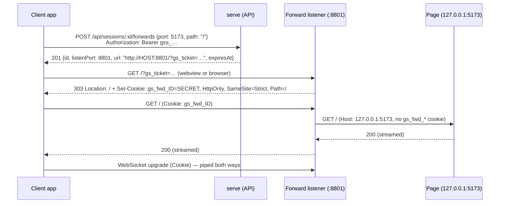
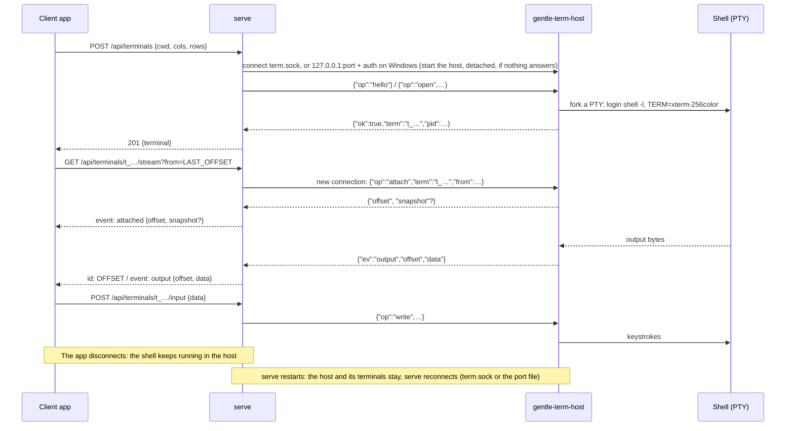

# `gentle-shell serve`

`gentle-shell serve` runs one long-lived server per agent home. The server owns Gentle Shell sessions — one `gentle-shell --mode rpc` process each, under a small keeper process — so they keep running when the client that started them disconnects, and when the server itself restarts or is upgraded; any paired device can follow and drive them over HTTP and Server-Sent Events (SSE). A device can also open web pages that live on the server's own loopback — the design canvas, a dev server the agent started, [Gentle Tower](#gentle-tower) — through [authenticated port forwards](#port-forwarding).

This is Phase 1 of [RFC #3527](https://github.com/Gentleman-Programming/gentle-shell/issues/3527), plus the `/.well-known/gentle-shell` identity, LAN discovery and `serve share` codes, and the pieces a remote client needs around sessions: [files](#files-on-the-server), [git](#git-on-the-server), [uploads](#uploads), [server-level forwards](#server-level-forwards-and-services) and [persistent terminals](#persistent-terminals) over a native terminal host. SSH bootstrap and TLS (Phase 3) and a mobile web client (Phase 4) are not part of it; see [Not done yet](#not-done-yet). To run it from a source checkout on a Linux machine and reach it from another one, see [Try it](#try-it-from-source-on-linux).

This page is the reference: commands, files, every endpoint, limits and troubleshooting. For the overview — what runs on the server and on each client, diagrams of pairing, sessions, host tools, forwards and terminals, and the security model in one place — read [Remote use](remote.md) first.

## Quick start: connect from Gentle Shell GPUI

On the computer where the agents should run (for example a Linux PC on your home network), run one command:

```sh
gentle-shell serve share
```

It prints a short code, and a long one under it:

```text
Started the Gentle Shell server for your network on port 8787.

  Code: 7PH3-DM9V

In Gentle Shell GPUI → Configuration → Where agents run → Gentle Shell server, enter this code. Valid for 5 minutes, once.
If the app can't find this computer, paste this instead:
gsc1.eyJ2IjoxLCJpZCI6InNydl8…

It uses plain HTTP on your network: share only on a network you trust, such as your home network.
```

Type the 8-character code in Gentle Shell GPUI on the other computer, in **Configuration → Where agents run → Gentle Shell server**: the app finds this computer on your network by itself ([LAN discovery](#lan-discovery)) and pairs. That is all: no SSH, IP addresses, ports or tunnels. When the app cannot find it — the computers are on different subnets, on a tailnet, or the Wi-Fi isolates clients — paste the long `gsc1.…` line in the same field instead. On Linux with a firewall, `share` also prints the command that opens the port (for example `sudo ufw allow 8787`, which covers both the HTTP connection and discovery). For another device, or when the code expired, run `serve share` again. `gentle-shell serve share --always` also starts the server at every login; `serve share --off` turns that off. Details: [Share on your network](#share-on-your-network). From a source checkout, run the checkout's launcher instead (`gsdev serve share`, see [Try it](#try-it-from-source-on-linux)).

## Quick start by hand

```sh
gentle-shell serve                 # start in the background; prints the URL
gentle-shell serve pair            # one-time code for a device (5 minutes, single use)
curl -X POST http://127.0.0.1:PORT/api/pair \
  -H 'Content-Type: application/json' -d '{"code":"ABCD-EFGH","name":"laptop"}'
# → {"id":"dev_…","name":"laptop","scopes":[…],"token":"gss_…"}   (the token is shown once)

curl -X POST http://127.0.0.1:PORT/api/sessions -H "Authorization: Bearer $TOKEN" \
  -H 'Content-Type: application/json' -d '{"cwd":"/path/to/project"}'
curl -X POST http://127.0.0.1:PORT/api/sessions/$SID/rpc -H "Authorization: Bearer $TOKEN" \
  -H 'Content-Type: application/json' -d '{"type":"get_state"}'
curl -N "http://127.0.0.1:PORT/api/sessions/$SID/events?after=0" -H "Authorization: Bearer $TOKEN"

gentle-shell serve status
gentle-shell serve stop            # stops the server; its sessions keep running for the next one (--sessions stops them too)
```

## Commands

| Command | Does |
| --- | --- |
| `gentle-shell serve share [--port <n>] [--always] [--json]` | Open the server to the local network (with [LAN discovery](#lan-discovery)) and print the short pairing code plus a [connection code](#connection-code) for Gentle Shell GPUI. See [Share on your network](#share-on-your-network). `--json` prints `{ code, pairingCode, port, addresses, expiresAt, serverId, discovery }` (`code` is the `gsc1.…` connection code, `pairingCode` the short one, `discovery` whether the server answers LAN discovery). |
| `gentle-shell serve share --off` | Remove the login autostart that `--always` installed (this stops the server it runs). |
| `gentle-shell serve [--listen <host>:<port>] [--allow-host <name>]... [--forward-ports <from>-<to>] [--foreground] [--json]` | Start the server. In the background by default (log in `serve/server.log`); `--foreground` keeps it in the terminal until Ctrl+C. `--listen` defaults to `127.0.0.1:0` (a random port); `:8787`, `8787` and `[::1]:8787` are accepted. `--allow-host` adds one DNS name clients may use in the `Host` header (repeatable; see [Security model](#security-model)). `--forward-ports` gives [port forwards](#port-forwarding) their listen ports from one range (at most 1000 ports), so a firewall can open it; without it each forward takes a random port. |
| `gentle-shell serve status [--json]` | URL, pid, start time, protocol and the session list. Exit 1 when no server runs. |
| `gentle-shell serve stop [--sessions]` | Asks the server to stop and waits for it to exit. Its sessions keep running and the next server reattaches them ([Sessions across server restarts](#sessions-across-server-restarts)); `--sessions` stops them first. |
| `gentle-shell serve pair [--scope <scope,…>] [--json]` | Mint a pairing code. Scopes default to `sessions:read,sessions:operate,terminal`. |
| `gentle-shell serve devices [--revoke <id>] [--json]` | List paired devices or revoke one. Works without a running server too (on the devices file). |

The home selectors work ahead of `serve` as they do for `setup`: `gentle-shell --home ~/work-agent serve` runs a separate server for that home, and its sessions run against that home.

## Share on your network

`serve share` is the one command a person runs to connect Gentle Shell GPUI on another computer of the same network:

- **No server yet:** it starts one in the background on every interface (`--listen 0.0.0.0:8787 --allow-host <hostname> --allow-host <hostname>.local --forward-ports 8800-8899`). When the port is taken it tries the next nine; `--port <n>` starts the search elsewhere. [Forwarded pages](#port-forwarding) take ports 8800-8899.
- **A server on this computer only (loopback):** with no running sessions it is stopped and started again on the network, transparently. With running sessions it is left alone: `share` explains in one line and exits 1 (stop them or run `serve stop` first).
- **A server already on the network:** reused as it is (on its own port).

Then it mints a pairing code (as `serve pair` does: default scopes, 5 minutes, single use) and prints it, followed by the [connection code](#connection-code) that carries it. The app takes either in the same field: the short code when it can [find the server on the network](#lan-discovery) by itself, the long one where discovery does not reach (another subnet, a tailnet, a Wi-Fi with client isolation). When the server could not open its UDP port, `share` says so in one line (discovery is off; the long code still works). On Linux, when `ufw` or `firewall-cmd` is installed, it also prints the exact command that opens the port for TCP and UDP and the forwarded pages' range for TCP (it never runs `sudo` itself), for example `sudo ufw allow 8787 && sudo ufw allow 8800:8899/tcp`. A server it reuses that was started by hand without `--forward-ports` gives forwarded pages random ports, which a firewall blocks; `share` then says how to restart it with the range.

The network server is plain HTTP, exactly as `--listen 0.0.0.0` (see [Security model](#security-model)): the pairing code, the device token and session traffic cross the network unencrypted. Share only on a network you trust; over the internet use the [SSH tunnel](#4-reach-it-from-the-mac) instead.

### LAN discovery

A server listening on a non-loopback address (`share`, or any `--listen` other than loopback) also binds UDP on `0.0.0.0:<its HTTP port>` and answers discovery queries. When that bind fails (the port is taken) the server logs `discovery off: …` and runs without it.

- **Query** (client → broadcast): `{"t":"gentle-shell/discover","v":1}`, sent from one ephemeral UDP socket to `255.255.255.255` and to each interface's directed broadcast address, on ports 8787-8796 (the ports `share` tries).
- **Reply** (server → unicast to the query's source address and port): `{"t":"gentle-shell/here","v":1,"id":"<serverId>","n":"<hostname>","p":<HTTP port>}`.

Anything else is ignored: datagrams over 512 bytes, other JSON, other `t` or `v`. Replies are rate-limited (20 per second overall, 4 per second per source address). They carry no secrets.

The client collects replies for about 1.5 s and, for each distinct one, checks `GET http://<reply source IP>:<p>/.well-known/gentle-shell` names the same `serverId`. With a short code it then pairs with `POST /api/pair { code, name }` at the only server verified, lets the person pick one (name and IP) when several answered, and when none did asks them to check that both computers are on the same Wi-Fi and the firewall allows the port (`sudo ufw allow 8787` opens TCP and UDP), or to paste the long code instead. The pairing code is never sent to an address whose identity did not match.

### Connection code

The fallback for when discovery cannot reach the server: `gsc1.` followed by the base64url (no padding) of one JSON object:

```json
{"v":1,"id":"srv_…","n":"linux-box","p":8787,"a":["192.168.1.20","100.101.102.103","linux-box","linux-box.local"],"c":"ABCD-EFGH"}
```

| Key | Value |
| --- | --- |
| `v` | `1` |
| `id` | The server's `serverId`. |
| `n` | The server machine's hostname, for display. |
| `p` | The port. |
| `a` | Addresses to try, best first, at most 8: the machine's IPv4 addresses except loopback and link-local (`169.254.x.x`) — private LAN ranges first, then others such as a tailnet's, then container and VM bridges (`docker0`, `virbr0`, …) — then its hostname and `<hostname>.local`. |
| `c` | The pairing code. |

The client probes `GET http://<address>:<p>/.well-known/gentle-shell` at every address in parallel (about 1.5 s each), keeps the first whose `serverId` equals `id`, pairs there with `POST /api/pair { code: c, name }`, and keeps that address as the server URL. It never sends the pairing code to an address whose identity did not match. The code is a secret while its pairing code is valid (5 minutes, single use); afterwards it only names the server and its addresses.

### Start at login

`serve share --always` hands the network server to the login service manager, so it starts at every login and restarts after a crash. The service runs the same launcher, the same home flags and the same `--listen`/`--allow-host` as `share` would, with `PATH` and the `GENTLE_SHELL_NO_AUTO_SETUP`, `GENTLE_SHELL_HOME`, `GENTLE_SHELL_CONFIG`, `GENTLE_PI_CONFIG_HOME`, `GENTLE_SHELL_PI` and `PI_CODING_AGENT_DIR` values of the invocation (when set), so a source checkout works too.

| System | What it writes and runs |
| --- | --- |
| Linux | `~/.config/systemd/user/gentle-shell-serve.service` (`$XDG_CONFIG_HOME` when set), then `systemctl --user daemon-reload` and `systemctl --user enable --now gentle-shell-serve.service`. Output goes to the journal (`journalctl --user -u gentle-shell-serve`). A user unit runs while you are logged in; `sudo loginctl enable-linger $USER` starts it at boot and keeps it after logout (`share` prints this). |
| macOS | `~/Library/LaunchAgents/com.gentle-shell.serve.plist`, then `launchctl bootstrap gui/$UID` on it. Output goes to `<home>/serve/server.log`. |
| Windows | Not supported yet: `--always` exits 1 before starting anything. |

A server already running is replaced by the service only when it has no running sessions (otherwise `--always` exits 1 and leaves it alone); one the service already runs is reused. `serve share --off` disables and removes the unit (`systemctl --user disable --now`) or boots out and removes the agent, which stops the server it ran. One autostart per user: `--always` from another home replaces it.

## Files

Everything lives in `<agent home>/serve/`, a `0700` folder:

| File | Content |
| --- | --- |
| `server.json` (`0600`) | `{ schema: "gentle-shell.serve.server/v1", protocol, serverId, url, listen, pid, startedAt, version, adminToken, discovery, forwardPorts? }`. Local clients discover the server here (`discovery`: whether it answers [LAN discovery](#lan-discovery); `forwardPorts`: `{ from, to }` when started with `--forward-ports`). Removed when the server stops. |
| `server-id` (`0600`) | The server's `serverId` (`srv_` and 16 hex digits), minted on the first run and kept: the id in `server.json`, `/.well-known/gentle-shell`, `GET /api/server`, discovery replies and connection codes stays the same across restarts and upgrades. Delete it to give the server a new identity. |
| `server.lock` (`0600`) | The pid holding the single-instance lock. A lock whose pid is gone is taken over. |
| `devices.json` (`0600`) | Paired devices: id, name, scopes, created and last-used times, and the **sha256 of the token** — never the token. |
| `server.log` (`0600`) | Background server log: lifecycle lines and each session's stderr while the server is attached, prefixed by session id. |
| `sessions/` (`0700`) | One [keeper](#sessions-across-server-restarts) per session: `<id>.json` (`0600`) is its record (`{ schema: "gentle-shell.serve.session/v1", id, cwd, startedAt, keeperPid, pid, token, state, exitCode, exitSignal, exitedAt, seq, error? }`), kept after the session exits so the next server lists it, removed when the session is deleted or forgotten; `<id>.sock` (`0600`) is the keeper's socket while it runs. |
| `uploads/<device>/<random>/<name>` (`0700` folders, `0600` files) | [Uploads](#uploads) from devices; each removed 7 days after it arrived. |
| `term.sock` (`0600`) | The [terminal host](#persistent-terminals)'s Unix socket, while it runs (not on Windows). |
| `term/` (`0700`) | The terminal host's state folder: its log, `term-host.log`; over TCP (Windows) also `term-host.json` (`0600`; on Windows a DACL for its owner only): `{ port, token, pid }`. |
| `terminals.json` (`0600`) | Which device opened each terminal: `{ schema: "gentle-shell.serve.terminals/v1", owners: { <term>: <device id> } }`. Terminals outlive the server, so their owners are kept on disk. |
| `bin/gentle-term-host` (`0755`) | A terminal host installed with `PUT /api/term-host`. |

`adminToken` is a fresh random token per server run. It is how `serve status`, `pair`, `devices` and `stop` talk to the server, so anyone who can read `server.json` (the owner) administers it.

## Process model

Each session is a Pi process run by this same launcher (`node bin/gentle-shell.mjs <home flags> --mode rpc [--session-id <id>]`, in the requested folder), so Pi is resolved exactly as a plain launch resolves it, with `GENTLE_SHELL_INTERACTIVE_HOST=1` (Desktop RPC and RPC dialogs on, as for Gentle Desktop) and `GENTLE_DESIGN_OPEN_BROWSER=0` (never a browser on the server machine). It is not the server's child: a small detached Node process, the session's **keeper**, starts it and owns its stdin and stdout, so the session outlives the server.

- The keeper reads Pi's stdout continuously, whoever is listening, numbers each record (`seq`), keeps the replay ring, the dialogs waiting for an answer and the host tool calls still open, and keeps Pi's stdin open for its whole life (closing it is Pi's shutdown request). The server is a client of the keeper and holds a copy of that state, which it serves to devices.
- A session ends only when it is deleted (`DELETE /api/sessions/:id`), when the server stops with `--sessions` (`POST /api/server/stop { endSessions: true }`), when Pi exits on its own, or when no server came back to it for 24 hours. Its exit is a record in its stream (`serve_session_exited`) and a state in the list. Up to 16 exited sessions stay listed (with their replay ring while this server holds it) until deleted.
- Stopping closes stdin and sends SIGTERM together (Pi treats them as one orderly shutdown request), then SIGKILL after 5 s; then the keeper exits.
- At most 16 sessions run at once.

### Sessions across server restarts

Stopping the server (`serve stop`, SIGTERM from a service manager, Ctrl+C on a foreground server) closes its connections to the keepers and leaves the sessions running. The next server — the same version or an upgrade — scans `<home>/serve/sessions/` and reattaches every keeper that answers before it serves requests:

- **Same ids, same `seq`.** A session keeps its id, and its `seq` continues where it was: what Pi printed while no server ran is in the keeper's replay ring. A client reconnects to `GET /api/sessions/:id/events?after=<last seq>` and gets exactly what it missed (or `snapshot-required` if the ring moved past it). `GET /api/server` lists the capability `persistent-sessions`.
- **Dialogs and host tool calls** still waiting are kept and re-sent to subscribers as before. The devices that registered host tools and which device drove the session last are kept with the keeper too; device streams are not, so a device owing a host tool call has 30 s after the restart to reconnect before the server answers the call for it ("isn't connected right now").
- **A session that ended meanwhile** is listed as exited with its exit code (from its record). A keeper whose Pi exited while no server ran waits 60 s for a server to collect the end of its stream, then exits. A keeper that is gone without recording an exit (killed, a reboot) is listed with `exitCode: null` and `error: "keeper_lost"` in its record; a server attached to it when that happens adds `serve_session_exited` with `"error":"keeper_lost"` to the stream.
- **Orphans.** A keeper with no server attached for 24 hours stops its session.
- **Security.** Each keeper listens on an owner-only Unix socket `<home>/serve/sessions/<id>.sock` (`0600`, in a `0700` folder; on Windows the named pipe `\\.\pipe\gentle-shell-serve-<user>-<id>`) and answers only a connection that first presents the session's random token from its record file (`0600`); one server at a time (a new one takes over).
- **What a restart loses:** requests in flight (they fail) and open event streams (clients reconnect with their last `id`); in-memory state of the old server such as forwards and Tower. A server started without a serve folder (only in tests) keeps its keepers in a private temporary folder and stops them when it stops.

## Protocol

`gentle-shell.serve/v1`, protocol `1`. JSON over HTTP for requests; SSE for each session's output. All errors are `{ "error": { "code", "message" } }`.

### Endpoints

| Method and path | Scope | Body → answer |
| --- | --- | --- |
| `GET /.well-known/gentle-shell` | none | `{ schema: "gentle-shell.serve.identity/v1", serverId, name, protocol, version }`: who answers at this address (`name` is the machine's hostname). No secrets; `Host` and `Origin` rules still apply. A client holding a [connection code](#connection-code) probes it before pairing. |
| `POST /api/pair` | none (the code) | `{ code, name? }` → `201 { id, name, scopes, createdAt, token }`. `403 invalid_code`, `429 rate_limited`, `409 too_many_devices`. |
| `GET /api/server` | `sessions:read` | `{ schema, protocol, serverId, version, startedAt, capabilities, device, platform, arch, pathSeparator, home? }`. `capabilities` includes `forwards`, `server-forwards`, `services`, `tower`, `files`, `git`, `uploads`, `print` ([one-shot prompts](#one-shot-prompts)), `persistent-sessions` ([sessions survive a server restart](#sessions-across-server-restarts)), and `terminals` when a [terminal host](#persistent-terminals) binary is there. `platform` and `arch` are Node's `process.platform` and `os.arch()` of the server (`darwin`/`linux`/`win32`, `arm64`/`x64`), `pathSeparator` its path separator (`/` or `\`), so a client builds server paths without guessing. `home` is the absolute home folder of the user the server runs as (a default folder for new sessions), only for a token with `sessions:operate`. |
| `POST /api/server/stop` | `admin` | `{ endSessions? }` → `202 { stopping: true, endSessions }`; the server exits. Its sessions keep running for the next server unless `endSessions` is `true`. |
| `POST /api/pairing-codes` | `admin` | `{ scopes? }` → `201 { code, scopes, expiresAt }` |
| `GET /api/devices` | `admin` | `{ devices: [{ id, name, scopes, createdAt, lastUsedAt? }] }` |
| `DELETE /api/devices/:id` | `admin` | `{ revoked }`. Immediate: the token stops working, its tickets die, its open streams close. |
| `POST /api/tickets` | `sessions:read` | `{ sessionId }` → `201 { ticket, expiresAt }` (see [Stream tickets](#stream-tickets)). |
| `GET /api/sessions` | `sessions:read` | `{ sessions: [Session] }` |
| `POST /api/sessions` | `sessions:operate` | `{ cwd, sessionId? }` → `201 { session }`. `cwd` must be an absolute path to an existing folder; `sessionId` is a Pi session id (`--session-id <id>`: the folder's session with that exact id, or a new one with it when Pi never wrote it, as for a conversation with no messages yet), never a path. `503 session_start_failed` when its keeper could not start. |
| `GET /api/sessions/:id` | `sessions:read` | `{ session }` |
| `DELETE /api/sessions/:id` | `sessions:operate` | Stops the session (waits for its exit) and forgets it: `{ session }`. |
| `POST /api/sessions/:id/rpc` | per command | One Pi RPC command object → its Pi `response`. |
| `POST /api/sessions/:id/desktop` | per method | `{ method, params? }` → the Desktop RPC response object. |
| `GET /api/sessions/:id/events?after=<seq>` | `sessions:read` | SSE stream (bearer header, or `?ticket=`). |
| `POST /api/sessions/:id/forwards` | `sessions:operate` | `{ port, path? }` → `201 Forward & { url, expiresAt }` (`200` when the device already had it). See [Port forwarding](#port-forwarding). |
| `GET /api/sessions/:id/forwards` | `sessions:read` | `{ forwards: [Forward] }`: the calling device's forwards for the session (an admin token sees every device's). |
| `DELETE /api/sessions/:id/forwards/:fid` | `sessions:operate` | `{ closed }`. Only the device's own (`404` otherwise). |
| `POST /api/forwards` | `sessions:operate` | `{ port, path? }` → `201 Forward & { url, expiresAt }` (`200` when the device already had it): a [server-level forward](#server-level-forwards-and-services), not tied to a session. |
| `GET /api/forwards` | `sessions:read` | `{ forwards: [Forward] }`: every forward the calling device owns, of any kind (an admin token sees every device's). |
| `DELETE /api/forwards/:fid` | `sessions:operate` | `{ closed }`. Any of the device's own forwards (`404` otherwise). |
| `GET /api/services` | `sessions:read` | `{ services: [Service] }`: local services worth forwarding. See [Server-level forwards and services](#server-level-forwards-and-services). |
| `GET /api/terminals` | `terminal` | `{ terminals: [Terminal] }`. See [Persistent terminals](#persistent-terminals). |
| `POST /api/terminals` | `terminal` | `{ cwd, cols, rows, argv?, env? }` → `201 { terminal }` |
| `POST /api/terminals/:t/input` | `terminal` | `{ data }` (base64) → `{ ok }` |
| `POST /api/terminals/:t/resize` | `terminal` | `{ cols, rows }` → `{ ok }` |
| `DELETE /api/terminals/:t` | `terminal` | `{ closed }` |
| `GET /api/terminals/:t/stream?from=<offset>` | `terminal` | SSE: `attached`, then `output`, `title`, `resized`, `exit`. |
| `GET /api/term-host` | `terminal` | `{ available, running, path?, version?, pid?, protocol?, platform, arch, asset, transport }` |
| `PUT /api/term-host` | `admin` | Raw binary, header `x-sha256` → `201 { path, sha256, size, active }` |
| `POST /api/tower` | `sessions:operate` | → `201 Forward & { url, expiresAt, started }` (`200` when the device already had a forward to Tower). Starts [Gentle Tower](#gentle-tower) when it is not running and forwards it. `501 not_supported` when this server cannot start Tower, `503 tower_unavailable` when it failed to. |
| `GET /api/tower` | `sessions:read` | `{ running: false }` or `{ running: true, startedAt }`. |
| `DELETE /api/tower` | `sessions:operate` | `{ stopped }`. Stops Tower and closes its forwards. |
| `GET /api/fs/list?path=` | `sessions:read` | `{ path, entries: [Entry], truncated }`. See [Files on the server](#files-on-the-server). |
| `GET /api/fs/stat?path=` | `sessions:read` | `Entry & { path, mode, etag?, linkTarget?, realPath? }` |
| `GET /api/fs/read?path=&offset=&length=` | `sessions:read` | The file's raw bytes. |
| `PUT /api/fs/write?path=[&create_only=1]` | `sessions:operate` | Raw body → `{ path, size, mtime, etag, created }`. |
| `POST /api/fs/mkdir` | `sessions:operate` | `{ path }` → `{ path, created }` |
| `POST /api/fs/rename` | `sessions:operate` | `{ from, to, overwrite? }` → `{ from, to }` |
| `POST /api/fs/remove` | `sessions:operate` | `{ path, recursive? }` → `{ removed }` |
| `GET /api/fs/search?root=&q=&limit=` | `sessions:read` | `{ root, results: [{ path, name, kind, score }], truncated }` |
| `GET /api/fs/watch?path=` | `sessions:read` | SSE stream of change batches. |
| `POST /api/git` | per command | `{ cwd, args, stdin?, env?, timeoutMs? }` → `{ code, signal, stdout, stderr, truncated, timedOut }`. See [git on the server](#git-on-the-server). |
| `POST /api/print` | `sessions:operate` | `{ cwd, prompt, model? }` → `{ text }`. See [One-shot prompts](#one-shot-prompts). |
| `POST /api/uploads?name=` | `sessions:operate` | Raw body → `201 { path, name, size, sha256, expiresAt }`. See [Uploads](#uploads). |

`Session` is `{ id, name, cwd?, state: "running"|"exited", startedAt, exitedAt?, exitCode?, exitSignal?, seq, subscribers, pendingDialogs, lastActiveDevice }`. `name` is the folder's basename; the absolute `cwd` is included only for a token with `sessions:operate` (which can start sessions in any folder anyway). `lastActiveDevice` is the id of the device that most recently drove the session (started it, or sent any request that needs `sessions:operate`: a prompt, a steer, a follow-up, a dialog answer, a host message, a Desktop write), or `null`.

### Pi RPC: `POST /api/sessions/:id/rpc`

The body is one [Pi RPC command](https://github.com/earendil-works/pi/blob/main/packages/coding-agent/docs/rpc-commands.md) (`{ "type": "get_state" }`, `{ "type": "prompt", "message": "…" }`, …). Several clients can share a session, so the server sends it under its own id (`serve-rpc-<run>-N`, unique per server run) and puts the client's `id` back on the response it returns. The same response also appears in the event stream, under the server's id.

- The server waits up to 30 s for the response. A command that takes longer (a long `bash`, `compact`) answers `202 { pending: true, id }`, and its response arrives in the stream under that `id`.
- `extension_ui_response` is the answer to a dialog: see [Dialogs](#dialogs). It answers `202 { accepted: true }`.
- Bodies are limited to 8 MiB (prompts can carry images).
- A `/gentle:desktop` prompt whose request is `set_host_tools`, `host_tool_result`, `host_tool_progress`, `host_message` or `set_host_context` is refused with `400 use_desktop_endpoint`: those go through `/desktop` only (see [Host tools](#host-tools)).

### Desktop RPC: `POST /api/sessions/:id/desktop`

A convenience over the existing [Desktop RPC](desktop-rpc.md) transport: the server sends the `/gentle:desktop` prompt with its own `requestId`, waits for the matching `gentle-desktop-rpc` widget answer, and returns it (`{ schema, kind: "response", requestId, ok, data | error }`; `requestId` is the server's, and any `schema` or `requestId` in the body is ignored). `504 desktop_timeout` after 30 s; `502 desktop_refused` (with Pi's prompt response) when the session refused the prompt. Bodies are limited to 80 KiB (Desktop RPC requests are limited to 64 KiB), except `set_host_tools`, `host_tool_result`, `host_message` and `set_host_context`, which may be up to 10 MiB less 1 KiB (a result can carry 8 MiB of screenshots and 1 MiB of details; the session caps each method at its own limit). Desktop RPC events keep arriving in the event stream as `setWidget` records, exactly as Desktop sees them. Sending `/gentle:desktop` prompts through `/rpc` also works for every other method; this endpoint only adds the correlation.

### Host tools

A client can provide [host tools](desktop-rpc.md#set_host_tools): tools the agent calls like any other but that run on the client's own device (a screenshot of the Mac, a photo from the phone). The agent runs here; the tool runs there. The server routes the calls:

- **The provider is the device.** `set_host_tools` and `set_host_context` through `/desktop` always register under the calling device's id (`provider` in the body is replaced), and need `sessions:operate`. The same requests through `/rpc` are refused, so no client can register tools or context as another device.
- **Messages.** [`host_message`](desktop-rpc.md#host_message) (a client's custom message into the conversation) goes through `/desktop` only too, with `sessions:operate`. [`set_host_context`](desktop-rpc.md#set_host_context) keeps one hidden context per device, added before each agent run until the device clears it or the session changes.
- **Only the provider answers.** A `host_tool_result` or `host_tool_progress` for a call whose `provider` is another device is refused with `403 forbidden`. The server remembers each call it saw in the session's output until a result settles it, a `host_tool_cancel` ends it, or 11 minutes pass since the call or its last accepted `host_tool_progress`.
- **One tool, several devices.** Devices may offer the same tool name (the Mac and the phone both offer `device_screenshot`). A call goes to the device that most recently drove the session (`lastActiveDevice`) if it offers the tool and has an open event stream; otherwise to the next most recently active one that does; when none does, it is answered at once as not connected. The server keeps the session told with [`set_host_activity`](desktop-rpc.md#set_host_activity) (connected providers, most recently active first) whenever that order changes; clients cannot send it (`403` through `/desktop`, `use_desktop_endpoint` through `/rpc`).
- **Delivery.** The `host_tool_call` event reaches every subscriber like any Desktop RPC event (`data.provider` says which device runs it; the others ignore it). A device that opens a stream while one of its calls is still waiting, and whose replay does not carry it, also gets it as an SSE event `event: host_tool_call` whose `data` is the original `setWidget` record.
- **Offline device: an answer at once.** If the call's device has no open event stream when the call appears, the server answers for it right away with an error result the model reads — `<tool> runs in <device name>, which isn't connected right now.` — instead of letting the turn wait. If a device's last stream closes while it owes results, the server waits 10 s for it to reconnect, then answers its waiting calls the same way. Revoking a device answers its calls at once.
- **Time limit.** The session itself ends a call after 10 minutes without a result, with an error result and a `host_tool_cancel`. A device still working on a call sends [`host_tool_progress`](desktop-rpc.md#host_tool_progress) through `/desktop` every 60 s (`sessions:operate`; a body up to 80 KiB like other Desktop requests); each one restarts the 10 minutes. A heartbeat is not activity: it does not change `lastActiveDevice` or which device gets the next call.

The server never runs client code: a host tool's work happens on the client, with the client's authority, and only its result comes back into the conversation.

### Event stream: `GET /api/sessions/:id/events`

Every record the child prints — Pi responses, session events, extension UI requests (including Desktop RPC answers and events) — gets the session's next `seq`, starting at 1. Each one is an SSE message with `id: <seq>` and the record, unchanged, as `data`:

```text
retry: 3000

event: hello
data: {"session":"ses_…","state":"running","seq":13,"oldest":1}

id: 1
data: {"type":"extension_ui_request","id":"…","method":"setStatus",…}

id: 2
data: {"type":"response","id":"serve-rpc-3f9a1c07-1","command":"get_state","success":true,"data":{…}}

: ping
```

Other SSE events, which carry no `id` (so they never move a client's cursor):

| Event | When |
| --- | --- |
| `hello` | First, on every connection: the session's state, current `seq` and oldest replayable `seq`. |
| `snapshot-required` | `after` is older than the replay ring (records the client never saw were evicted) or newer than the stream (a cursor from another session). `{ after, oldest, seq }`. The client recovers state with Pi `get_state` / `get_messages` and Desktop RPC `get_snapshot`, then follows the live stream that continues on the same connection. |
| `dialog` | A dialog still waiting for an answer that this connection's replay did not carry. `data` is the original `extension_ui_request`. |
| `host_tool_call` | To the device that provides it only: a host tool call still waiting for that device's result that this connection's replay did not carry. `data` is the original `setWidget` record. |
| `resync` | Sent as the stream is closed for falling behind: `{ reason: "slow_client", seq }`. Reconnect with the last `id` seen. |

The server also adds its own records to the stream (they have a `seq` like any other):

| Record | Meaning |
| --- | --- |
| `{"type":"serve_dialog_resolved","id"}` | A client answered this dialog; other clients can close it. |
| `{"type":"serve_session_exited","code","signal","error"?}` | Pi exited (`error`: `spawn_failed` when it could not start, `keeper_lost` when its keeper went away). The stream ends after it. |
| `{"type":"serve_record_dropped","reason":"too_large","maxBytes"}` | A stdout record over 16 MiB was dropped. |

`after` comes from the query, or from the `Last-Event-ID` header that `EventSource` sends on reconnect. Without it the stream starts live (plus the pending dialogs and the device's waiting host tool calls). An exited session replays and then ends the stream.

A comment line (`: ping`) is sent every 20 s so proxies do not close idle streams.

#### Replay and resume

Each session keeps a replay ring of its newest records: 2000 records or 8 MiB, whichever is reached first (the newest record is always kept). `after` inside the ring replays exactly what was missed; outside it the client gets `snapshot-required`. Sequence numbers belong to the session for its whole life, across [server restarts](#sessions-across-server-restarts).

#### Dialogs

`select`, `confirm`, `input` and `editor` requests stay pending until answered, until their own `timeout` passes, or until the session exits. A subscriber that connects later gets them as `dialog` events. Answer one with `POST /rpc` `{ "type": "extension_ui_response", "id": "<request id>", … }`: only the first answer reaches Pi; a later one gets `409 dialog_answered`, an unknown id `404 unknown_dialog`. The server then adds `serve_dialog_resolved` to the stream.

#### Backpressure

A slow client never slows a session. Pi's stdout is always read; each subscriber's unsent bytes are bounded (4 MiB). A subscriber over that bound is dropped: its stream ends with a `resync` event (and is cut 5 s later if it still is not reading), and it reconnects with its last `id`. Commands are refused with `503 session_busy` if Pi stops reading its stdin and 16 MiB pile up there.

#### Framing

Pi's stdout is split on LF only, with an optional CR before it stripped, never on U+2028/U+2029 (which are valid inside JSON strings, and which Node's `readline` would split on). A line that is not a JSON object is not forwarded, nor is a record whose `type` starts with `serve_` (those are the server side's own). Commands are written as one JSON object plus LF.

## Authentication

There is no unauthenticated mode: every endpoint except `GET /.well-known/gentle-shell` (public identity, no secrets) and `POST /api/pair` needs a token.

- **Pairing.** `gentle-shell serve pair` mints a code like `ABCD-EFGH` (40 random bits, Crockford base32; case, dashes and `O`/`I`/`L` look-alikes are forgiven). It is single use — the first attempt that names it consumes it — and expires after 5 minutes; at most 16 are live. Ten failed attempts in a minute, from anyone, pause pairing for the rest of that minute.
- **Device tokens.** `gss_` plus 32 random bytes (base64url). Shown once, in the pairing answer. Stored only as a sha256 hash; compared in constant time. Sent as `Authorization: Bearer <token>`. At most 64 devices.
- **Scopes.**
  - `sessions:read` — list and read sessions, follow their streams, mint stream tickets, read-only Pi RPC commands (`get_state`, `get_messages`, `get_available_models`, `get_available_thinking_levels`, `get_session_stats`, `get_fork_messages`, `get_entries`, `get_tree`, `get_last_assistant_text`, `get_commands`) and read-only Desktop RPC methods (`capabilities`, `get_*`, `list_*`).
  - `sessions:operate` — start and stop sessions, every other Pi RPC command (prompts, steering, aborts, bash, model changes, `extension_ui_response`), and every other Desktop RPC method; [file](#files-on-the-server) changes, [git](#git-on-the-server) operations, [uploads](#uploads) and [forwards](#port-forwarding). (`sessions:read` also reads files and runs read-only git commands.)
  - `terminal` — open, list, drive and close [persistent terminals](#persistent-terminals): a shell as the server user. In the default pairing scopes; `serve pair --scope sessions:read,sessions:operate` leaves it out. Devices paired before it existed do not have it: pair them again.
  - `admin` — pairing codes, devices, stopping the server, installing the terminal host; sees every device's forwards and terminals.

  Authorization is checked per request (per command or method for `/rpc` and `/desktop`), never per connection.
- **Revocation** (`serve devices --revoke`, or `DELETE /api/devices/:id`) takes effect at once: the token stops working, its stream tickets are discarded and its open streams are closed.
- **Local admin token.** The CLI uses the per-run token in the owner-only `server.json`; it has every scope.

### Stream tickets

Browsers' `EventSource` cannot send headers, and long-lived tokens never go in URLs. A client with a token calls `POST /api/tickets { sessionId }` and opens `GET /api/sessions/:id/events?ticket=<ticket>`. A ticket is valid for 60 s, for one connection, to that one session, with the scopes of the device that minted it. The events endpoint is the only one that accepts `?ticket=`.

## Port forwarding

A page that listens on the server's loopback — the design canvas (`127.0.0.1:<random>`), a dev server the agent started (`127.0.0.1:5173`), Gentle Tower — cannot be opened from another machine. A forward opens it there, for one paired device, without opening the port itself to anyone.

- **One listener per forward,** on the same address as the server (`--listen`): a loopback server makes loopback forwards (reach them through the same `ssh -L` tunnel, one per port), a network server makes network ones. Its own port, not a path prefix, so the page's absolute paths (`/assets/app.js`, `/@vite/client`) keep working. Ports come from `--forward-ports` when set (`share` uses 8800-8899), otherwise the OS picks one.
- **Only this machine's loopback.** A forward targets `127.0.0.1:<port>`, or `[::1]:<port>` when only IPv6 answers (a dev server bound to `localhost` on macOS). Never another host, never the server's own port or another forward's.
- **Per device, per session.** `POST /api/sessions/:id/forwards { port, path? }` opens one, or reuses the one the device already has for that session and port (a forward belongs to one session so that it closes with it; another device gets its own). Every call mints a fresh link.
- **Server-level forwards.** `POST /api/forwards { port, path? }` opens one that belongs to no session (`sessionId: null`, `kind: "server"`), for a page the server machine runs on its own — [Engram](#server-level-forwards-and-services), a database console. Same rules and answers as a session's; it closes on `DELETE`, when its device is revoked, after 12 idle hours, or when the server stops.



`Forward` is `{ id, port, listenPort, sessionId, kind, createdAt, lastUsedAt }`: `kind` is `"session"`, `"tower"` or `"server"`, and `sessionId` is `null` for Tower's and server-level ones. The answer to `POST` adds `url`, the link to open as it is — `http://<the host name the client used to reach the server>:<listenPort><path>?gs_ticket=<ticket>` (the ticket goes before any `#fragment` of `path`, after any query) — and `expiresAt`, when the ticket expires. `path` defaults to `/`; it must start with `/` (not `//`) and hold printable ASCII without spaces, at most 2048 characters.

Errors: `400 invalid_port` (not 1-65535, or the server's own port or a forward's), `400 invalid_path`, `404 not_found` (session), `409 session_exited`, `429 too_many_forwards`, `503 no_forward_port` (every port in the range is taken). Whether something listens on the port is not checked when the forward opens (the agent may start the server later): until it does, the forward answers `502` with a plain text line.

### Forward security

- **A ticket, then a cookie.** The link's `gs_ticket` is single use, valid 60 s, and bound to that forward and its device. The first request that carries it gets a `303` to the same URL without it and a cookie `gs_fwd_<forwardId>` (a fresh random secret, `HttpOnly; SameSite=Strict; Path=/`). Every later request, WebSockets included, needs that cookie; without it the answer is `401`. A link already used opens again only in a browser that holds the cookie; otherwise ask for a new one (`POST` again). Browsers share cookies across ports of a host, so each forward's cookie has its own name, and the proxy strips the ticket and every `gs_fwd_*` cookie before the page sees the request, and drops any `gs_fwd_*` cookie the page tries to set.
- **Host and Origin.** The `Host` header follows the [main server's rules](#security-model) for the forward's port (`421` otherwise). A request with an `Origin` other than the forward's own (`http://<Host>`) is refused with `403`: another forwarded page on the same host is the same site for `SameSite`, so it could otherwise send requests that carry the cookie. No CORS headers are added.
- **What the page sees.** `Host` is `127.0.0.1:<port>` (or `[::1]:<port>`); the forward's own `Origin` and `Referer` are rewritten to the page's own, so pages that check them (Gentle Tower, dev servers) accept the request. Other cookies of the host still reach the page (as they would for any page on that host). Redirects (`Location`) to the page's loopback address are rewritten to the forward. Hop-by-hop headers are dropped both ways.
- **Streaming.** Requests and responses are piped, never buffered: SSE, downloads and uploads stream. A WebSocket upgrade is handed to the page and the two sockets are piped both ways.
- **Closing.** A forward closes, with its open connections, when its session stops or is deleted (session forwards), when its device is revoked, on `DELETE`, when the server stops, and after 12 hours with no request and no open connection.
- **Same authority as the session.** A forward opens nothing the device could not already reach: `sessions:operate` can run `curl 127.0.0.1:<port>` in the session. It is plain HTTP on a network listen, like the rest of the server.

### Firewall

A network server's forwards listen on their own ports, so a firewall that allows only the server's port blocks them. Start the server with a range (`--forward-ports 8800-8899`; `serve share` does) and open it once: `sudo ufw allow 8800:8899/tcp`, or `sudo firewall-cmd --permanent --add-port=8800-8899/tcp && sudo firewall-cmd --reload`. Over an SSH tunnel, forward each forward's port too (`ssh -L 8800:127.0.0.1:8800 …`), with the same port on both ends.

### Server-level forwards and services

Some pages belong to the server machine rather than to a session. `GET /api/services` (`sessions:read`) lists the ones a client may want to open, so it can offer them without asking for a port:

```json
{ "services": [
  { "id": "engram", "name": "Engram", "url": "http://127.0.0.1:7437", "port": 7437, "available": true, "forwardable": true, "via": "forwards" },
  { "id": "tower", "name": "Gentle Tower", "port": 41234, "available": true, "forwardable": true, "via": "tower" }
] }
```

- **Engram** is always listed: at the server's `ENGRAM_URL`, or `http://127.0.0.1:7437`. `available` says whether `GET <url>/health` answered `2xx` within 1.5 s (credentials in `ENGRAM_URL` are sent as Basic auth and never shown). `forwardable` is `true` for a plain-HTTP loopback URL; then `via: "forwards"`: open it with `POST /api/forwards { port, path? }`. A remote or HTTPS Engram is listed with `forwardable: false` (the client reaches it directly, if at all).
- **Gentle Tower** is listed only while it runs, with `via: "tower"`: open it with `POST /api/tower` (which adds Tower's token path), never with `/api/forwards`.

`Service` is `{ id, name, url?, port, available, forwardable, via? }`.

## Gentle Tower

`POST /api/tower` (`sessions:operate`: Tower sends messages to sessions and opens new ones) starts Gentle Tower inside the server process when it is not running — the same server `gentle-shell tower` runs, on `127.0.0.1` with a fresh token, without a browser — and answers with a forward to it like `POST …/forwards` does, plus `started` (whether this call started it). The link's path is Tower's own token path (`/<token>/`), so Tower's own token check still applies behind the forward's. Every device gets its own forward to the one Tower. `GET /api/tower` says whether it runs; `DELETE /api/tower` stops it and closes its forwards; it also stops with the server.

- `503 tower_unavailable` with the reason when Tower cannot start (for example a source checkout whose web app is not built: `pnpm build:tower`).
- Tower shows the sessions of this machine (its hub is per user, not per agent home). Its "new floor" action opens a terminal window on the server machine, as it does locally.

## Files on the server

A client browses and edits files that live on the server — the project a session works in — through `/api/fs/*`. Every path is an **absolute path on the server** (`/home/you/project/src/main.rs`; on Windows `C:\…`), as a string of at most 4096 characters without NUL; relative paths answer `400 invalid_path`. Paths are normalized lexically (`a/../b` is `b`) before use. `GET /api/server` gives the server's `platform`, `pathSeparator` and (for `sessions:operate`) `home`.

`Entry` is `{ name, kind: "file"|"dir"|"symlink"|"other", size, mtime, linkKind? }`: `mtime` in milliseconds since the epoch, `size` in bytes, and for a symlink `linkKind` is what it points to (`"file"`, `"dir"`, `"other"`, or `null` when it dangles). `other` is a socket, FIFO or device.

| Endpoint | Behaviour |
| --- | --- |
| `list` | Every entry of the folder, hidden ones included, sorted by name (byte order). At most 5000; past that `truncated: true` (which 5000 is up to the file system). A symlinked folder is followed. |
| `stat` | `lstat` of the path: a symlink is reported as one, with `linkTarget` (the link's text), `linkKind`, and the `size` and `etag` of the file it points to. `realPath` is the path with every symlink resolved (absent when a link dangles). `mode` is the permission bits. |
| `read` | Up to 8 MiB from `offset` (default 0): `length` bytes, or as many as fit the cap and the file. `200 application/octet-stream` with `ETag`, `Last-Modified`, `X-File-Size`, `X-File-Mtime` (ms), `X-Offset` and `X-Truncated: 1` when bytes remain after this chunk. `If-None-Match: <etag>` or `If-Modified-Since` answer `304` when the file did not change. Follows symlinks; a folder or special file answers `400 not_a_file`. |
| `write` | The raw request body (at most 64 MiB) becomes the file's content, atomically: it is written to a temporary file in the same folder and renamed over the target, so a reader sees the old or the new content, never a mix. An existing file keeps its permission bits; a new one gets the default (`0666` less the server's umask). Writing through a symlink replaces the file it points to and keeps the link. `create_only=1` refuses an existing file (`409 exists`; exclusive even against a concurrent writer). `If-Match: <etag>` (from `stat`, `read` or a previous `write`) answers `412 changed` when the file changed since — a client's guard against overwriting someone else's edit. The folder must exist (`404`). `201` when it created the file, `200` otherwise. |
| `mkdir` | Creates the folder and any missing parent (`mkdir -p`). `201 { created: true }`, or `200 { created: false }` when it already existed. |
| `rename` | Moves `from` to `to` (a file, folder or symlink itself — never what a link points to). An existing `to` answers `409 exists` unless `overwrite: true` (a case-only rename of the same entry is not a clash). |
| `remove` | Removes a file or symlink (never what it points to), or a folder: an empty one, or with `recursive: true` everything in it (symlinks inside are removed, not followed). A non-empty folder without `recursive` answers `409 not_empty`. |
| `search` | File and folder names under `root` (an existing folder) matching `q` (1-256 characters, case-insensitive), best first: exact name, name prefix, name substring, relative-path substring (so `src/main` works), then the query's characters in order in the name. `limit` defaults to 100, at most 1000. Never enters `.git` or `node_modules`, nor follows symlinked folders. Looks at no more than 200 000 entries or 5 s; past that `truncated: true`. |
| `watch` | SSE: `event: ready` `{ path, recursive }`, then `event: changes` `{ paths: [<absolute path>…] }` whenever something under `path` changes (a file or a folder, recursively where the platform supports it: macOS, Windows and Linux). Changes are batched: a batch is sent 150 ms after the last change, and at most 1 s after the first. A batch over 1000 paths is sent as `{ paths: [], overflow: true }` (rescan). It says *what* changed, not how: `stat` the paths. `event: error` `{ message }` ends the stream when the watch fails (for example the Linux inotify limit). `: ping` every 20 s. At most 32 open per device (`429 too_many_watchers`). |

Errors are mapped from the file system: `404 not_found`, `400 not_a_directory`, `400 is_a_directory`, `400 not_a_file`, `403 permission_denied` (the server user may not), `409 exists`, `409 not_empty`, `409 cross_device` (a rename across volumes), `409 dangling_symlink` (a write through a link to nothing), `413 too_large`, `507 no_space`.

### File safety

- **The server user's authority.** These endpoints run as the user the server runs as, with no folder jail: `sessions:read` can read every file that user can read, and `sessions:operate` can change every file that user can change — the same authority a session's own tools (`bash`, `write`) already have. Pair devices accordingly.
- **Refused targets.** `remove` and `rename` refuse (`403 protected_path`) the file system root, the server user's home folder, and every folder above the home. The check runs on the entry itself with its folder's symlinks resolved, so `/home/you/link-to-root/home` is refused like `/home`, while removing `/home/you/link-to-home` removes only the link.
- **No partial writes.** A write that fails, is cut short or is too large leaves the target untouched and removes its temporary file.

## git on the server

`POST /api/git` runs one `git` command in a folder on the server and answers when it ends, so a client shows and drives a repository that lives there (status, diffs, staging, commits, branches, fetch and push).

```json
{ "cwd": "/home/you/project", "args": ["status", "--porcelain=v2", "-z"], "stdin": "<base64>", "env": { "GIT_AUTHOR_NAME": "…" }, "timeoutMs": 120000 }
```

- **No shell.** `git` (from the server's `PATH`) runs with `args` as its arguments, in `cwd` (an absolute path to an existing folder, symlinks resolved), in its own process group without a controlling terminal. `args`: 1-256 strings without NUL, each at most 32 KiB. `stdin` (base64, at most 8 MiB) is written to its standard input, which is then closed; without it standard input is empty.
- **Answer.** `200 { code, signal, stdout, stderr, truncated, timedOut }` whatever the exit code: `code` is git's exit code (`null` when a signal ended it), `stdout` and `stderr` are base64. `stdout` is cut at 32 MiB — git is then stopped and `truncated` is `true` — and `stderr` at 1 MiB. `501 git_missing` when the server has no `git`.
- **Nobody to ask.** The environment is the server's, without inherited `GIT_DIR`, `GIT_WORK_TREE`, `GIT_INDEX_FILE` and the like, plus `GIT_TERMINAL_PROMPT=0` and `GCM_INTERACTIVE=never` (a credential prompt fails instead of waiting), `GIT_PAGER=cat`, `GIT_EDITOR=true` (a commit without `-m` aborts; a rebase takes its todo as is) and `GIT_MERGE_AUTOEDIT=no`; read-only commands also get `GIT_OPTIONAL_LOCKS=0` (they never write the index). `env` may add only: `GIT_AUTHOR_NAME`, `GIT_AUTHOR_EMAIL`, `GIT_AUTHOR_DATE`, `GIT_COMMITTER_NAME`, `GIT_COMMITTER_EMAIL`, `GIT_COMMITTER_DATE`, `GIT_DIR`, `GIT_WORK_TREE`, `GIT_INDEX_FILE`, `GIT_NAMESPACE`, `GIT_LITERAL_PATHSPECS`, `GIT_GLOB_PATHSPECS`, `GIT_NOGLOB_PATHSPECS`, `GIT_ICASE_PATHSPECS`, `GIT_REFLOG_ACTION`, `GIT_MERGE_AUTOEDIT`, `GIT_MERGE_VERBOSITY`, `GIT_OPTIONAL_LOCKS` (any other name: `400 env_not_allowed`). SSH keys, agents and credential helpers are the server user's own.
- **Time.** 120 s by default; `timeoutMs` (1000 or more) may lower it, or raise it up to 600 s for `fetch`, `push`, `clone`, `pull`, `ls-remote` and `submodule` (`400 invalid_timeout` otherwise). At the limit git's process group gets SIGTERM, then SIGKILL 2 s later, and the answer has `timedOut: true`. At most 16 commands run at once (`429 too_many_git`); the server's stop ends them.

### git scopes and refusals

A command that only reads needs `sessions:read`; anything else needs `sessions:operate`. The subcommand is the first argument after git's global options (`-C <dir>`, `--no-pager`, `--git-dir=…`, …). Reads are:

- `status`, `diff`, `log`, `show`, `rev-parse`, `ls-files`, `for-each-ref`, `cat-file`, `ls-tree`, `rev-list`, `merge-base`, `blame`, `describe`, `shortlog`, `name-rev`, `check-ignore`, `check-attr`, `grep`, `show-ref`, `diff-tree`, `diff-files`, `diff-index`, `count-objects`, `version`, `ls-remote`, and git with no subcommand (`--version`) — unless they carry `--output` (writes a file) or, for `grep`, `-O`/`--open-files-in-pager` (runs a program);
- `branch` and `tag` listing (no name, or `--list`/`-l`, `--contains`, `--merged`, `--points-at`, `--show-current`, …, and no flag that creates, deletes, moves or signs); `config --get`/`--get-all`/`--get-regexp`/`--get-urlmatch`/`--list` and `config get`/`config list`; `remote` with no subcommand, `remote get-url` and `remote show`; `stash list`/`show`; `worktree list`; `symbolic-ref` with one name.

Any `-c`/`--config-env` override makes a command an operation (configuration can make a read run a program). Some configuration and options are refused outright with `400 git_refused`, whatever the scope, because they make git run another program: the keys `core.sshCommand`, `core.fsmonitor`, `core.hooksPath`, `core.gitProxy`, `uploadpack.*`, `alias.*`, `remote.<name>.uploadpack`, `remote.<name>.receivepack` and `protocol.ext.allow` (in `-c`, `--config-env`, and `clone -c`/`--config`); `--exec-path=<dir>`; `--upload-pack`, `--receive-pack` and `--exec` (and `-u` for `clone` and `ls-remote`). Arguments after `--` are paths and never checked as options.

This is defence in depth, not a sandbox: `sessions:operate` is the server user's authority (it can already write `.git/config` through the file endpoints or a session's tools), so the refusals only keep the convenient injection routes closed and keep `sessions:read` from becoming command execution.

## One-shot prompts

`POST /api/print` answers one prompt with this machine's Gentle Shell and nothing else — no session, no tools — so a client writes a commit message (or a title) for a folder that lives on the server, exactly as it does with its own local Gentle Shell.

```json
{ "cwd": "/home/you/project", "prompt": "Write a git commit message for …", "model": "anthropic/claude-sonnet-4-5" }
```

- **What runs.** The same launcher and agent home as the sessions, the way the app runs it locally: `node bin/gentle-shell.mjs <home flags> --print --no-session --no-tools [--model <model>]`, in `cwd` (an absolute path to an existing folder), in its own process group, with the sessions' environment but without `GENTLE_SHELL_INTERACTIVE_HOST` (nothing answers dialogs in a one-shot run). The prompt goes on standard input (Pi takes piped input as the message), so it never shows in the process list. `prompt`: a non-empty string of at most 256 KiB. `model` (optional) is passed as `--model` (Pi's pattern: `provider/id` or `id`, optionally `:<thinking>`): at most 200 characters, no spaces or control characters, not starting with `-`.
- **Answer.** `200 { text }`: the run's standard output as it printed it. `502 print_failed` when it exits with an error (or cannot start): `message` is the end of its stderr (2000 characters), and the answer also carries `exitCode`. `502 output_too_large` past 1 MiB of output, `504 print_timeout` after 120 s; both stop the run (SIGTERM to its process group, SIGKILL 2 s later), and so does a client that hangs up. `400 invalid_cwd`, `invalid_prompt`, `invalid_model`; `429 too_many_prints` with 4 already running; `501 not_supported` on a server built without a launcher (no `print` capability).

## Uploads

A client that wants the agent to see a file from its own machine — a chat attachment, a screenshot, a log — sends it with `POST /api/uploads?name=<file name>` (the raw bytes as the body, at most 64 MiB, `sessions:operate`) and puts the answered `path` in the prompt.

- It is stored at `<agent home>/serve/uploads/<device id>/<16 random hex>/<name>`: owner-only (`0700` folders, `0600` file), one fresh folder per upload so names never clash. `name` keeps only its last path component, with control characters and `<>:"|?*` replaced by `_`, at most 200 UTF-8 bytes (`upload` when nothing is left).
- The answer is `201 { path, name, size, sha256, expiresAt }`. A refused or cut-short upload leaves nothing behind.
- Uploads are removed 7 days after they arrived (checked at start and hourly). They are plain files: the agent reads them with its own tools, and a client can also read them back through [`/api/fs/read`](#files-on-the-server).

## Persistent terminals

A device can open real terminals on the server — a shell in the project folder — that keep running when it disconnects, when another device takes over, and when `serve` itself restarts. The PTYs live in a separate native process, `gentle-term-host`; `serve` is only a client of it.



### The host

- **Where it comes from.** `serve` runs `$GENTLE_TERM_HOST` when set, otherwise `<agent home>/serve/bin/gentle-term-host` (`.exe` on Windows), otherwise the first `gentle-term-host` on `PATH`. Without one, `GET /api/server` has no `terminals` capability and the terminal endpoints answer `501 term_host_missing`. A client can install one: `PUT /api/term-host` (`admin`) with the binary as the raw body (at most 64 MiB) and its sha256 in the `x-sha256` header; the server checks the hash (`400 sha256_mismatch`), makes it `0755`, and moves it into place atomically (on Windows, where a running `.exe` can't be replaced, the old one is renamed aside to `*.old` and removed by a later install). `active` in the answer says whether it is the one `serve` now uses (`false` when `$GENTLE_TERM_HOST` points elsewhere). `GET /api/term-host` tells `platform`, `arch` and `asset`: the name of the prebuilt binary for this server in Gentle Shell GPUI's GitHub releases (`gentle-term-host-<os>-<arch>[.exe]`, os `linux`/`macos`/`windows`, arch `x64`/`arm64`; `null` when none is built for it, e.g. Windows on arm64), listed in the release's `SHA256SUMS`, so a client downloads it, checks it and installs it. A host already running keeps running its old binary until it exits.
- **Started on first use.** The first terminal request connects to `<agent home>/serve/term.sock`; when nothing answers there, `serve` starts the host detached (`--socket <home>/serve/term.sock --state-dir <home>/serve/term`, its own session, output appended to `term/term-host.log`) and waits up to 5 s for its socket. A host that is already running — started by an earlier `serve` — is simply reused. The socket is owner-only (`0600`, in the `0700` serve folder).
- **On Windows: loopback TCP.** There `serve` starts the host with `--tcp --state-dir <home>/serve/term` (`transport: "tcp"` in `GET /api/term-host`; `GENTLE_TERM_HOST_TRANSPORT=tcp` picks it on Linux and macOS too). The host listens on `127.0.0.1` at a port the system picks and writes `{ port, token, pid }` to `term/term-host.json`, readable only by the server user (a protected DACL for the file's owner). Every connection's first line must be `{"op":"auth","token":…}` (answered `{ ok: true }`); anything else gets `unauthorized` and the connection closes, as it does after 10 s without it. A port file whose port refuses the connection (or the token) is left from a host that died: `serve` removes it and starts another. The host compares tokens in constant time; other local users can reach the port but not the token.
- **Lifetime.** The host keeps every terminal while no client is connected and outlives `serve`: stopping or restarting `serve` closes its connections, never the terminals. The host exits on its own when it has had no terminals and no connections for 10 minutes. A host restart (a reboot, a crash) loses its terminals.
- **Protocol.** JSON Lines over the socket, one request `{ id, op, … }` → one reply `{ id, ok, … }`, plus events (`output`, `exit`, `title`, `resized`, `overflow`) on connections attached to a terminal; terminal bytes travel as base64. `serve` keeps one control connection and opens one more per stream.

### Terminal endpoints

`Terminal` is `{ id, pid, cwd, argv, cols, rows, title, alive, exitCode?, createdAt, offset, owner }`: `createdAt` in ms since the epoch, `offset` the number of bytes the terminal has written so far, `owner` the id of the device that opened it.

- **Open.** `POST /api/terminals { cwd, cols, rows, argv?, env? }`: `cwd` an absolute path to an existing folder, `cols` 1-1000, `rows` 1-500; `argv` (1-256 strings) defaults to the server user's login shell with `-l` (on Windows PowerShell: `pwsh.exe -NoLogo` when `pwsh.exe` is on `PATH`, else `powershell.exe -NoLogo`; the PTY is a ConPTY); `env` (at most 128 names) is added to the host's environment, which also sets `TERM=xterm-256color`, `COLORTERM=truecolor` and `TERM_PROGRAM=GentleShell`. `502 term_spawn_failed` when the program cannot start.
- **Ownership.** A terminal belongs to the device that opened it: the list shows a device its own, and every other endpoint answers `404` for another device's terminal. A token with `admin` sees and drives all of them. Revoking a device closes its terminals and ends its streams.
- **Input and resize.** `POST …/input { data }` writes base64 bytes as typed (keys, pastes, and the answers a terminal emulator gives to queries such as cursor position reports). `POST …/resize { cols, rows }`. Both answer `409 terminal_exited` once the program ended.
- **Close.** `DELETE /api/terminals/:t` closes a running terminal (SIGHUP, then SIGKILL to its process group after 3 s; on Windows the program is ended at once and closing its pseudoconsole ends what else ran in it; it leaves the list at once) or forgets an exited one.
- **Stream.** `GET …/stream?from=<offset>` (or `Last-Event-ID`, as `EventSource` sends it) is SSE:
  - first `event: attached` `{ offset, snapshot? }`. When `from` is still in the terminal's replay buffer (at least the last 1 MiB of output), there is no snapshot: `offset` is `from` and the missed bytes follow as `output`. Otherwise `snapshot` (base64) is an ANSI sequence that, written into a fresh terminal emulator of the terminal's size, reproduces its screen — contents, cursor, colours and attributes, alternate screen, cursor visibility, bracketed paste, mouse and application-cursor modes — with up to 2000 lines of scrollback above it; `offset` is the current end. A client resets its emulator, writes the snapshot, and continues.
  - `event: output` `{ offset, data }` with `id: <offset>`: `data` is base64 terminal output and `offset` the byte offset of the end of this chunk, so the last `id` seen is the `from` to resume with.
  - `event: title` `{ title }`, `event: resized` `{ cols, rows }` (whoever resized it).
  - `event: exit` `{ code }`: the program ended; the stream ends after it. Attaching to an exited terminal gives its final snapshot and `exit` at once.
  - `event: overflow` `{ reason }`: this stream fell behind (8 MiB unsent, at the host or here) and ends; reconnect, without `from` if it is no longer in the buffer.
  - `event: error` `{ code: "term_host_gone" }` when the host went away. `: ping` every 20 s.

  Every stream is its own attachment, so several devices (or windows) can follow the same terminal; each needs its own `GET`.

### Terminal security

- **A terminal is a shell as the server user.** The `terminal` scope is that authority, separately from `sessions:operate` so a device can drive sessions without opening shells. The server adds no sandbox.
- **Owner-only socket.** Only the server user can connect to the host; the host never listens on the network. Remote devices reach terminals only through `serve`'s authenticated endpoints.
- **Installing the host** needs `admin`, and the hash the client sent must match the bytes received; it is the same trust as an admin token already has (it could start sessions that run anything).

## Security model

- **Loopback by default.** Without `--listen` the server binds `127.0.0.1` on a random port. Remote use goes through `ssh -L` (or a tunnel) to that port.
- **Plain HTTP on a network is an explicit choice.** A non-loopback `--listen` (for example `0.0.0.0:8787`) starts only because device auth is always on, and prints a warning: tokens and session traffic then cross the network unencrypted. Use it on a network you trust (a home LAN, a tailnet).
- **LAN discovery reveals presence only.** A network server answers the UDP [discovery query](#lan-discovery) of anyone on the network with its `serverId`, hostname and port — what `/.well-known/gentle-shell` already tells — and nothing else; replies are rate-limited and go only to the sender (a reply is about the size of the query, so it cannot amplify traffic). A loopback server does not listen for discovery.
- **Origin and Host.** A request whose `Origin` is not this server's own origin (`http://<Host>`) is refused (`403 forbidden_origin`), before authentication, including `POST /api/pair`. Requests without `Origin` (curl, native clients) are accepted; tokens are never cookies, so a browser cannot attach them on another page's behalf. The `Host` header must name this server and its port (`421 bad_host`): loopback names for a loopback bind, the bound address otherwise, and for `0.0.0.0`/`::` any IP literal or this machine's own hostname (also as `<hostname>.local`) — never another DNS name (DNS rebinding). A name the operator trusts, such as a tailnet MagicDNS name (`box.tail1234.ts.net`), is added with `--allow-host <name>`; it is an exact name, never a pattern. No CORS headers are sent.
- **Headers.** `Cache-Control: no-store`, `Content-Security-Policy: default-src 'none'; frame-ancestors 'none'`, `X-Content-Type-Options: nosniff`, `Referrer-Policy: no-referrer`.
- **Bounded input.** 16 KiB for small JSON bodies, 80 KiB for Desktop RPC (10 MiB for host tool registrations, results, messages and context), 8 MiB for Pi RPC commands, 64 MiB for a file write; 20 s to send headers.
- **Host tools run on the client.** A device's host tools run on that device with its own authority; the server and the agent only see the call's arguments and the result. A device can only register tools as itself and answer its own calls.
- **Remote authority never exceeds the terminal's.** `sessions:operate` is the same authority as typing into the session's terminal or writing the Desktop app's RPC stdin — including `/gentle:mode`, `set_permission_mode` and the rest of the [Desktop RPC trust boundary](desktop-rpc.md#trust-boundary). The server forwards to Pi unchanged and bypasses none of the existing rules: remote prompts are not interactive consent, provider consent stays terminal-only, and Desktop RPC's own checks apply inside the child. Pair `sessions:operate` only with devices you would hand your terminal; `sessions:read` follows without driving.

## Limits

| Limit | Value |
| --- | --- |
| Running sessions | 16 (`429 too_many_sessions`) |
| Exited sessions kept | 16 |
| Session with no server attached | 24 hours, then stopped; an exited one waits 60 s for a server to collect its stream |
| Host tool call after a server restart | 30 s for its device to reconnect |
| Replay ring per session | 2000 records or 8 MiB |
| Unsent bytes per subscriber | 4 MiB, then `resync` |
| One stdout record | 16 MiB, then `serve_record_dropped` |
| Pending stdin per session | 16 MiB, then `503 session_busy` |
| `/rpc` and `/desktop` wait | 30 s (`202 pending` / `504 desktop_timeout`) |
| Host tool call, device offline | answered at once; 10 s grace after its last stream closes |
| Host tool call, no result | 10 minutes, restarted by each `host_tool_progress` |
| Heartbeat | 20 s |
| Pairing code | 5 minutes, single use, 16 live, 10 failures per minute |
| Stream ticket | 60 s, single use, 256 live |
| Devices | 64 |
| LAN discovery replies | 20 per second overall, 4 per second per source address; queries over 512 bytes dropped |
| Forwards | 32 open at once; 64 connections each |
| Forward ticket | 60 s, single use, 256 live |
| Forward browser sessions | 32 cookies per forward (the oldest is dropped) |
| Forward idle | 12 hours with no request and no open connection |
| Forward connect to the page | 10 s, then `502` |
| File read | 8 MiB per call |
| File write | 64 MiB per call |
| Folder list | 5000 entries, then `truncated` |
| File search | 1000 results; 200 000 entries or 5 s walked, then `truncated` |
| Change streams | 32 per device; batches after 150 ms quiet, at most 1 s late, 1000 paths |
| git command | 120 s (600 s for network commands); 32 MiB stdout, 1 MiB stderr, 8 MiB stdin; 16 at once |
| One-shot prompt | 120 s; 256 KiB prompt, 1 MiB answer; 4 at once |
| Upload | 64 MiB; kept 7 days |
| Terminals | `cols` 1-1000, `rows` 1-500; input 4 MiB per request; replay buffer at least 1 MiB per terminal; 8 MiB unsent per stream, then `overflow`; host start 5 s; host request 10 s |
| Terminal host binary | 64 MiB |

## Try it from source on Linux

A walkthrough for running this branch on a Linux machine (written for Arch / Omarchy; other distributions differ only in package names) and reaching it from another machine, for example a Mac. No released Gentle Shell has `serve` yet: the installed `gentle-shell` takes `serve` as a prompt for the model, so every command below runs the checkout's launcher.

### 1. Install the checkout

Requirements: `git`, Node `^22.19.0 || >=23.6.0` (`package.json` `engines`), and corepack to get the pinned pnpm (`packageManager`: `pnpm@11.1.1`). Node 22 and 24 ship corepack; Node 25 and later do not, so install it with `npm install -g corepack` (with `sudo` for a system Node from pacman; not with mise).

```sh
sudo pacman -S --needed git nodejs npm      # or: mise use -g node@22
git clone -b feat/serve-phase1 https://github.com/ismaelosuna7824/gentle-shell.git ~/src/gentle-shell
cd ~/src/gentle-shell
corepack pnpm install
```

`pnpm install` installs the dependencies (Pi included, in `node_modules`) and its `postinstall` downloads the pinned Gentle AI release binary, verified against its signed checksums, into `.gentle-ai/v<version>/` inside the checkout. It writes nothing in your home (a git checkout is not a Pi-managed install, so the global Pi settings are not touched).

A shell function keeps the commands short:

```sh
gsdev() { GENTLE_SHELL_NO_AUTO_SETUP=1 node ~/src/gentle-shell/bin/gentle-shell.mjs "$@"; }
```

### 2. Choose the agent home

The checkout resolves its home exactly as the installed `gentle-shell` does: `--link`, `--isolated` or `--home <dir>` when given, otherwise the home saved in `~/.gentle-shell/config.json`, otherwise `~/.gentle-shell/agent` (or `$GENTLE_SHELL_HOME`). So with no flags it uses the same home as your installed Gentle Shell, with its sign-ins (`auth.json`), providers and settings. Compare the `home` line of both:

```sh
gentle-shell --version     # the installed one
gsdev --version            # the checkout; prints nothing new on disk
```

- **Reuse your providers (recommended):** run `gsdev serve …` with the same home selector you use day to day (none, or `--link` if you launch `gentle-shell --link`). `serve` itself writes only `<home>/serve/`. Its sessions are ordinary launches of the checkout in that home, so they also read and write the home's sessions and settings, as any Gentle Shell launch does. `GENTLE_SHELL_NO_AUTO_SETUP=1` (in `gsdev`) keeps those launches from re-running setup in the home when the checkout's version differs from the one that set the home up, so the companion packages stay as your installed Gentle Shell left them. The installed Gentle Shell keeps working alongside; the two never share a process.
- **Fully separate:** `gsdev --home ~/.gentle-shell-serve serve …` uses a new home. Copy your sign-ins into it if you want them (`install -m 600 ~/.gentle-shell/agent/auth.json ~/.gentle-shell-serve/`); without `GENTLE_SHELL_NO_AUTO_SETUP=1` its first session installs the companion packages there.

Sessions use the checkout's Pi (`node_modules`), not the installed one's.

### 3. Start, check, stop

```sh
gsdev serve --listen 127.0.0.1:8787   # starts in the background, prints the URL and the log path
gsdev serve status                    # URL, pid, sessions
gsdev serve pair                      # one-time code (5 minutes, single use)
gsdev serve devices                   # paired devices; --revoke <id> removes one
gsdev serve stop                      # stops the server; sessions keep running (--sessions stops them too)
```

The log is `<home>/serve/server.log` (rewritten on each start). Gentle Shell never launches the server on its own: once started it runs until `serve stop`, a reboot, or its process is killed. Sessions run on the Linux machine, so their `cwd` is a path there.

`gsdev serve share --always` writes and enables a systemd user unit for the network server ([Start at login](#start-at-login)). To keep a loopback-only server for the SSH tunnel instead, write the unit by hand (same file name, so use one or the other); it runs the server in the foreground and its output goes to the journal instead of `server.log`:

```sh
mkdir -p ~/.config/systemd/user
cat > ~/.config/systemd/user/gentle-shell-serve.service <<EOF
[Unit]
Description=Gentle Shell serve (source checkout)

[Service]
Type=simple
Environment=PATH=$PATH
Environment=GENTLE_SHELL_NO_AUTO_SETUP=1
ExecStart=$(command -v node) %h/src/gentle-shell/bin/gentle-shell.mjs serve --foreground --listen 127.0.0.1:8787
Restart=on-failure
RestartSec=5
TimeoutStopSec=30

[Install]
WantedBy=default.target
EOF
systemctl --user daemon-reload
systemctl --user enable --now gentle-shell-serve
journalctl --user -u gentle-shell-serve -f
```

The heredoc writes your current `PATH` and `node` into the unit (a user service does not read your shell profile; sessions' tools need the `PATH`). Add your home selector before `serve` if you use one. `systemctl --user stop gentle-shell-serve` stops it in order (SIGTERM); `gsdev serve stop` also works and is not restarted. A user unit runs while you are logged in; `sudo loginctl enable-linger $USER` starts it at boot and keeps it running after you log out.

### 4. Reach it from the Mac

**Easiest: `serve share`.** `gsdev serve share` on the Linux machine, then enter the short code it prints in Gentle Shell GPUI on the Mac, or paste the long `gsc1.…` code when the app cannot find the Linux machine ([Quick start](#quick-start-connect-from-gentle-shell-gpui)). It is option (b) below, plain HTTP on your network, without typing addresses. The rest of this step is the manual way.

**(a) SSH tunnel (recommended).** The server stays on loopback and SSH encrypts everything. It needs `sshd` on the Linux machine (`sudo systemctl enable --now sshd`). On the Mac:

```sh
ssh -N -L 8787:127.0.0.1:8787 you@linux-box
```

The client then uses `http://127.0.0.1:8787`. Keep the **same port on both ends**: the client's `Host` header carries the Mac's local port, and the server accepts only its own (`-L 9000:127.0.0.1:8787` is refused with `421 bad_host`). The tunnel works over a LAN or a tailnet (`you@linux-box` can be a Tailscale name).

**(b) LAN or Tailscale, plain HTTP.** Bind every interface:

```sh
gsdev serve --listen 0.0.0.0:8787
```

It prints a warning: device tokens and session traffic cross the network unencrypted, so use it only on a network you trust (a tailnet encrypts at its own layer). Clients may use, in the URL:

- an IP literal: `http://192.168.1.20:8787`, or the Tailscale IP `http://100.x.y.z:8787` (`tailscale ip -4`);
- the machine's own hostname (`uname -n`), alone or with `.local`: `http://linux-box:8787` — also a tailnet's short MagicDNS name when it equals the hostname;
- any other DNS name only when allowed by name. A full MagicDNS name such as `linux-box.tail1234.ts.net` is refused (`421 bad_host`) unless the server is started with it:

  ```sh
  gsdev serve --listen 0.0.0.0:8787 --allow-host linux-box.tail1234.ts.net
  ```

Binding a single address (`--listen 100.x.y.z:8787`) accepts only that address in `Host`. If `ufw` is enabled (Omarchy enables it; check `sudo ufw status`), open the port to the network you use, for example `sudo ufw allow in on tailscale0 to any port 8787 proto tcp` or `sudo ufw allow from 192.168.1.0/24 to any port 8787` (TCP and UDP: UDP carries [LAN discovery](#lan-discovery)). The SSH tunnel needs no rule beyond SSH's.

### 5. Pair a client and drive a session

On the Linux machine, mint a code (`gsdev serve pair`). On the Mac, with `URL` the address from step 4:

```sh
URL=http://127.0.0.1:8787
curl -sX POST $URL/api/pair -H 'Content-Type: application/json' -d '{"code":"ABCD-EFGH","name":"mac"}'
# → {"id":"dev_…","name":"mac","scopes":["sessions:read","sessions:operate","terminal"],"createdAt":"…","token":"gss_…"}
TOKEN=gss_…                                           # shown once: keep it
curl -s $URL/api/server -H "Authorization: Bearer $TOKEN"
curl -sX POST $URL/api/sessions -H "Authorization: Bearer $TOKEN" \
  -H 'Content-Type: application/json' -d '{"cwd":"/home/you/project"}'
SID=ses_…                                             # session.id from the answer
curl -N "$URL/api/sessions/$SID/events?after=0" -H "Authorization: Bearer $TOKEN"   # in a second terminal
curl -sX POST $URL/api/sessions/$SID/rpc -H "Authorization: Bearer $TOKEN" \
  -H 'Content-Type: application/json' -d '{"type":"get_state"}'
curl -sX DELETE $URL/api/sessions/$SID -H "Authorization: Bearer $TOKEN"
```

A `{"type":"prompt","message":"…"}` command starts a model turn with the home's provider, exactly as typing in the session would. The device stays paired across server restarts (`<home>/serve/devices.json`) until revoked.

The Gentle Shell GPUI desktop app is getting a client for this server: [gentle-shell-gpui#247](https://github.com/Gentleman-Programming/gentle-shell-gpui/issues/247).

### Troubleshooting

| Symptom | Cause and fix |
| --- | --- |
| `421 bad_host` | The `Host` header does not name this server and port. A tunnel with a different local port (use the same port on both ends); a DNS name other than the hostname on `0.0.0.0` (use the IP, or `--allow-host <name>`); a loopback server addressed by another name. |
| `403 forbidden_origin` | The request carries an `Origin` other than `http://<Host>` (a web page on another origin, or a client adding one). Native clients and curl send no `Origin`. |
| `401 unauthorized` | No `Authorization: Bearer <token>`, a mistyped token, a revoked device, or a token paired with another home's server (devices are per home). Pair again. |
| `403 forbidden` | The token lacks the scope (for example `sessions:read` only, or an `admin` endpoint). Pair with `serve pair --scope …`. |
| `403 invalid_code` | The code is mistyped, expired (5 minutes), already used (the first attempt consumes it), or was minted by another home's server. Mint a new one. After 10 failures in a minute pairing answers `429 rate_limited` until the minute ends. |
| `could not start: listen EADDRINUSE` | Something else listens on the port: `ss -ltnp 'sport = :8787'`. Pick another port or stop it. `already running at …` means this home's server already runs (`serve status`). |
| `serve status` says not running but `<home>/serve/server.json` exists | A server that was killed (or a reboot) left it; it is ignored and the next start takes it over. Only if a reused pid makes `status` report a server that does not answer, confirm nothing listens (`ss -ltnp`) and remove `<home>/serve/server.json` and `server.lock`. |
| `Connection refused` from the Mac | The server listens on loopback (use the tunnel, or `--listen 0.0.0.0:8787`), the firewall drops the port, or the server is not running. |
| The app does not find the computer from the short code | The two computers are not on the same network segment (another subnet or VLAN, a guest Wi-Fi with client isolation, a VPN or tailnet), or the firewall drops UDP on the port (`sudo ufw allow 8787` opens TCP and UDP). Paste the long `gsc1.…` code instead, which `share` prints under the short one. `share` notes when the server could not open its UDP port at all. |
| `gentle-shell serve` opens a chat | That is the installed release, which has no `serve`; use the checkout (`gsdev serve`). |
| A forwarded page does not load from another computer | The firewall blocks the forward's port: open the range (`sudo ufw allow 8800:8899/tcp`) and start the server with `--forward-ports` (`share` does). On a loopback server, tunnel the forward's port too. |
| A forward link answers `401` | The link was already used or is older than 60 s, and this browser has no cookie for the forward (another browser or webview, cookies cleared): ask for a new link (`POST …/forwards` again). |
| A forward answers `502` | Nothing listens on that port of the server's loopback yet, or the page closed: start it, then reload. |
| A forward answers `403` | The request came from another page (its `Origin` is another port or host); forwards accept only their own pages. |

## Not done yet

- **WebSocket.** The RFC proposes one WebSocket per client with `hello`/`welcome` negotiation and `session/subscribe`. This phase uses HTTP + SSE instead, which needs no dependency (Gentle Shell ships one runtime dependency) and works from browsers, phones and curl. The contract — per-session `seq`, replay window, `snapshot-required`, dialog replay, per-request scopes, tickets for streams — is transport-independent, so a WebSocket transport can be added later behind it.
- **Native Desktop RPC frames.** Desktop RPC still travels as `/gentle:desktop` prompts and `setWidget` records inside each session; `/desktop` only correlates them.
- **Idle unload and crash resume.** Sessions run until stopped and survive a server restart, but not a reboot or a crash of their keeper: start them again with `sessionId` and Pi reopens the conversation from disk.
- **`message_update` coalescing.** Slow clients are dropped into a resync instead.
- **Narrower file scopes.** File access uses `sessions:read` and `sessions:operate`; separate `fs:read`/`fs:write` scopes, or a folder jail per device, are not there.
- **SSH bootstrap and TLS** (Phase 3), **the mobile web client, QR codes and a relay** (Phase 4).
