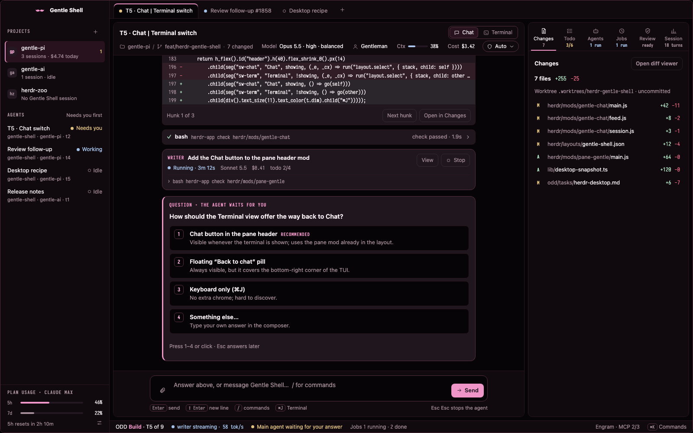

# Gentle Shell

Gentle Shell sessions as a native desktop: projects and agents on the left, sessions as tabs, the
conversation as a chat in the centre with the real TUI one switch away, and an inspector on the
right with everything the Gentle Shell sidebar shows.

`preview.png` is a **design render**, not a live capture: `design/herdr-desktop/01-inspector.html`
(direction A) rendered with headless Chrome at 1600×1000, its caption bar hidden. The live window
is checked against it side by side (`herdr/FIDELITY-T6.md`, `herdr/mods/gentle-chat/FIDELITY.md`).

This file is the brief: enough to rebuild the layout from an empty folder. The files next to it are
one build of it. People install them with `gentle-shell desktop`
([guide](../docs/gentle-shell-desktop.md)).

## What you see

A row of two columns, filling the window (no title bar, macOS traffic lights at 14, 17):

1. **The sidebar**, 251px plus a 1px rule, `chrome` (`#100A0F`), not resizable:
   - **Brand**, 46px: the Gentle mark and "Gentle Shell", room for the traffic lights; drags the
     window.
   - **Projects**, 200.25px for three rows (it resizes itself up to six, then scrolls): each Herdr
     space with a 22px two-letter avatar, "<n> sessions · $<live spend>", and how many need you.
     A + opens a new space.
   - **Agents**, the rest: every agent, needs-you first, two lines each (session name and state,
     then app · space · address).
   - **Plan usage**, 111px for two windows (it grows with its rows): "Plan usage · <plan>", one
     bar per window the TUI usage panel shows (5h and 7d, every limit), the other providers the
     panel lists, when the first window resets, a refresh (the panel's `r`) and a gear for
     Herdr's settings.
2. **The work column**:
   - **Tabs**, 42px: 34px tabs on the bottom edge, a state dot and the session name; the active tab
     in `canvas` with a 2px `accent` top edge; + right after the last tab. Drags the window.
   - **The work body**, padding 8, gap 8:
     - **Views**, a stack of two cards (radius 10, 1px `border`, `background` `#060407`):
       **Chat** (`gentle-chat`) and **Terminal** (the tab's real panes; focused pane border
       `accent`). The chat: a two-row header (title and the Chat | Terminal switch; project /
       branch · changed, Model, Persona, Ctx, Cost and the permission pill), the log, and the
       composer.
     - **Inspector**, 372px (280–900), `chrome`, radius 10: a tab strip — Changes, Todo, Agents,
       Jobs, Review, Session — over one panel.
   - **Status bar**, 28px: ODD phase and todo position, streaming / working / idle with tok/s,
     what the session waits for, jobs running · done, integrations, and "⌘K Commands".

Colours: canvas `#060407`, chrome `#100A0F`, surface `#20161e`, raised `#241822`, selected
`#28121E`, line `#2A1720`, line strong `#563040`, text `#f6eff3`, muted `#a78e9b`, faint `#76616b`,
accent `#f095c8`, ok `#b4e7c7`, warn `#e0c27a`, err `#ff718f`, info `#a9c7ee`. Fonts: the system
sans and a mono stack, chosen at run time from `fonts()`.

## How it behaves

| State | Tab dot / agent row | Status bar |
|---|---|---|
| working | `working` (info) | "streaming" or "working", tok/s when published |
| blocked | `blocked` (warn), "Needs you" | the blocked label, e.g. "Main agent waiting for your answer" |
| done | `done` (ok) | idle |
| idle | ring, "Idle" | idle |

- Everything follows the **focused Gentle Shell session**: the chat, the header, the inspector,
  the status bar and the plan usage.
- The chat reads the session's JSONL incrementally: a long session opens at its end (≥ 300 KB
  and 300 lines, ≤ 3 MB; "Show earlier" reads further back), a `watchFolder` wakes it only for
  its own file, a big file's new bytes come through one `sh` (size and tail), and a look while
  shown covers a missed event.
  It sends what you type with `hc send`. A question card answers with a click or `1`…`N`.
- **Chat | Terminal**, `⌘J` and the palette switch the `views` stack (`layout.select`).
- `⌘K` opens the Gentle palette (needs-you items, session commands, views, permission modes, every
  command of the session); `/` in the composer opens the command menu.
- Actions (permission mode, stop the turn, stop a subagent, cancel a job, answer a single-choice
  question) go through the session's private inbox and its own owners, with the authority the
  person has in the terminal. Super-YOLO and the global RDD switch ask in a dialog
  (`gentle-confirm`) first. Consent is never answered here: the Terminal shows instead.
- Commands whose result is a TUI screen (`/gentle:changes`, `/gentle:agents`, `/gentle:profiles`,
  …) are typed into the TUI and the Terminal shows.
- Redraws only when a snapshot changes; the Jobs tab ticks each second only while it shows a
  running job, the usage footer when its reset words change. Nothing animates while a session
  works (no pulse, no spinner): any native animation redraws the whole window every frame
  (`PERF.md`). Only the status bar (`gentle-status`) reads the snapshots and runs `ps`; it
  publishes them in shared state (`gentle-shell.feeds`) and every other mod reads that.

## Built from

- **The layout** (`layouts/gentle-shell.json`): root `row`, `titlebar: "none"`,
  `traffic_lights: [14, 17]`, `background: "canvas"`, `terminal_padding: [14, 12]`, a 1px
  `border` divider, and `"theme": { "light": "gentle-shell-light", "dark": "gentle-shell-dark" }`
  (`herdr/themes/`, S14): the dark theme file's `colors` set the Herdr theme roles to the colours
  above, the light one to the light palette (`FIDELITY-light.md`); no root `colors`, which would
  apply in both appearances.
  Sidebar `column` (`brand`, `spaces`, `agents`, `sidebar-footer` blocks); work `column` (`tabs`
  block, `work-body` row with the `views` stack and the `panel` column, `status` block). The
  `views` stack is `chat` (mod `gentle-chat`, props `{ stack: "views", self: "chat", other: "main" }`)
  over `main` (`content: { tab: "active", pane: { lone: true, … } }`). No `"header": "tabs"` on any
  stack: Herdr 0.1.15 rejects it.
- **Ten mods**, all `place: "none"`:

  | Mod | Region | Notes |
  |---|---|---|
  | `gentle-sidebar` | Brand and Plan usage (`props.part`) | adapted from `workspace-chrome` |
  | `gentle-spaces` | Projects | cloned from `spaces` |
  | `gentle-agents` | Agents | cloned from `agents`; keeps `setAgentOrder` |
  | `gentle-tabs` | Tabs | cloned from `tabs`; no Files / Changes buttons; + runs `tab.new { argv: ["gentle-shell"] }` |
  | `gentle-chat` | Chat | session reader, markdown, tool / diff / subagent / question cards, composer, `/` menu |
  | `gentle-inspector` | Inspector | draws its own tab strip |
  | `gentle-status` | Status bar | adapted from `workspace-status`; owns the window-wide `toggle` and `stop` commands |
  | `gentle-palette` | ⌘K palette | popup overlay, 620px, 64px from the top |
  | `gentle-confirm` | Dialog | Herdr's `confirm` plus a cancel report |
  | `gentle-tokens` | — | the shared `tokens.js` and `snapshot.js`; opened on its own it shows a token swatch |

- **Data source: the desktop feed.** Each interactive Gentle Shell session publishes
  `<agentDir>/desktop/sessions/<session>.json` (`gentle-shell.desktop-feed/v1`:
  identity with its own `agentDir`, project, model, context, cost, usage, permission, todo,
  changes, agents, jobs, review, stats, activity, the open question, commands). The mods read
  every agent dir in `snapshot.js` `agentRoots()`: `~/.gentle-shell/agent` (bundled),
  `~/.pi/agent` (Pi extension) and the entries of `~/.config/herdr-app/gentle-shell-roots.json`.
  Actions go to the session's `<agentDir>/desktop/inbox/<session>/` and are answered in
  `outbox/` (`gentle-shell.desktop-action/v1`). Format: [`docs/desktop-feed.md`](../docs/desktop-feed.md).
  The conversation itself comes from the session's own JSONL.
- **Keys** (`keys.json`, section `layout:gentle-shell`): `cmd-k` palette, `cmd-j` Chat ↔
  Terminal, `cmd-.` stop, `cmd-alt-1`…`6` inspector tabs. Merged into the person's `keys.json`,
  never replacing a key they bind.
- **How it was built:** the design was chosen from three directions in `design/herdr-desktop/`,
  then each region was built against the artboard and closed only after a side-by-side check of
  `herdr-app shot` with a headless render at the same size (sizes, spacing and colours sampled).
  `tokens.js`, `snapshot.js` and `actions.js` are byte-identical copies in each mod that uses them
  (a mod cannot import outside its folder).

## Watch out

- The mods **read files outside their folders**: `<agentDir>/desktop/` and the sessions' JSONL
  under `<agentDir>/sessions/` for `~/.gentle-shell/agent`, `~/.pi/agent` and the agent dirs
  listed in `~/.config/herdr-app/gentle-shell-roots.json`. Another agent dir is seen only once
  listed there, and only inside the home folder. Remote terminals are not read.
- They **run programs**: `hc send` / `hc keys` into Gentle Shell terminals, `pwd -P` to resolve a
  session folder, `gentle-ai review mode status` while the Review tab shows, and
  `gentle-ai review mode enable|disable --scope global` for the RDD switch, after a dialog.
- They **write** one action file at a time into a session's inbox, only when the session created
  it. No network.
- `gentle-sidebar`, `gentle-spaces`, `gentle-agents`, `gentle-tabs` and `gentle-status` are
  adapted from Herdr 0.1.15's shipped mods, so Herdr no longer updates them in this layout.
  Compare them after a Herdr upgrade.
- Built and checked on Herdr app 0.1.15 (macOS). Herdr is 0.1.x and regenerates its mod API per
  version: pin and check it.
- Not published yet: persona, integrations, subagent roles. Plan usage shows "unavailable" for
  providers that report none.
- A covered window does not draw: `herdr-app shot` returns the last frame.

## Done when

- `herdr-app check` passes for every `mods/gentle-*` folder.
- After `layout.switch {name: "gentle-shell"}`, `herdr-app status` reports no errors.
- A Gentle Shell session in the shown tab fills the chat, header, inspector, status bar and plan
  usage; sending a message shows it in the chat and the TUI.
- `⌘J` switches Chat ↔ Terminal both ways; `⌘K` opens the palette; `⌥⌘1`…`6` pick the tabs.
- Super-YOLO asks in a dialog first; a consent question shows "Answer in Terminal".
- Switching to another layout and back works.
